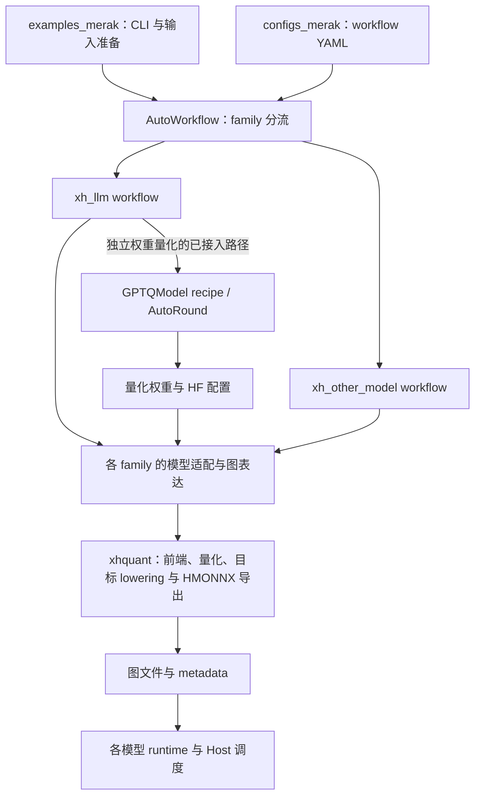

# Merak 架构与扩展边界

本文维护稳定的职责、契约和设计理由；具体模型命令留在其 README，
算子及芯片差异见 [建模知识](../modeling/README.md)。
“当前实现”以仓库代码为准，“演进方向”说明新增能力如何落位，不代表已有 API。

## 当前实现

图中合并展示职责，不表示两个 family 共用同一模型基类或同一个结果类型。

| 边界 | 负责什么 | 当前入口 |
| --- | --- | --- |
| 顶层 workflow | 读模型类型并选择 family，保持调用面简洁 | [AutoWorkflow](../../xhmodel_merak/workflows/auto.py)、[WorkflowProtocol](../../xhmodel_merak/workflows/base.py) |
| `xh_llm` | LLM 图导出、prefill/decode、cache，以及组合这些契约的多模态模型 | [BaseLLMWorkflow](../../xhmodel_merak/xh_llm/workflows/base.py) |
| `xh_other_model` | 各模型定义组件、导出计划和专用调度 | [BaseOtherModelWorkflow](../../xhmodel_merak/xh_other_model/workflows/base.py) |
| 模型包 | 上游适配、权重变换、graph wrapper、processor、专用 runtime | [LLM 模型](../../xhmodel_merak/xh_llm/models/)、[other-model 模型](../../xhmodel_merak/xh_other_model/models/) |
| GPTQModel / AutoRound | 独立权重量化、量化侧模型适配、checkpoint 写入与重载验证 | [ModelZoo 接入及跨仓库职责](quantization-boundary.md) |
| xhquant | 算子定义、图转换、目标实现与量化工具链 | 通过安装的 SDK 使用，如 `xhquant.nn`、`xhquant.api` |
| 示例 | 用户输入、CLI 编排与输出展示 | [examples_merak](../../examples_merak/) |

选择 family 看执行契约，不按音频、视觉等模态划线。例如语音组件既可能独立调度，
也可能组合进 LLM。已有模型仅在被复用的契约上作为参考，不指定永远不变的“标杆模型”。
LLM 的模型类型注册与 traceable wrapper 注册各有职责，`_setup`/`graph_forward` 和
frontend 的选择见 [图表达边界](../modeling/operators/graph-expression.md)。

### 配置与阶段

两个 family 有各自的 config 校验和 result 定义，不要用文档假装已经完成统一：

| 配置字段 | `xh_llm` | `xh_other_model` |
| --- | --- | --- |
| 模型类型 | `export.model.model_type` | `export.model.type` |
| 目标芯片 | `export.model.chip_arch` | `export.target_device` |
| 独立量化配置 | `quant`，可为 `null` | `quant`，可为 `null` |

来源：[LLM config](../../xhmodel_merak/xh_llm/workflows/config.py)、
[other-model config](../../xhmodel_merak/xh_other_model/workflows/config.py)。
不要同时填写两个模型类型字段来掩盖分流错误，也不要为追求格式一致擅自改名。
`device="cuda:0"` 等参数选择执行导出的计算设备，与目标芯片是两件事。

`quant()` 准备量化权重或返回显式 skipped 结果；`export()` 消费该结果并保存实际配置和产物；
`dump_golden()` 消费导出结果生成数值参考。这是阶段的职责，
不意味着每次任务、每种模型或每次 CI 都必须运行三阶段；图导出自身仍可能应用量化配置。
两套 [LLM result](../../xhmodel_merak/xh_llm/workflows/result.py) 与
[other-model result](../../xhmodel_merak/xh_other_model/workflows/result.py) 目前字段一致：
`QuantResult` 记录来源与量化产物，`ExportResult` 记录 `work_dir`、`config_file`、`meta`。
`meta` 仍由具体实现解释，不存在覆盖所有模型的统一、强类型 metadata schema。

ModelZoo 的 `quant()` 是用户工作流入口，不表示本仓库拥有 GPTQ/AutoRound 算法。
配置映射、量化模型注册、checkpoint 格式和部署图改写的具体归属，以及已有兼容遗留，
见 [ModelZoo / GPTQModel 开发边界](quantization-boundary.md)。

### 必须一起维护的契约

- **模型语义**：上游权重的解释、归一化、RoPE、路由与预处理，不能因图可导出而悄悄改变。
- **图与 runtime ABI**：输入输出名称、轴顺序、dtype、有效长度、cache 所有权及更新方式。
  shape 相同不代表状态或布局相同；导出、metadata、加载端共同维护。
- **产物可消费性**：runtime 使用该模型的 metadata 解析实际组件与路径，新增产物支持搬移后加载。
  文件名与旧目录布局不是新的公共 API。
- **依赖方向**：新增模型能力进入运行库，示例调用运行库。跨 family 复用采用中立接口，
  不直接耦合对方模型内部。历史导入仍有遗留，例如 Wan2.2 的旧编码器引用；
  这些是迁移债务，不是建议写法，也不在纯指引变更中顺带迁移。

## 扩展应落在哪一层

| 新需求 | 优先落点 | 何时才扩展公共机制 |
| --- | --- | --- |
| 新上游模型/变体 | 本 family 注册、模型适配、配置和示例 | 现有 family 契约确实无法表达时 |
| 可复用结构，如混合注意力 | 先明确数学与状态契约，再共享语义相同的实现 | 多个实际使用方需要同一行为时 |
| 新算子或图改写 | 模型 wrapper 表达语义；通用目标实现由 xhquant 承担 | 当前算子 API 无法表达需要的图语义时 |
| 权重量化算法、量化侧模型接入或 checkpoint 格式 | GPTQModel/对应量化后端；ModelZoo 更新 adapter 与消费契约 | 现有 recipe 无法表达需要的量化能力时 |
| 同模型适配新芯片 | 目标配置、算子 lowering/能力校验、runtime ABI 适配 | 实际出现不同设备路径时建立最小 target adapter |
| 新导出组合 | 模型的配置/plan 与 metadata | 多个 workflow 需要同一种组合机制时 |
| 新回归用例 | 当前 CI 目录的用例及同名 impact 声明 | 只有真正全局的选择策略变化才修改 CI policy |

稳定复用单位是算子语义、结构契约和产物接口，不是某次重构后的文件夹名字。
尺寸、精度、图档位用现有配置/plan 表达；语义不同的实现不因代码相似而强行合并。

### 多芯片演进方向

模型描述需要什么语义；目标实现回答在给定 SDK、dtype、shape 和执行模式下如何实现。
能力判断至少包含“算子/结构 + target + SDK/runtime 版本 + shape/layout + 精度 + 阶段”，
不能只有 `supports_attention = True`，也不能把所有差异摊成模型内的芯片判断。

新增目标时先核实 SDK 的真实标识和算子路径，再把模型级差异集中在配置/adapter；
kernel 与 lowering 留在工具链。不同模型共用同一能力时才抽取公共 target 接口。
当前仓库还没有统一的 target capability registry，本次建立的是其知识边界；
不新增空 registry、不自动把 M50/YH/XH3 互作别名、不把 Markdown 当运行时配置。
具体已有入口和未知项见 [目标设备](../modeling/targets/README.md)。

## CI 是架构的一部分

所有新增测试均进入 [benchmark_test/ci_test_transformer5.16.0](../../benchmark_test/ci_test_transformer5.16.0/README.md)。
这里用同名 `.impact.json` 将实现、配置和共享依赖映射到测试；声明与用例一起演进，
从而模型接入不需要不断修改中心化的全局规则。共享依赖需要各相关用例显式声明。

CPU 契约测试锁定接口和状态语义，固定 checkpoint 的 block 导出检查真实工具链。
两者都在同一 CI 目录，按成本与覆盖对象区分，不能把“CPU 用例”放到另一个测试树。
测试优先由小 config 构造最小真实模型，保留受影响结构，用小 tensor 和参数化覆盖相关
边界、失败路径与状态变化；合成模型无法代表的权重格式才依赖固定真实产物。
现有 `tests/` 仅可作为历史证据，其存在不构成当前 CI 覆盖。

## 设计取舍与参考

保留简短的仓库约定，架构与领域知识按需阅读；不按目录重复一套开发流程。
下面是借鉴的设计思想，外部项目的贡献政策不作为本仓库规则，也未复制其源码。

| 参考（固定源码版本） | 借鉴点 | 在这里的取舍 |
| --- | --- | --- |
| [vLLM CustomOp](https://github.com/vllm-project/vllm/blob/f4eccdadefc6501fafeb1a0bf7f171ff24f984b0/docs/design/custom_op.md) | 算子语义与 backend 实现分开 | 复用 xhquant 边界，按真实需求扩展 adapter |
| [PyTorch native functions](https://github.com/pytorch/pytorch/blob/071dd4d98ee0ca692fbe0cb3e9f3b95955d73329/aten/src/ATen/native/README.md) 与 [OpInfo](https://github.com/pytorch/pytorch/blob/071dd4d98ee0ca692fbe0cb3e9f3b95955d73329/torch/testing/_internal/opinfo/core.py) | schema、设备分派与 dtype/输入用例独立描述 | 记录具体特性的条件与证据，避免只有模型名或芯片名的支持表 |
| [llama.cpp backend tests](https://github.com/ggml-org/llama.cpp/blob/74a7c897f049c17e7080423aa2111776eff6ebbf/tests/test-backend-ops.cpp) | 以算子构造小图并做 backend 数值比较 | 用小契约/小图暴露问题，保留必要的真实导出验证 |

资料核对日期：2026-09-06；仓库实现核对基线：`ee4aa01`。
