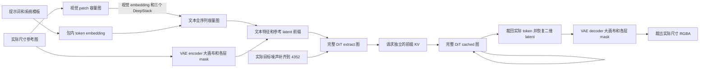

# Qwen-Image-2.1 接入记录

状态：已完成浮点诊断、全部学习组件实际 SDK 导出、完整 Host runtime、workflow、
ModelRecipe 和统一接口实现，recipe 门禁通过。真实权重已通过统一构建/Manifest 发布，
历史 512² 部署包搬移后已通过公开接口连续运行文生图和编辑。
默认 1MP 容量部署包括一对完整 DiT 图、视觉 patch 容量复用与逐层 mask 的 VAE 画布。
当前实现已改为按原序分段调用两张 DiT 图、SDK 原地 KVCache、四维 VAE 和现有 RMSNorm 融合；
W16A16/W8A16/W8A8 已有包直接修改 VAE ONNX，三精度真实 VAE 复测及 W8A16 完整推理已通过，
没有重新导出权重。
下面区分当前契约与已完成的上一版实测。
下文保留历史诊断与数值结果；旧 HMONNX 及其外部权重文件已删除，原始 checkpoint、
图片和报告保留。当前容量包的记录在下面 1MP 小节。

## 当前契约：分段 DiT、原地 cache 与四维 VAE（2026-10-09）

整包 metadata schema=3，DiT schema=4。仍然只有六张学习组件图：
text_encode、visual、vae_encode、vae_decode、denoise_text、denoise_image。
文本 DiT 与图像 DiT 均包含完整 32 层栈和各自输入投影，共享静态权重资源；
文本图使用 causal FlashAttention，图像图使用 non-causal FlashAttention。
没有 query_kv_range_abs 或图像块范围输入。

首次请求按官方原始顺序初始化条件，而不是把所有文本合并到参考图之前。
常见单图编辑为“文本前段 → 参考图 → 文本后段 → 目标噪声”，因此通常是四次完整 DiT 调用：
三个条件调用使用 t=0，第四个目标调用使用当前采样时间。参考图只生成条件 KV，不参与采样。
相邻参考图分别调用，禁止让前一张参考图看到后一张参考图。

每层通过 SDK LLMCacheV2 写入调用方提供的 CacheTensor；加载端启用原地更新。
图输出分别只有 hidden 或 noise，没有普通 cache tensor 输出或 Host 整份回拷。
条件段起点和实际段长度分别传入 past_seq_length、current_input_length；
图像 FlashAttention 的 kv_valid_length 为两者之和。整份 cache 的容量是条件最大容量加目标最大容量，
默认 4928+4352=9280，实际序列紧凑排列为 [条件 P][目标 N][无效尾部]。
后续每步固定 past_seq_length=P、current_input_length=N，覆盖 [P,P+N)，不追加旧目标。
条件前缀不变；请求、正负 CFG 分支各自拥有缓存。RoPE 按完整原始序列和真实网格生成，再逐段切片。

VLM 语言图容量 1664、DiT 文本段容量 576 由 tokenizer、模板、512 token 提示预算和视觉预算推导。
视觉、目标和参考 token 容量仍为 4352，VAE 画布仍为 1536×1536，实际输出默认 1024×1024。
新路径保留 padding 行在 attention 量化前清零、实际长度时间调度和二维 latent 恢复。

VAE 导出接口和 mask 均为四维 NCHW。Encoder 输入 [1,4,H,W]、输出 [1,64,H/16,W/16]，
decoder 反向。去掉原生单帧时间轴，保留 shortcut 的空间重排、零填充和归约语义。
卷积输入输出、上下采样及残差路径继续逐层使用对应 mask；attention 先收集有效二维位置，
按真实长度排除无效位置，再恢复二维网格，不用简单有效长度直接截断有行间空洞的原展平序列。

原 Normalize、sqrt(C)、gamma、零 bias 使用现有 SDK RMSNorm 节点，
公式为 x*gamma/sqrt(mean(x²)+1e-8)，权重直接使用原生 gamma。
接受与原生 L2 分母截断的微小公式差异；epsilon=1e-8 同时让现有 FP16 倒数在全零 padding 处有限。
SDK RMSNorm 接口、导出和加载代码保持 HEAD 原样，无新增模式或算子。

新实测和发布材料保存在 `work_dirs/qwen_image21/standard_rmsnorm_1mp_20261009/`。
真实三精度包已通过统一构建与发布校验，路径为 `artifacts/{w16a16_sefp,w8a16_sefp,w8a8_sefp}`。
18 张图的算子与精度核对通过：各包 FlashAttention 数为 36/27/1/1/32/32，
两张 DiT 图各有 64 个 KVCache、70 个输入与一个输出，没有范围 mask 输入。
VAE encoder/decoder 分别有 26/36 个普通 RMSNorm，没有 Normalize 节点或 epsilon_mode 属性。
全图记录为 `all_graph_audit.json`。
原始三次构建 CPU RSS 峰值分别为 105629/91569/91572 MiB，
整进程 1 秒采样 GPU 显存峰值分别为 894/702/702 MiB；采样值不是逐分配精确峰值。
本次没有重新构建模型，只修改已有六张 VAE ONNX 的 RMSNorm 属性并同步 runtime metadata、Manifest 大小和 SHA。
其余组件图和所有权重文件不变；逐文件记录见 `onnx_patch_report.json`。
当前 SDK 补丁基于 `3d399450e3f12c0cbc1b6882070bb0ddd3464442`，限定 FlashAttention、卷积的六个文件，
文件为 `sdk_qwen_image21_standard_rmsnorm_1mp.patch`，SHA 和版本见 `sdk_revision.json`。
补丁正向应用到 HEAD 及反向核对当前工作区均通过，排除既有 GDR/SparseAttention 修改。
`sdk_baseline_preserved.json` 记录原后端函数 AST 未变，保护目录没有本次改动。
CPU 加载、校准、trace、导出与仅权重 PTQ 使用 GPU 的流程保持不变。
本次三精度均用真实权重重测修改后的 VAE encoder/decoder。Encoder 验证 1024² 输入、
脏 padding 排除、无效输出为零，以及换尺寸后重复请求逐位一致。
Decoder 分别复用修改前保存的文生图、编辑、竖图和 CFG 的 DiT latent，验证实际输出形状、
有限值、脏 padding 排除、无效输出为零及换尺寸后重复解码逐位一致。
此项不等于三精度完整编辑链路复测；编辑的参考图编码变化可能继续影响后续 DiT。
报告为三份 `*_vae_patch_report.json`，图片在 `vae_component_images/`。

| VAE 精度 | 生图 latent 解码对修改前 | 编辑 latent 解码对修改前 | 竖图 latent 解码对修改前 | CFG latent 解码对修改前 |
|---|---:|---:|---:|---:|
| W16A16 | 67.165195 dB | 66.850674 dB | 67.351755 dB | 60.711518 dB |
| W8A16 | 67.137868 dB | 66.801980 dB | 67.289123 dB | 60.605279 dB |
| W8A8 | 54.127519 dB | 53.408280 dB | 53.836810 dB | 41.195469 dB |

表中均为相同已保存 latent 经过修改前后 decoder 得到的 PNG RGB PSNR。
W8A8 的 512² CFG 样本存在最大 133 个 RGB 灰度级的单像素差异，不把所有样本描述为逐位相同或微小变化。
本次另用 W8A16 重跑整个公开接口：1024² 文生图、输出高768/宽1376 的编辑、1376×768 竖图和 512² CFG。
GPU 1 的既有 VLLM 服务占用约 47 GiB，W16A16 完整推理所需剩余显存不足，未重跑该精度的完整链路。
真实三精度完整链路的修改前记录位于 `segmented_1mp_20261009/`，用于核对未改的 DiT/cache 图；
没有将这些旧报告记作当前整包复测。
W8A16 连续复用同一个已加载 runtime，各请求 cache 转换检查数为 19/19/2/1/1/1；
条件前缀逐位不变，目标每步原地覆盖，无效尾部不变，正负 CFG 与不同请求缓存独立。
经历编辑、换尺寸和 CFG 后重建最初请求，前两步预测逐位一致。
真实编辑条件为文本8 → 参考图4096 → 文本12，P=4116；目标 N=4128，
每步固定覆盖 [4116,8244)，kv_valid_length=8244，cache 剩余 1036 个 slot 不可见。

| 本次完整链路复测 | 文生图对原生 FP16 | 编辑对原生 FP16 | 文生图对上一版 extract/cached | 编辑对上一版 extract/cached |
|---|---:|---:|---:|---:|
| W8A16 | 40.521563 dB | 41.735792 dB | 52.366773 dB | 59.344426 dB |

表中均为保存 PNG 的 RGB PSNR，固定 seed42、20 步、CFG1；编辑参考图统一使用原生 FP16 生图。
PSNR 衡量像素接近程度，不是画质评分；结论只覆盖记录的样本。最终 latent 的 cosine、RMSE、
实际分段长度、各步 cache 检查和 GPU 内存记录见 `w8a16_sefp_real_report.json`。
横评图 `fp16_w16_w8a16_w8a8_1mp_comparison.png` 明确标注三精度仅重跑 VAE、复用各自保存的 latent；
W8A16 完整链路横评另见 `w8a16_full_pipeline_comparison.png`，完整推理原图和 latent 位于 `images/`。
执行范围为 GPU 1 上的 HMONNX V2 golden，没有做 NPU 板端验证，也不是吞吐性能测试。
最终 CI 按用户要求停止，不再追加本地验证。原选择清单为 100 个变更路径、43 个测试目标、1155 项；
停止时统一矩阵已有 36/46 个结果，其中 35 项通过；GLM 因已有 QTL-489 删除旧 SDK 接口失败，
单独使用匹配的上游 SDK 加相同六文件补丁已通过。未完成的整轮 CI 不记为全部通过。
记录见 `ci.log`、`ci_stopped_by_user.json` 和 `ci_glm_sdk_compatibility.json`；已有模型实测入口为 `validation_summary.json`。
合并提交范围的 69 个 Python 文件没有新增 Ruff 诊断；21 项存量诊断集中在两个既有文件，
比较基线为最新主线 `3a9b093e`，记录见 `ruff_delta_report.json`。diff 检查及 SDK 补丁校验通过。
环境没有 ocr，未执行该工具，已人工复核并记录在 `manual_review.md`。
飞书文档已追加[当前 1MP 版本的算法原理、M50 逐组件适配与完整推理流程](https://houmo.feishu.cn/docx/YMrrdPaOwoTpkvx6cGgcMTBpnRC#doxcnNxS6QQerQqXTjVq3mLnsJd)，
并插入分段条件初始化、目标采样与 VAE 解码时序图；正文回读和画板预览检查通过。
下面上一版结果保留作数值与结构对照。

## 上一版实测：extract/cached 与逐层 VAE mask（2026-10-09）

默认实际输出为 1024×1024，参考图、目标图和视觉 patch 容量均为 4352，
VAE 固定计算画布为 1536×1536。输入输出高、宽统一按 32 对齐：VAE 空间压缩为 16，
视觉 patch16 再做 2×2 merge，以及官方 pipeline 的对齐要求共同决定整条链使用 32。
容量内改变实际宽高不增加图，增大容量或画布需要重新构建。
配置中尺寸顺序为高、宽；横评图片标注采用宽×高。

当前真实 tokenizer 推导出文本图容量 1664、DiT 前缀容量 4928；
配置只给出 512 token 提示预算和最多一张参考图，禁止手填这两个派生容量。
文本编码部分是 Qwen3-VL 的语言层：视觉输出替换图片占位 embedding，
三个 DeepStack 输出继续注入语言层，所以其输入预算包含视觉 merge 后 token。
DiT 前缀则保留已感知参考图的文本特征，用 VAE latent token 替换视觉占位区域；
其容量按参考图 latent token 计算，不能照搬文本图的容量。

视觉图在紧凑 patch 序列上运行，实际 patch grid 决定学习位置嵌入的双线性插值和
二维 RoPE；padding patch 在每层清零并通过长度排除。原生视觉 head_dim=72，
RoPE 后补零到 FlashAttention 的 128 维物理通道，仍使用原始 72 维缩放，输出再裁回。

上一版 DiT 是一对完整图，前缀右对齐于 4928，目标固定从这个偏移开始。
实际宽高生成 RoPE 后补齐，采样器以实际目标 token 数计算时间调度，预测输出裁回实际长度。
`query_kv_range_abs` 指定每个 query 可见的连续 KV 范围；前缀空位和目标尾部不可见。
Q/K/V 在量化前清除无效行，避免 padding 投影 bias 影响 SEFP 分组指数。
每步替换同一个目标 cache 区域，前缀不变，请求与正负 CFG 分支分别持有缓存。

VAE 输入先补到左上对齐的固定画布，Host 提供 1/2/4/8/16 五个尺度的矩形有效区域 mask。
卷积在输入和输出都应用 mask；重采样使用对应分辨率 mask，残差主支与 shortcut 同步屏蔽。
该 VAE 使用通道归一化，不跨空间位置统计；因此不会让补零改变有效区域的归一化统计。
二维区域展平有行间空洞，attention 用索引先把有效位置收集到连续前缀，按真实长度执行
FlashAttention，再恢复原二维位置。Encoder 和 decoder 使用相同规则，最后才裁剪。
这一处理与直接在实际尺寸运行原模型在浮点舍入范围内对齐，不能只在最外层乘一次 mask。

真实 VAE 中间 attention 分别为单头 D=768、D=1152。SDK 新增对应完整 QK 点积与
分块 V 输出的 kernel，保持单头语义，不拆成多个 attention head。原 kernel 和 CPU
逐 token 参考实现保留；CPU FP32 校准新增按 query 分块实现，其他 dtype 保留原计算。

真实大画布解码最初在 SDK 卷积的整幅 unfold/SEFP 中间张量处显存不足。
运行时现按输出行分段展开，每段包含完整输入邻域并写回整幅输出，各层仍计算完整画布。
通道共享指数和归约顺序保持原实现；W16A16/W8A16/W8A8、padding、stride、dilation 的九项回归逐位一致。
改动位于 SDK 非保护的 IR operator 分发，保护目录中的芯片函数未修改。
原始卷积及原优化实现继续保留为 callable。

本次依赖 SDK revision `65cfd95a887abf6c0d68ca8cdd700a44d5aed6c5` 上的六文件补丁，
涉及 VAE 大单头 FlashAttention、CPU FP32 校准和卷积临时内存分段。
精确补丁为 `dynamic_1mp_20261009/sdk_qwen_image21_1mp.patch`，文件 SHA 及版本见
`sdk_revision.json`；`sdk_baseline_preserved.json` 记录原函数 AST 未改变。
该补丁属于 xhquanttool 后端，未复制到 ModelZoo 模型实现。

W16A16、W8A16、W8A8 真实整包均已完成 CPU 导出，分别位于
`work_dirs/qwen_image21/dynamic_1mp_20261009/artifacts/{w16a16_sefp,w8a16_sefp,w8a8_sefp}`，每包六张图；
文本/视觉/VAE encode/VAE decode/extract/cached 的 FlashAttention 数分别为 36/27/1/1/32/32，
没有 MatMul、Softmax 或非 FlashAttention attention 图，全部 Linear/Conv 与
Q/K/V/score/probability 精度均与对应档位一致。
三次构建 CPU RSS 采样峰值分别为 105529/91455/91421 MiB，
物理 GPU 1 的整进程 1 秒采样显存峰值分别为 798/766/766 MiB；
采样值不等同于逐分配精确峰值。构建记录为对应的 `*_build_memory.json`，
全三包算子核对为 `all_graph_audit.json`。
三种精度的最小真实模型整包已通过导出、搬移、多尺寸生成、编辑、CFG 和重复请求回归。
真实 W16A16 已通过 1024×1024 文生图、768×1376 编辑（参考图 1024×1024），
两者均为 seed42、20 步；保存 PNG 相对原生 FP16 的 RGB PSNR 分别为
42.155497/43.712329 dB。同一 runtime 还通过 1376×768、512×512 CFG、各层前缀不变、
固定目标区域覆盖和缓存独立检查；经历这些请求后重新运行原请求，前两步预测逐位一致。
报告为 `w16a16_sefp_real_report.json`。W8A16 同一套真实整包验证也已通过，
文生图/编辑的 RGB PSNR 分别为 41.019274/41.637096 dB，报告为 `w8a16_sefp_real_report.json`。
W8A8 也已通过同一套验证，文生图/编辑的 RGB PSNR 为 31.634351/37.633719 dB。

| 部署精度 | 1024×1024 文生图 RGB PSNR | 高768、宽1376 编辑 RGB PSNR |
|---|---:|---:|
| W16A16 | 42.155497 dB | 43.712329 dB |
| W8A16 | 41.019274 dB | 41.637096 dB |
| W8A8 | 31.634351 dB | 37.633719 dB |

同一行比较使用原生 FP16 参考、seed42、20 步、CFG1；编辑参考图统一为原生 FP16
文生图结果。PSNR 比较保存 PNG 的 RGB 像素接近程度，不是画质评分，也不代表全样本精度。
横评图为 `dynamic_1mp_20261009/fp16_w16_w8a16_w8a8_1mp_comparison.png`；
所有原图、latent、单精度报告及 `validation_summary.json` 位于同一运行目录。
执行范围为物理 GPU 1 上的 HMONNX V2 golden 推理，没有执行 NPU 板端验证。
三包均连续复用同一个已加载 runtime，cache 转换检查数均为 19/19/2/1/1/1。
真实默认包的单请求 FP16 cache 约 4.53 GiB；CFG 正负分支各自拥有该容量。
当前 CI 清单 1051 项全部通过，按互不重叠的批次执行：主批次 1032 项，
六图公开接口 3 项、两图 CPU 构建 3 项、大单头 HMONNX 导出加载 4 项、
卷积分段 9 项。主批次使用当前 run.sh，预览为 55 个变更路径、31 个测试目标。
逐批记录见 `ci_summary.json`，完整汇总见 `validation_summary.json`。
Ruff、diff 检查和 SDK 补丁反向校验通过。环境未安装 ocr，未执行该工具；
已人工复核容量、逐层 mask、几何位置、缓存所有权、产物契约与 SDK 原算术保留。
旧 HMONNX 已删除 461 张图及其外部权重，共 1295 个文件；原始 checkpoint、
历史图片与报告保留，精确清单为 `old_hmonnx_cleanup_plan.json` 和对应 result。

## 核对来源

- 本地 `weights/Qwen-Image-2.1` 的 model_index、text_encoder、transformer、processor、vae 配置。
- [官方 Diffusers PR 14804](https://github.com/huggingface/diffusers/pull/14804)，
  核对 commit `8d3c30bfda9b511c00992f40cff4170a5502814d`。
  该实现仅检出在被忽略的 `work_dirs/qwen_image21/diffusers`，未复制到运行库。
- [调制、前缀 KV 与双图说明](https://houmo.feishu.cn/docx/YMrrdPaOwoTpkvx6cGgcMTBpnRC)，revision 7。
  原始读取结果保存在 `work_dirs/qwen_image21/reference_doc.json`。
- 现有 Merak `qwen3_vl/_vision_model_impl.py`、`modeling_qwen3_vl.py`。

## 编码器与尺寸

编码器为 Qwen3-VL：文本隐藏维 4096、36 层、32 个 Q 头和 8 个 KV 头；
视觉隐藏维 1152、27 层，deepstack 层为 8/16/24。用于 DiT 的是最后 decoder 层
**最终 RMSNorm 之前**的序列特征，不是语言模型 logits，也不能直接用已归一化的
`last_hidden_state`。所核对上游 pipeline 对 Transformers 5 的输出捕获差异使用
临时 norm hook；复用 Merak 时必须显式给出这个输出边界。

上游视觉模型不是固定方图。patch_size=16、spatial_merge_size=2，processor
按 32 像素倍数调整尺寸，并受面积/纵横比约束；位置嵌入按实际 grid 插值。
checkpoint processor 的面积上下界为 65536 与 16777216。
不能将“可变分辨率”理解成任何尺寸均不经预处理直接输入。

现有 Merak 视觉 wrapper 在 `_setup` 按 max_size_w/h/t 固定 grid、位置嵌入与 RoPE，
因此一个已导出的图是具体档位，不自动支持上游所有尺寸。接入需要明确图档位、
预处理的 resize 与实际 grid，并验证非方形输入及多图边界。

## DiT、调制和缓存

DiT 是单流 32 层，隐藏维 4096，32 个 128 维注意力头，SwiGLU 中间维 12288；
输入/输出 latent 通道都是 64，patch_size=1，RoPE 三轴为 16/56/56。

全模型共享一份 `[16384,4096]` 调制线性层，输出四段 4096 维参数：
attention scale/gate 和 MLP scale/gate。所有 block 复用相同四段，
不是输出 32 组各层独立参数；没有 shift，残差 gate 使用 tanh。
可以在进入 block 前计算共享调制，避免每层广播复制整个序列的参数。

`causal_condition=true` 时前缀（文本与参考图）使用 t=0，目标图使用当前 t。
注意力允许先前位置，以及同一图像块内双向位置；文本保持因果。
只有两者一起成立，前缀的各层激活与 K/V 才不依赖当前去噪时间及目标噪声。
相邻参考图仍是不同块，不能合并成一个双向区域。

上一版部署保留 extract 与 cached 两条执行路径，共享权重：

- extract 计算前缀和目标，逐层输出前缀 RoPE 后 K 与对应 V。
- cached 只更新目标的 Q/K/V，读取冻结前缀，目标可以看到整个前缀和目标块。
- cache 属于单次请求和条件分支；正/负 CFG 分支分别持有，换提示或参考图必须重建。
- 量化验收由候选模型自己产生并消费 cache，不能拿 BF16 cache 代替候选生产端。

上游 cached 路径仍在进入 block 前处理一些前缀元数据和投影；部署切图可以进一步
去除这些重复计算，但必须以逐步输出和 cache 等价比较证明语义未改变。

VAE 为专用四通道 RGBA 模型，空间压缩 16 倍、latent 通道 64；不能直接套用
旧 Qwen-Image VAE 或三通道后处理。参考图片同时参与 VLM 与 VAE 路径，二者的
图像 token 对齐必须保留。

## 浮点验证与后续验收

指定环境 `xhquant_55_tf_latest_20260828` 的初始版本为 Torch 2.8.0+cu128、
Transformers 5.16.1、Diffusers 0.38.0；其中未提供 QwenImage21Pipeline。
诊断使用隔离的上游源码与依赖 PYTHONPATH，不改共享环境。仅使用物理 GPU 1。

`work_dirs/qwen_image21/float_probe.py` 使用相同 FP32 初始 latent，分别转换为
BF16/FP16，记录逐步 latent、模块输入输出幅值、首个非有限张量及最终图片。
首轮为 512×512、20 步、seed 42。上游 block 有 FP16 clip(±65504)，
最终输出有限不能单独证明中间没有溢出；需要进一步检查裁剪前的残差运算。
此处不提前填写通过结论，实际状态以对应 report.json 为准。

初始验收计划（进展和结果记录在后文）：

1. BF16/FP16 全链路数值比较、首个溢出定位与根因；覆盖图片条件和更大尺寸。
2. 真实模块的共享调制、块因果 mask、extract/cached 多步等价验证。
3. 编码器 pre-norm 特征、视觉档位与 deepstack 的已有实现复用验证。
4. Merak workflow、图表达、cache ABI、VAE、运行时调度和 metadata。
5. 可发现 ModelRecipe、统一构建/推理示例、可搬移发布产物。
6. 当前 CI 下的小真实模型回归与 impact 声明、实际图导出/运行验证及 ocr 审查。

### 2026-09-29 实测

均为 GPU 1 / A100 80GB，20 步，seed 42，固定红色茶壶提示，无 CFG，开启前缀 cache。
“未发现非有限值”仅覆盖这些样本和监测点，不代表所有输入的精度认证。

| 路径 | 比较 | 图像 PSNR | 最终 latent cosine | 结果目录 |
| --- | --- | --- | --- | --- |
| 文生图 512² | FP16 对 BF16 | 26.292 dB | 0.983104 | `bf16_512_20` / `fp16_512_20` |
| 文生图 1024² | FP16 对 BF16 | 33.160 dB | 0.998076 | `bf16_1024_20` / `fp16_1024_20_clamp` |

目录均在 `work_dirs/qwen_image21`。BF16 与 FP16 图片已目视检查：512² 的 FP16
壶嘴出现额外突起，不能仅依据有限性判定画质通过。1024² 的差异较小；
尚未通过固定编码器特征与固定 DiT 输入区分误差来源。

初版裁剪监测只拦截 aten.clamp，漏掉 inference_mode 下未分解的 aten.clip。
已修正并添加四种 clamp/clip × inference/no-inference 回归。
修正后的 `fp16_1024_20_clip_verified/report.json` 记录 642 次裁剪前检查，
包含 32×20 个 DiT block；最大幅值 9104，未发现非有限值。
该运行模块边界最大幅值：编码器 13536、DiT 9112、VAE 207.5，均低于 FP16 上限。
因此当前 1024² 样本没有溢出证据，不能将 512² 图像差异直接解释为溢出。

`fp16_edit512_20` 使用 BF16 基线图片作为条件，VLM、VAE 编码、DiT 与 VAE 解码
完成且模块边界有限。该次运行发生在 clip 监测修正之前，仍需用修正后的诊断复跑，
并补 BF16 编辑对照、多图、RGBA、2048² 和多提示验证。

当前 CI 覆盖诊断工具的真实 FP16 线性溢出、BF16 有限基线、裁剪隐藏溢出及
监测不改变正常算术；它不覆盖尚未实现的模型导出与运行时。
本机 `ocr` 不在 PATH，搜索也未找到对应可执行文件，审查尚未执行。

### 受控精度对照与缓存语义（2026-09-29 补充）

`work_dirs/qwen_image21/precision_ablation_fresh.py` 每组分别从原始 checkpoint
按指定 dtype 加载编码器与 DiT，固定 BF16 VAE、512²、20 步、seed 42。
参考组为 BF16 编码器 + BF16 DiT。四组的监测点均未发现非有限值。

| 编码器 | DiT | 最终 latent RMSE | 图像 PSNR |
| --- | --- | --- | --- |
| FP16 | BF16 | 0.104566 | 29.228 dB |
| BF16 | FP16 | 0.249813 | 25.567 dB |
| FP16 | FP16 | 0.220514 | 26.300 dB |

固定编码器时，只改变 DiT 精度，latent RMSE 在第 1/5/10/15/20 步分别为
0.00237 / 0.02147 / 0.08242 / 0.16254 / 0.24981。该证据支持数值差异沿去噪
轨迹累积；并无 Inf/NaN 溢出的证据，不应通过裁剪或提高阈值“修复”此样本。
两个 FP16 DiT 运行均观测到 640 次 block 裁剪前值，最大幅值分别为 8928、9096。
编码器特征本身 FP16/BF16 RMSE 为 0.89497，cosine 为 0.997249。
结论仅限此提示/种子，不能从单样本给出普遍的画质排序。

首次探索 `precision_ablation/` 对加载后的模型调用 `.to(dtype)`，结果已标记作废。
`buffer_cast_evidence.json` 证明这种转换把 Qwen3-VL 视觉和文本 RoPE 的 FP32
`inv_freq` 转成 BF16，最大舍入差分别为 0.001828 和 0.000898。
因此精度实验必须分别加载，不能把转换后的模型与原生 dtype 加载混为一谈。
checkpoint 权重 dtype：文本和 DiT 都是 BF16，VAE 为 FP32；buffer 的保留精度
仍需由对应原生 loader 维护。

`cache_probe.py` 使用真实 32 层 transformer 权重，合成 24 个文本 token、
两个相邻参考图块（各 8×8 latent token）与 16×16 目标块；这不是画质评测。
每层前缀 KV shape 为 `[1,152,32,128]`。在 t=0.8/0.4/0.05：

- FP32 下，cached 输出与完整重算的目标段最大绝对差分别为
  1.80e-5 / 4.04e-5 / 5.44e-5，达到实验的 atol=rtol=1e-4 检查。
- 后续步不修改原 cache；用新 t 和新目标噪声重新 extract 后，前缀 K/V
  与原 cache 逐元素相同，验证了此输入下的时间与目标独立性。
- 完整/extract 路径输出联合序列，cached 路径只输出目标序列。原 pipeline
  对输出取最后 target_length 项；部署图 ABI 必须显式处理这一差异。
- FP16 首轮逐元素对照未达到试设 atol=rtol=0.02（16384 个元素中 2 个超出），
  不能标为数值检查通过；后续需记录全部时间步并分离不同矩阵形状的舍入影响。

诊断增加了裁剪观测次数校验，缺少 block 观测时报告失败；当前 CI 123 项通过。
原生参考的上述验证不替代 Merak 图、SDK 导出和运行时验证，完整接入仍未完成。

FP16 完整记录在 `cache_probe_float16/report.json`：三个时间步的最大绝对差为
0.009766 / 0.035156 / 0.050781，RMSE 为 0.001362 / 0.002524 / 0.003198。
前缀 KV 的重新提取不变性与缓存未被修改三步均成立；只有最后一步未达到上述
逐元素容差。不能将高 cosine（最后一步 0.9999967）替代该失败记录。

### DiT 图适配与真实 SDK 验证（2026-09-29）

模型包已开始实现：`xhmodel_merak/xh_other_model/models/qwen_image21/graph.py`。
`BlockCore` 复用上游权重，显式表达 norm、Q/K/V、相邻实数对 RoPE、mask attention、
门控残差和 SwiGLU；`ExtractBlock` 输出前缀 K/V，`CachedBlock` 输入冻结前缀。
`SharedModulation` 在 block 外一次计算 1+scale 与 tanh(gate)，为完整 DiT 的共享调制提供接口。
目前只验证 batch=1、显式 score matmul，不能据此认定大分辨率内存可用。

验证脚本及报告均保存在 `work_dirs/qwen_image21`，脚本通过直接文件加载模型包的图表达。
小尺寸随机权重使用 hidden=128、2×64 heads、P=8、target=8，包含因果文本与图像块。
`verify_dit_graph.py` 对上游 block 浮点最大绝对差 2.38e-7，cached/full 目标输出一致，
TorchFX 图有 90 个节点。

`export_dit_graph.py` / `run_dit_graph.py` 已实际导出并在 GPU 1 执行
XH2a W16A16 SEFP HMONNX，使用 HMONNXInferenceV2。小图 extract 相对浮点
max_abs=0.002533、RMSE=0.000385；cached 读取候选 extract 自己输出的 K/V，
与候选 extract 的目标输出逐元素相同。两图没有使用浮点 cache 替代候选 cache。

`verify_dit_graph_real.py` 从原始 safetensors 读取第 0 层实际权重（hidden=4096、
32×128 heads、SwiGLU=12288），保留 P=8、target=8 合成输入。
对上游 FP32 block max_abs=0.000214，达到 atol=rtol=1e-4 的逐元素对照；
这里包含相对容差，不是宣称最大绝对差小于 1e-4。
`export_dit_graph_real.py` 已导出实际宽度的 extract/cached 图，每张 external_data 约 423 MiB。
`run_dit_graph_real.py` 实际 V2 串联结果：

| 比较 | max_abs | RMSE | cosine |
| --- | --- | --- | --- |
| extract 对 FP32 | 0.864777 | 0.011122 | 0.99999934 |
| cached 对 FP32 目标段 | 0.310120 | 0.009619 | 0.99999970 |
| cached 对候选 extract 目标段 | 0 | 0 | 1 |

这是单层合成激活的工具链/缓存 ABI 证据，不是全模型量化精度或最终图片验收；
不能用高 cosine 掩盖最大绝对误差，也不能推出完整 32 层与真实去噪输入已通过。
真实图的文件和报告位于 `dit_graph_export_real/`。

SDK 转换会原地替换原生模块，因此两条路径分别从同一份浮点权重创建独立导出实例。
HMONNX 输入需要 FP16；V2 的严格 dtype 校验已实际触发并按真实 ABI 修正。
输出缓存的存储所有权需要由最终 runtime 处理，不能让 slice view 长期持有完整目标 KV。

新增当前 CI `test_qwen_image21_graph.py` 及 impact：六项测试验证两层/三步缓存不变性、
多参考图块 mask、共享调制一次计算、非法前缀长度和两张图的 FX 输入端口。
当前全 CI **127 passed / 2 failed**：两项 recipe 门禁都报告缺少
`xh_other_model/qwen_image21/` 的 ModelRecipe。该接入尚未完成，未添加豁免或占位 recipe；
后续必须补齐真实 workflow、完整组件导出/加载、统一接口及功能覆盖，再通过门禁。

### 多层图、请求缓存与最终输出头（2026-09-29）

模型包新增 `ExtractStack` / `CachedStack` 与 `DenoiseStackRunner`：
extract 端口顺序为 hidden、layer0 K/V、layer1 K/V……；cached 消费同一顺序的
冻结缓存。缓存布局 `[1,H,P,D]`，request runner 持有独立 owner，拒绝跨 runner 使用。
extract 输出的 K/V 会复制到紧凑连续存储，不让前缀切片继续持有目标 KV 的大 buffer。
`PrefixState` 是请求内状态，不是可序列化的模型发布文件。

`SharedConditioning` 对两行 time embedding 只计算一次 SiLU，再分别计算共享
block 调制与最终 norm 的 scale；当前时间为第 0 行，t=0 为第 1 行。
完整图在进入 block stack 前只展开一次参数，cached 直接广播当前时间行。
`OutputHead` 只处理目标隐藏态，不对不用的前缀执行最终归一化和 latent 投影。
这仍需结合完整 workflow 的输入投影、token 合并、位置/掩码构造与调度使用。

实际小图验证脚本 `work_dirs/qwen_image21/export_run_stack.py` 已对两层 stack
分别导出 XH2a W16A16 SEFP HMONNX，并通过 V2 + production runner 串联。
记录在 `stack_export/report.json`：extract 目标对浮点 RMSE=0.0004922，
cached 对候选 extract 的目标 max_abs=0，四个缓存 tensor 都具有紧凑独立存储。
此处使用两层随机小权重，未称为真实 32 层量化模型验证。

`validate_real_stack_head.py` 使用完整真实 32 层 FP32 transformer，在 GPU 1
运行上游 512² 文生图前两个去噪步，采集实际第一层输入（25 个前缀 token、1024 个目标
latent token）、时间嵌入和上游输出，重放 production stack + output head。
结果保存在 `real_stack_head/report.json`：

| 阶段 | 对上游最大绝对差 | 对上游 RMSE |
| --- | --- | --- |
| extract 的最终 hidden | 0.012024 | 7.447e-5 |
| cached 的最终 hidden | 0.001923 | 4.415e-5 |
| extract 最终 noise prediction | 5.078e-5 | 4.081e-6 |
| cached 最终 noise prediction | 3.961e-5 | 3.841e-6 |

共享条件模块的前四个输出与上游调制拆分逐元素相同。该运行验证真实输入下的
多层浮点数学和最终输出边界，尚未导出完整 32 层量化图，也没有用该图完成全步图片生成。
现有显式 attention score 在大分辨率下仍需解决内存问题。

当前图/runtime 九项回归覆盖多层多步 cache、角色行顺序、紧凑存储、跨请求拒绝、
错序 shape/缺失端口、共享计算、目标输出头以及 FX 可追踪性；完整 recipe 门禁的
缺口依旧是尚未完成的 workflow/ModelRecipe，不能由这些测试替代。

本轮最后一次完整 CI 为 **130 passed / 2 failed**（`ci_stack_full.log`），
两项失败仍是缺少真实 workflow/ModelRecipe 的 recipe 门禁；九项图/runtime 回归全部通过。

### 多参考图布局与时间输入（2026-09-29）

`layout.py` 根据编码器 image slot 与每张图的 latent 网格构造联合序列，保留
相邻参考图各自的双向注意力块。固定前缀档位的 padding 不参与有效 key，目标
RoPE 使用原生位置，不能随档位 padding 平移。输入投影分别由 `TextProjection`
（零中心 RMSNorm）和 `ImageProjection` 执行。

真实 FP32 双参考图运行 `validate_layout_real.py` 使用一张方形图与一张非方形图，
得到 latent 网格 `(32,32)`、`(28,36)`、目标 `(32,32)`，实际前缀 2065 token，
补齐至 2176，目标 1024 token。输入投影及拼接与原生逐元素相同。完整 32 层
extract noise prediction 对原生 max_abs=5.8353e-5 / RMSE=4.7970e-6；下一步
复用前缀 cache 的 noise prediction max_abs=7.4625e-5 / RMSE=3.7014e-6。
证据为 `work_dirs/qwen_image21/layout_real/report.json`。此结果为浮点、两步验证，
不代表完整量化图或全步生成验收。

Host `timestep_features` 接收归一化时间，生成 `[当前时间, 0]` 两行 256 维特征，
频率在 CPU 以 FP32 初始化后移动到执行设备，与原生初始化顺序一致，计算完成后
才转换为图输入 dtype。直接在 GPU 初始化频率在本机曾产生最高 4.43e-5 的特征差，
因此没有采用该路径。`TimeConditioning` 接续时间 MLP、共享 block 与输出线性投影，
输出两组原始参数。实际 SDK 导出验证发现当前 HMONNX V2 不支持 `Tanh`，故采用
Host `prepare_conditioning` 每步一次地执行 scale 加 1 和 gate tanh，不使用近似替代。
图/runtime 回归现为 15 项，覆盖 padding、图块边界、时间角色与缓存状态。

`export_frontend.py` 使用上游随机小模型（hidden=128、context=96）对文本、图像、
时间三个 production 投影模块分别导出 XH2a W16A16 SEFP HMONNX，并在 GPU 1
使用 V2 执行。浮点图与上游逐元素相同；候选量化图相对浮点的 RMSE 分别为
文本 2.0731e-4、图像 2.0044e-4、时间两组原始参数 6.5398e-5 / 6.3552e-5。
证据为 `work_dirs/qwen_image21/frontend_export/report.json`。该测试证明这些算子路径
可导出执行，不代表真实完整权重的量化精度。

本轮完整 CI 为 **136 passed / 2 failed**（`ci_frontend_full.log`），失败仍为缺少
真实 workflow/ModelRecipe 的两项门禁。随后调整时间条件的 Host 边界，15 项
图/runtime 回归再次通过，相关文件 Ruff 和 `git diff --check` 通过。

### 请求级连续去噪（2026-09-29）

`DenoiseRequest` 已把投影、Host 时间条件、联合序列、extract/cached 与输出头接入
同一调用入口。请求持有固定 prompt/reference 与紧凑前缀缓存；每个请求或 CFG 分支
独立实例，首步 extract，之后只执行 target cached。调度器与 VAE 仍在外层。
`LayerwiseDenoiser` 支持逐层 session 串联；`TokenProjection` 为无 token 间交互的
投影图提供固定容量 padding/裁剪，并拒绝超档位输入。

真实权重脚本 `work_dirs/qwen_image21/validate_request_full.py` 分别使用原生 DiT
与 production `DenoiseRequest`，在同一原生 pipeline 中完成 512²、seed=42、20 步
FP32 文生图。编码器输出固定复用，调度器和 VAE 不变；候选端完整执行 32 层，
前缀 25 token 补齐为 128，目标 1024 token。连续 19 个 cached 步没有回灌原生
latent，候选轨迹独立更新。最终 latent RMSE=2.5657e-4，max_abs=0.017216；
解码图像 RMSE=5.6433e-5，PSNR=84.9694 dB。保存于
`request_full/report.json` 和 `request_full/{native,candidate}.png`。

这证明请求级浮点执行链在该完整轨迹上对齐；编码器/VAE 尚未替换为部署产物，
也不等价于真实权重量化全模型验收。workflow、ModelRecipe 和完整产物加载仍待接入。

小模型部署串联验证 `export_request.py` 使用上游两层随机模型（hidden=128），
实际导出 8 张 XH2a W16A16 SEFP HMONNX：文本/图像/时间/输出头各一张，以及
两层各自 extract/cached。全部加载为 V2 session，由同一 `DenoiseRequest`、
`LayerwiseDenoiser` 和 `TokenProjection` 执行三个时间步，后两步消费候选自身缓存。
noise prediction 对浮点 RMSE 依次为 6.4924e-4、4.4170e-4、4.4067e-4，
见 `work_dirs/qwen_image21/request_export/report.json`。此证据覆盖部署接口串联，
不是完整真实 32 层量化权重测试。18 项图/runtime 回归已通过。

本轮完整 CI 为 **139 passed / 2 failed**（`ci_request_full.log`），仍只有尚未完成的
workflow/ModelRecipe 两项接入门禁失败。相关文件 Ruff、`git diff --check` 通过。

### DiT 组件包导出与独立加载（2026-09-29）

`export.py` 提供实际逐层 SDK 导出，`artifacts.py` 提供 `DenoiseGear`、路径校验、
元数据读取和 `DenoiseBundle`。每个 block 的 extract/cached 独立转换，原生 source
保持浮点；frontend 与输出头也导出。成功后才生成运行元数据和路径型组件清单。
输出仍为 DiT 组件包，完整发布还需要编码器、VAE、HF 配置、workflow 与 manifest。

`verify_bundle.py` 调用生产导出器输出两层随机小模型（8 张图，3.3 MiB），随后
`load_bundle.py` 在新解释器、不引入实验 diffusers 路径、不加载 HF 权重的条件下，
通过生产 `DenoiseBundle` 从文件重新加载并执行三个时间步。输出对浮点的 RMSE
依次为 6.9248e-4、4.5819e-4、4.5825e-4；证据为
`work_dirs/qwen_image21/dit_bundle_load_report.json`。小包位于 `dit_bundle_small/`。
6 项 artifact 回归检查档位、完整 layer 配对、资源路径、symlink 和无效导出前置条件。

真实 32 层导出已由 `export_bundle_real.py` 启动，校准为真实提示词的 512² 首步
输入，固定 E=128、image projection=1024、P=128、T=1024，XH2a W16A16 SEFP。
目标为 68 张图，输出 `dit_bundle_real/`，日志 `export_bundle_real.log`。启动不算
导出完成证据；只有成功生成元数据且后续真实加载/运行通过才能确认该阶段完成。

本轮完整 CI 为 **145 passed / 2 failed**（`ci_bundle_full.log`）；两项失败仍为
workflow/ModelRecipe 接入门禁，尚未添加豁免或占位注册。

### 真实整包精度诊断与编码器复用（2026-09-29）

首版 `dit_bundle_real/` 已完成 68 张实际图导出，且在独立进程成功加载执行。真实
首步 extract/cached 输出逐元素相同；对原生 FP32 noise prediction 的 RMSE 为
0.267335，cosine=0.990263。此误差尚不能作为精度验收通过证据，记录于
`dit_bundle_real_load_report.json`。

`diagnose_bundle_real.py` 使用真实权重逐层对照，将问题定位到文本投影：对真实 VLM
特征的投影 RMSE=27.5583，cosine=0.800377；图像投影 RMSE=2.19e-4，共享条件
约 2.2e-4～1.17e-3，各层 teacher-forcing 单层误差小，但完整链误差累积。
明细保存为 `dit_bundle_real_diagnosis.json`。不能把此量化图问题归因为原生 FP16
溢出；原生浮点的检查结论不变。

修正将文本 RMSNorm 保留为 SDK 专用算子，零中心 scale 的 `+1` 在 FP32、量化前
合并。原有显式平方/均值/rsqrt 路径仅保留作浮点对照。真实权重和同一输入的独立
重导出验证中，文本投影 RMSE 降至 0.049954，cosine=0.99999994，记录于
`text_norm_fix/report.json`。生产导出器已使用该路径；`dit_bundle_real_rms/` 正在
完整重导出，尚需加载及完整链精度验证，不能用局部改善替代该验证。

Qwen3-VL 复用增加可选 `output_pre_norm_hidden_states=True`（默认 False），在
embedding wrapper 中去掉最终 norm，保留已有文本层、MRoPE 和 DeepStack。该选项
要求 hidden-state export，不能同时输出 logits。当前 Transformers 5.16 的默认
RoPE 初始化和 tied-weight 声明格式已适配，复用安装版本的原生初始化函数及权重
绑定声明，不维护另一份公式。

小模型回归使用三层真实 decoder、不同 T/H/W 坐标、三个 DeepStack 注入点，比较
原生模型与 Merak wrapper 的归一化前/后输出，并实际保存及重新加载权重。该测试
不是完整真实编码器部署验收；视觉图档位与完整文本特征导出仍需接入。

当前完整 CI 为 **148 passed / 2 failed**（`ci_feature_full.log`），失败仍为尚未完成
的 workflow/ModelRecipe 门禁。文本投影回归加入大幅值 14000 的输入与近零输入，
检查 SDK RMSNorm 路径、零中心 scale 合并及 source 权重不被修改；不以小 tensor
回归替代前述真实投影导出验证。

### 修正整包与连续量化生成（2026-09-29）

`dit_bundle_real_rms/` 已完成 68 张图的重新导出及独立加载。真实首步对原生 FP32
的 noise prediction RMSE=0.00897491，cosine=0.99998856，较首版 0.267335 明显
改善；相同时间与目标输入下，candidate extract/cached 仍逐元素相同。
证据为 `dit_bundle_real_rms_load_report.json`。

`generate_bundle_real.py` 用该完整真实量化 DiT 执行 512²、seed=42、20 步生成，
编码器/VAE 保持原生 FP32。后续各步消费候选自己更新的 latent 和 prefix KV，
没有回灌原生中间结果；全部 latent 保持有限。最终图相对此前保存的原生 FP32
8-bit PNG，PSNR=40.6972 dB、RMSE=0.0092287。这里参考是保存后的 PNG，不能与
直接浮点图数组对照的 PSNR 混用。产物为 `quant_generation_rms/image.png`、
`latents.pt`、`report.json`；目视主体和构图一致。该验证覆盖完整 DiT 部署链，
仍不代表编码器/VAE 部署及统一 workflow 完成。

### 单帧 RGBA VAE 图边界（2026-09-29）

原生 `QwenImage21CausalConv3d` 实际继承 Conv2d：单帧维度先 squeeze，空间卷积后
再 unsqueeze，不接收 temporal cache。当前 `vae_graph.py` 用标准 Conv2d 保留
这些权重与对称 padding，单头 attention 改为显式 matmul，固定首帧路径保留原生
残差下采样/上采样。归一化在 FP32 计算 L2 norm，再恢复输入 dtype。

`VaeEncode` 输出 posterior mean（原生参考图路径选择 argmax/mode），不输出随机
采样；`VaeDecode` 接收未归一化 latent，输出 [-1,1] RGBA。mean/std 标准化和 token
打包属于 Host。二者均只针对 patch_size=None、单帧输入；不宣称视频 VAE 支持。

`verify_vae_graph.py` 使用保留五级缩放、残差 shortcut 与中间 attention 的上游
小模型，分别验证 32×32 和 32×48 的 encode/decode；生产图与原生最大差小于
1e-6，FX tracing 后保持一致，见 `vae_graph_float_report.json`。
SDK 转换使用 Dynamo 固定档位，避免 FX 路径留下运行时 shape FloorDiv；标准卷积
和函数式 padding 解决了当前 SDK 对原生自定义 Conv2d/ZeroPad2d 表达的限制。
小图实际 HMONNX 导出/加载验证仍在进行，未据浮点对照宣称部署完成。

后续 `export_vae_probe.py` 已用生产 VAE wrapper 完成实际小图导出并由 HMONNX V2
执行，XH2a W16A16 SEFP，encode RMSE=3.8854e-4、decode RMSE=9.4336e-4，
证据为 `vae_export_small/report.json`。导出端口使用唯一名称 `vae_input/vae_output`，
避免通用 `input` 与 Dynamo 生成节点发生命名冲突。真实权重 512² 验证已启动，
输出目录 `vae_export_real/`；尚未以小图结果替代真实精度验证。

当前完整 CI 为 **158 passed / 2 failed**（`ci_vae_full.log`）；两项失败仍为
workflow/ModelRecipe 接入门禁。10 项 VAE CPU 回归覆盖不同维数/dtype 的零输入和
大幅值归一化、SDPA 对照、卷积 padding/stride 和不支持的 temporal cache。

真实 VAE 浮点对照不能沿用默认 cuDNN TF32 精度设置：首次在折叠卷积 padding 时
encoder max_abs=0.004616，保留原生显式 padding 后为 0.002325，均未通过设定的
atol/rtol=1e-4。实际 flags 为 matmul TF32=False、cuDNN TF32=True；关闭 TF32 后
同一真实输入的 encoder 严格浮点对照通过，才进入量化导出。当前运行脚本是
`export_vae_real_strict.py`，输出 `vae_export_real_strict/`。保留失败日志用于区分
浮点后端精度和量化误差，不放宽容差掩盖该差异。decoder 和量化结果仍待确认。

`export_vae_real_strict.py` 后续已成功完成：真实 512² encoder/decode 两张
XH2a W16A16 SEFP HMONNX 在 GPU 1 的 V2 runtime 运行，encoder posterior mean
RMSE=0.0165413、cosine=0.99999362；decoder RGBA [-1,1] RMSE=0.000282623、
cosine=0.99999988，映射到 [0,1] 后相对严格 FP32 VAE 输出 PSNR=76.9965 dB。
两个角色都先通过严格 FP32 wrapper 对照才量化；报告和解码图位于
`vae_export_real_strict/{report.json,decoded.png}`。

真实 decoder 的输入来自前述量化 DiT 的最终 `latents.pt`，经原生配置的 mean/std
逆变换后馈入量化图，因此形成了实际 DiT→VAE 部署产物的数据链。与保存的原生 FP32
PNG 对照，最终量化 DiT+VAE 图像 PSNR=40.6450 dB（RGBA），RGB-only=39.3983 dB，
见 `combined_dit_vae_report.json`。这是分阶段运行后对保存 PNG 的比较，不是新增一次
原生浮点图数组对照；文本编码器仍为原生 FP32。统一 workflow 和编码器部署仍待完成。

## 整段文本特征部署验证（2026-09-29）

`feature_graph.py` 复用已验证的 Qwen3-VL embedding 包装，关闭文本 KV cache，保留
最终 RMSNorm 之前的全部 token 特征。固定容量的 `FeatureSession` 将 embeddings、
三路 DeepStack 和 M-RoPE 位置右侧补齐，位置转为 int32，浮点输入转为 FP16；输出
裁回有效长度并复制。构建 prefill_chunk_length 必须与容量一致。CPU 回归覆盖右侧
padding 对有效因果输出不产生影响，以及容量、位置表、DeepStack 输入拒绝。

`export_feature_probe.py` 的三层小模型已实际导出并由 HMONNX V2 运行，W16A16 SEFP
RMSE=0.000638965、max_abs=0.00378799。真实 36 层权重的
`export_feature_real.py` 使用 128 容量、39 个有效 token，原生 HF FP32 与 Merak
浮点包装对照 RMSE=0.00121723；完整 HMONNX 导出并加载后特征 RMSE=0.122757、
max_abs=27.9466、cosine=0.99997991，均为有限值。大幅值 outlier 使绝对最大差
不能直接代表成图质量，后续验证整段文本→DiT→VAE 的累计误差。
证据为 `feature_export_real/{report.json,inputs.pt,features.pt,features.onnx}`。

浮点基准使用 Transformers 5 原生类；仓库旧 HF 文本 forward 的 causal-mask
参数不兼容该版本，不能用它充当参考。导出图继续复用 Merak graph_forward。
视觉包装的小模型 FP32 和实际 HMONNX 对照已通过，但真实视觉权重的浮点对照
发现显著差异，尚在逐层定位，因此不能用小模型结果宣称视觉部署通过。

当前完整 CI：`ci_feature_full_sequence.log` 为 **159 passed / 2 failed**，失败项
仍是缺少真实 workflow/ModelRecipe 的接入门禁；未添加豁免。

### 视觉 RoPE 加载修复与文生图累计误差

逐层诊断 `diagnose_feature_vision_positions.py` 发现：实际 checkpoint 经 Transformers 5
meta 加载后，仓库本地视觉 RoPE 的非持久化 `inv_freq` 是未初始化存储。原生 HF 新类
有对应 `_init_weights`，本地类只在构造函数初始化，不能覆盖 meta materialization。
patch embedding max_abs 仅 8.23e-6，而第一层 attention 已显著偏离。
本地 `Qwen3VLPreTrainedModel._init_weights` 现根据 dim/theta 重建该 buffer，
测试从 save_pretrained→from_pretrained 验证其与原生频率逐元素完全一致。

修复后真实 256² 视觉浮点包装与原生 HF 对照，主输出 RMSE=4.8529e-6、
max_abs=8.2970e-5；三路 DeepStack RMSE 分别为 7.9575e-7、1.4073e-6、1.6676e-6。
后续实际量化导出位于 `vision_export_real_rope/`，完成状态另行记录。
该修复同时影响既有 Qwen3-VL 模型在 Transformers 5 下的加载，不是 Qwen-Image 专用
频率改写。修复后 CI `ci_feature_visual_rope.log` 仍为 159 passed / 2 recipe gate failed。

`generate_all_text.py` 已使用真实量化文本特征→量化 DiT→量化 VAE 完成同一茶壶提示词
512²、20 步、seed=42 的生成，所有 latent 有限，prefix cache 复用其余 19 步。
文本特征通过保存 tensor 跨进程传递；完整发布 runtime 尚未集成，因此不等同于统一
API 已完成。与保存的原生 FP32 PNG 对照 PSNR=39.0569 dB，RMSE=0.0111470；
报告和图像位于 `quant_generation_all_text/{report.json,image.png,latents.pt}`。

真实视觉量化已完成：`vision_export_real_rope/report.json`，256² 图像、27 层、
XH2a W16A16 SEFP，实际 V2 输出主特征 RMSE=0.00783934、cosine=0.99983180；
三路 DeepStack RMSE=0.000723351 / 0.00129976 / 0.00310017，cosine 分别为
0.99999535 / 0.99998975 / 0.99990505。全输出有限。

生产 `FeatureSession` 独立加载真实文本 HMONNX 也已验证：
`feature_export_real/session_report.json`，返回 `[1,39,4096]`，与直接 HMONNX 调用
逐位一致。为保持这一契约，padding 位置固定为对应的序列下标，覆盖有效位置时保留
真实 M-RoPE；不将尾部位置全部置零。首次使用零位置 padding 时实际量化输出有差异，
恢复校准所用的序列下标后差异为零。这表明部署结果也受 padding 内容影响，不能仅凭
浮点因果性推导量化逐位等价；构建和加载必须使用相同规则。

## 完整 Host runtime 与可搬移包（2026-09-29）

生产 `PromptEncoder` 复用既有 Qwen3-VL 位置计算，执行原生系统模板、白底 alpha
合成、视觉 token 替换及三路 DeepStack 散布。`prompt_encoder_real/report.json`
验证实际部署图：文字特征相对原生 FP32 cosine=0.99993443，带 256² 参考图为
0.99947411，输出分别为 `[1,25,4096]` 和 `[1,84,4096]`。

`ImageRuntime` 使用权重无关的原生 FlowMatch scheduler/RoPE，所有学习组件来自
部署 session；独立管理每次请求和 CFG 分支。原生随机数先按 channel-major 生成
再打包；VAE mean/std 在 Host FP32 处理。CFG 正分支输出需复制，避免第二次共用
head session 调用覆盖其 buffer，CPU 回归用实际可复用输出 ABI 验证该边界。

`run_runtime_real.py` 已用生产 runtime 完成 512²、20 步、seed=42 的真实文生图；
最终 latent 与量化组件接入原生 pipeline 的旧验证逐位一致（RMSE=0、max_abs=0），
全部有限值，见 `runtime_real/report.json`。它已在同一进程串联提示词处理及全部部署图，
不再依赖跨进程预先保存的文本特征。

`build_bundle` 已在完整小模型 checkpoint 上实际运行所有导出阶段，再搬移输出目录，
由 `load_runtime` 重新加载并生成图像：`build_tiny_bundle.log` 最后记录
`BUILT_MOVED_LOADED ... True`。小模型保留三层文本/视觉、三个 DeepStack、两层 DiT、
五级 VAE 缩放。32² 视觉 patch merger 暴露了非连续 tensor 的 `.view` 限制，改成
语义相同的 `.reshape`；CI 增加 32² 和 32×64、零/一/两张参考图组合回归。

真实 256² VAE encoder 已额外导出，RMSE=0.03070025、cosine=0.99997735，见
`vae_encode_256/report.json`。真实 DiT P512/T1024 的 68 张图已导出完成，输入包含
带图文本特征和参考 latent，见 `dit_bundle_edit/`。组件与 Host 资源组成完整包后
通过路径/type 清单校验并搬移到 `complete_bundle_relocated/`，已连续完成文生图和
图像编辑，两次均为 512²、20 步且 latent 全部有限，见 `complete_runtime_real/report.json`。
编辑把白色茶壶改为蓝色；同条件原生 FP32 对照见 `native_edit_reference/report.json`，
RGBA PSNR=55.1602 dB，RGB PSNR=54.2684 dB（量化 PNG 对原生浮点图像数组）。

公开 `qwen-image-2.1` recipe、build/inference adapter 和统一示例已实现。
recipe 将完整链声明为一个 `image` 组件，内部各角色仍分别索引；只接受已登记档位，
不声明 Golden、W4 或低内存导出能力。构建过程暂时关闭 matmul/cuDNN TF32，
保证单帧 Conv3d/Conv2d 校准使用 FP32，正常与异常退出均恢复调用方设置。
真实权重已通过 `build_model(model_id="qwen-image-2.1", ...)` 完整重建和发布，
再搬移为 `work_dirs/qwen_image21/unified_real_relocated`。公开 `inference_model`
连续完成文生图和编辑，均为 512²、20 步、seed=42，进程退出码为 0。
发布包含 72 张 HMONNX 图、159 个 Manifest 文件，总计 47,463,465,938 字节；
`requires_source=False`，所有图、外部权重、processor、embedding 和运行配置由包内加载。
加载校验同时核对公开档位与图的 external_data 路径/范围/Manifest 清单。

正式包编辑 PNG 与先前组件包编辑 PNG 逐像素一致；对原生 FP32 浮点图像数组，
RGBA PSNR=55.1602 dB、RGB PSNR=54.2684 dB、RGBA RMSE=0.00174578。
证据为 `unified_real_build.log`、`public_validation_report.json`、`unified_text.png`、
`unified_edit.png`，均位于 `work_dirs/qwen_image21/`。
统一调用和固定依赖安装见 [示例说明](../../../examples_merak/aigc/qwen_image21/README.md)。

最终当前 CI 选择 19 个测试文件，761 项通过（`ci_public_complete.log`）；
诊断脚本仅换行格式化后再跑相关 8 项，也全部通过。新增模型/集成/示例和新增 CI 用例
通过 Ruff，`git diff --check` 通过。`ocr` 不可用，自动审查未执行。
以上实际部署验证使用物理 GPU 1 的 HMONNX V2 执行 XH2a W16A16 SEFP 图，
没有执行 NPU 板端验证；不将该结果扩大为所有分辨率、提示词或芯片配置的验收。

## 两张完整 DiT 与构建时尺寸配置（2026-09-30）

新默认构建使用 `export_full_dit_bundle`，只输出两个完整 DiT 图；学习组件总数从
72 改为 6。DiT metadata schema=2，旧 schema=1 保留加载以支持既有产物和数值对照。
两图包含投影、时间 MLP、共享调制、32 层和输出头。gate 使用 SDK 可执行的
`2*sigmoid(2*x)-1`，并通过完整模型比较测量有限精度变化；没有修改 SDK。

缓存采用显式 tensor 端口，不使用 LLMCacheV2。extract 为 7 个输入、65 个输出；
cached 为 69 个输入、65 个输出，其中 64 个 cache 按每层 K/V 排列。
默认 cache shape 为 `[1,32,1536,128]`。条件前缀 512 保持不变，目标区域 1024
每步替换；不会累积去噪历史。runtime 为每个请求和 CFG 分支分配独立 buffer。
因此 length 是构建常量，不是新增的图输入；默认每分支完整 cache 为 768 MiB。

尺寸由 YAML 的 output_size、reference_size、feature_capacity、prefix_capacity、
max_position 统一驱动；runtime metadata 保存 deployment_config 并与所有组件档位
交叉验证。公共默认构建仍为输出 512² / 参考 256²；自定义 YAML 入口为
`examples_merak.aigc.qwen_image21.configured`，直接 workflow 产物使用 `load_runtime`，
不冒充带统一 Manifest 的公开 build_model 产物。此阶段没有实现运行时动态尺寸。

真实新 DiT 从原始 FP32 checkpoint 导出；与之前四个 encoder/VAE 部署图组成六图包：
`work_dirs/qwen_image21/two_graph_real_relocated`。这次完整模型验证复用原四图，
并非重新导出它们。重新构建全部六图的流程由小型真实模型另行验证。
真实对比保持 prompt、参考图、512²、seed=42、20 步一致。相对旧 72 图保存 PNG 的
RGB PSNR：文生图 44.759631 dB、编辑 54.708411 dB；不是逐位相等，也不代表全样本画质验收。

配置构建实际使用最小真实模型，从源码 checkpoint 经新 CLI 导出全部六图：
参考 `[32,64]`、输出 `[64,32]`（均为高、宽），搬移加载后连续文生图、编辑、
再次文生图，重复输出逐像素相等。报告 `work_dirs/qwen_image21/configured_small_report.json`。
另一组参考 `[64,32]`、输出 `[32,64]` 也已实际完成构建和推理。

最终 CI `two_graph_ci_final.log`：766 passed，2 warnings；新增图/运行时、接入代码、
示例和模型 CI 文件 Ruff 通过，git diff --check 通过。本机没有 ocr 命令，未执行
自动代码审查；已人工核对 cache 生命周期、图边界、配置与加载契约。
实际部署推理均为 GPU 1 的 HMONNX V2，未做 NPU 板端验证。

完整 32 层模型的三次请求也已全部通过：文生图 → 编辑 → 同种子同提示文生图，
首尾 PNG 逐像素相等；每次 19 个 cached 步骤，共 57 次，逐层验证了条件前缀
逐位不变、目标 K/V 区域更新。报告 `work_dirs/qwen_image21/two_graph_real_report.json`；
实际 ONNX 接口核对见 `two_graph_abi_report.json`。

## 六图算子检查与 Q/K norm、RoPE 修正（2026-09-30）

用户检查发现 denoise 的 Q/K RMSNorm 仍被展开。核查原两图：每图 64 组
ReduceMean/Sqrt/Div，Q/K norm 和相邻对 RoPE 都由手写算术表达；此前数值及状态
检查没有把专用算子表达作为验收项。

新完整图的 BlockCore 使用 SDK RMSNorm、Rope。Q/K norm 是普通 gamma，不做文本
零中心 norm 的 `weight+1`。Rope 前后转换相邻对/前后半区排列，输出和 K cache
仍保持原相邻对布局。SDK 未修改；旧显式路径用于逐层兼容和数学对照。

| 图 | 原节点数 | 新节点数 | 新 RMSNorm | 新 Rope |
| --- | ---: | ---: | ---: | ---: |
| denoise_extract | 2272 | 1570 | 65（含文本投影 1 个） | 64 |
| denoise_cached | 2368 | 1666 | 64 | 64 |

新图均不再包含 ReduceMean/Sqrt/Div 的 norm 展开链。节点数减少不是性能加速承诺。
六图 ONNX 实际清单：`work_dirs/qwen_image21/six_graph_operator_audit.json`；
旧清单为 `six_graph_operator_audit_before.json`。

同时核查：

- DiT 两图各 65 个 LayerNorm、34 个 SiLU、2 个共享 gate Sigmoid；Linear 数分别
  232/230，与 32 层和一次共享时间/调制相符，没有逐层重复调制线性。
- 文本图已有 144 个 RMSNorm、72 个 Rope、36 个 MaskedSoftmax，输出保持 pre-norm。
- 视觉图已有 58 个 LayerNorm、54 个 Rope，对应 27 层与 4 个 merger。
- VAE 的原生同名 RMS_norm 是 L2 normalize + gamma/scale，clamp 与 epsilon RMSNorm
  不同；保留专用 Normalize。encoder 的 5 个 ReduceMean 是下采样分组平均，不是漏融合的 norm。
- DiT attention 的 additive mask 同时表达文本因果、各图块双向和 padding。
  SDK LLM MaskedSoftmax 的三角 mask 不是等价替代；当前仍为显式 MatMul/Softmax，
  没有声称完成 FlashAttention。VAE 单帧卷积的显式 padding 继续保留此前验证的语义。
- cache 仍逐层 K/V 独立，目标区域替换，前缀只读；尺寸配置与加载端交叉校验保持不变。

新增非单位 norm 权重和坐标基向量测试，验证专用 norm/rope 数值及 K cache 排列；
小型真实 DiT 经过 SDK 导出/HMONNX 执行，确认专用算子实际落图。
CI：`fused_ci.log`，768 passed，2 warnings。Ruff 和 diff whitespace 检查通过；
本机仍无 ocr 命令，自动审查未执行。

完整融合版六图验证包：`work_dirs/qwen_image21/two_graph_fused_relocated`。
其中两张 DiT 从真实 checkpoint 重新导出，其余四图复用原发布包；此目录是带
export/runtime metadata 的运行包，不是重新发布的公共 Manifest 包。
GPU 1 HMONNX V2 连续运行文生图、编辑、重复文生图，每次 20 步，seed=42，
输出 512²、参考 256²。三次请求共 57 个 cached 步骤逐层验证前缀逐位不变、
目标区域更新，首尾文生图 PNG 逐像素相等；未做 NPU 板端验证。

| 对比基准（保存 PNG 的 RGB PSNR，dB） | 文生图 | 编辑 |
| --- | ---: | ---: |
| 融合两图 vs 原 72 图 | 42.255479 | 55.163581 |
| 融合两图 vs 上版未融合两图 | 49.108898 | 58.475298 |
| 原 72 图 vs 原生 FP16 | 41.938863 | 52.631825 |
| 上版未融合两图 vs 原生 FP16 | 46.530349 | 50.769053 |
| 融合两图 vs 原生 FP16 | 49.416131 | 51.087745 |

以上仅为两个样本，不能推断整体画质提升，也不是旧产物逐位对齐。
缓存与请求隔离报告：`work_dirs/qwen_image21/two_graph_fused_report.json`；
精度汇总：`work_dirs/qwen_image21/fused_precision_report.json`；
图片为同目录 `two_graph_fused_text.png`、`two_graph_fused_edit.png`。

## CPU 导出、统一 W8A8 与共享权重加载（2026-10-03）

完整构建采用仓库通用的 CPU 图转换、GPU 权重 PTQ 路径：Qwen3-VL、VAE 和
DiT checkpoint 以 FP32 加载到 CPU；校准前向、RoPE、图 trace 和 HMONNX 导出
都在 CPU。视觉走 CPU ONNX frontend，文本/DiT 走 FX，VAE 走 Dynamo。
SDK 在量化当前权重模块时临时使用选定 CUDA 设备，量化后回到 CPU；
启用 `auto_release_unused_parameters`，每张图转换完成后释放独立副本。
导出 helper 拒绝非 CPU 的源权重、buffer 和校准 tensor。
构建校准噪声也用 CPU generator；推理噪声保持原有 CUDA FP32 排列和 seed 语义。

统一 `build_model` 通过 `deployment_precision={"image": "w8a8_sefp"}` 选择
六张图的 W8A8 SEFP；checkpoint precision 仍描述浮点源。recipe 声明实际
`export.model.quant_scheme` 路径与可选值，Manifest、有效 YAML、runtime metadata
在发布和加载时交叉校验。产物名称用已解析的 deployment precision，保留默认
W16 名称；公共规划与校验没有 Qwen 模型名称分支。依赖迁移到当前 DependencySpec，
Diffusers 固定到已验证的 `8d3c30bfda9b511c00992f40cff4170a5502814d`。
同时支持 Transformers 5 的组合 `processor_config.json` 和原拆分配置。

两张 DiT 图改用 SDK `MultiHMONNXLoader` 的 initializer pool：只共享 dtype、
shape、实际字节相同的静态权重，K/V cache 仍为请求独立 tensor。
真实 W8 两图报告的重复权重减少量是 7,304,986,798 bytes（约 6.80 GiB）。
这解决了共享 GPU 上独立加载两张完整 DiT 图产生的重复权重显存压力；
没有合并各层 K/V、改变 SEFP 指数域或修改 cache 的目标覆盖语义。

真实模型六图全部重新构建，搬移后的公共验证包：
`work_dirs/qwen_image21/unified_w8a8_real_cpu_relocated`。
首轮构建用时约 731 秒；进程显存监测覆盖文本、VAE 和完整 DiT 阶段，
采样峰值 712 MiB，不含此前视觉阶段。共享 GPU 的总占用包含其他进程，
不作为本模型峰值。构建及监测记录见 `real_cpu_unified_build.log`、
`real_cpu_build_process_memory.json`。该轮校准噪声由 CUDA 生成后立即移到 CPU；
最终代码已将这一步改为 CPU RNG。

GPU 1 的 HMONNX V2 运行文生图 → 编辑 → 重复文生图，输出 512×512、
参考 256×256、20 步、seed 42、CFG=1。三次请求所有观测的 DiT 输出有限；
每次 19 个 cached 步，共 57 次，逐层检查前缀逐位不变和目标区域每步更新。
首尾文生图 PNG 逐像素相同。报告 `w8a8_real_report.json`。
最终精度命名再次经公开接口校验，并重跑 20 步文生图，输出与先前 W8 PNG
逐像素相同：`w8a8_final_public_naming_report.json`。

| 保存 PNG 的 RGB PSNR（dB） | 文生图 | 编辑 |
| --- | ---: | ---: |
| W8A8 vs 原生 FP16 | 35.316390 | 36.046515 |
| W8A8 vs 融合两图 W16A16 | 35.006221 | 36.536817 |
| W8A8 vs 原 72 图 W16A16 | 33.750567 | 36.344034 |

W8 相对 FP16 的 RGB 均方根误差分别约 4.37/255 和 4.02/255。
这两个样本保留了茶壶轮廓、蓝色编辑结果和背景，局部纹理、高光有变化；
PSNR 只表示与本次浮点对照的接近程度，不能代替更广泛的画质评估。
对比图 `fp16_w16_w8_comparison.png` 按原始像素拼接六个结果，并标注设置和指标。

`w8a8_six_graph_audit.json` 核对六图所有 Linear、Conv2d 的 weight/activation
man bits 为 8；Linear/Conv 权重为 SDK INT8 格式。DiT 两图专用 RMSNorm
分别 65/64 个、Rope 各 64 个，均没有 ReduceMean/Sqrt/Div 展开链。
其他图的 norm、rope、deepstack 与先前融合版保持一致。

CI 新增 FX/Dynamo CPU 导出、源权重不变、W16/W8 两图真实 HMONNX 执行、
共享权重与独立 cache、精度不一致拒绝等回归；统一小模型矩阵加入原生
Qwen3-VL/DiT/VAE 六图实际构建，移走源权重后执行生图、编辑、重复请求。
最终快速 CI：`w8_cpu_release_fast_ci.log`，935 passed、2 warnings。
Qwen 单独公开端到端用例：1 passed。实际验证均为 GPU HMONNX V2，
未做 NPU 板端验证。本机没有 ocr 命令，自动代码审查未执行。

完整 impact 选择范围的原始运行 `w8_cpu_ci.log` 为 833 passed、3 failed：
其中两项 Qwen 发布/搬移测试所在进程在修复前已加载旧版 Manifest 精度读取代码，
当前代码的快速 CI 已覆盖并通过，另用新进程精确重跑为 2 passed，日志
`w8_cpu_publication_final_rerun.log`。Kokoro 因 Artifactory 连接超时在构建前失败，
用文档支持的本地源覆盖、保持原固定文件校验与源码版本，重跑 1 passed，日志
`kokoro_offline_rerun.log`。统一小模型矩阵合并原始成功项及该重跑，27 个模型、
46 个档位全部通过；持久化结果见 `w8_cpu_unified_matrix_report.json` 和
`ci_matrix_results/`。低内存三 LoRA 构建用例在原始运行通过。
上述结论来自原始运行与针对失败项的重跑，不把原始运行描述为全绿。

最终代码再次完整构建六图，校准噪声也由 CPU RNG 生成，公共发布后搬移到
`work_dirs/qwen_image21/unified_w8a8_final_cpu_relocated`（约 24 GiB）。
构建源为本地可读的 `real_source_readable` checkpoint 副本。
`final_cpu_w8_build.log` 记录构建成功，用时 745.8 秒；
`final_cpu_w8_build_memory.json` 从整个构建开始，以约 0.5 秒加查询耗时的间隔
采样该进程在物理 GPU 1 上的占用，峰值仍为 712 MiB，排除了其他进程的占用。
这属于进程级采样观测，不是逐算子瞬时峰值。最终六图的量化格式、专用算子
和 64 个 FP16 cache 端口检查通过：`w8a8_final_six_graph_audit.json`。

最终发布包经公开接口运行生图、编辑、重复生图，57 次 cache 更新检查和重复
逐像素比较全部通过；生图和编辑均与首轮 CPU 导出包逐像素一致，PSNR 表不变。
报告 `w8a8_final_real_report.json`。另一次测试只加载一个 runtime，连续处理上述
三次请求：三组 cache 存储独立、57 次前缀不变/目标覆盖检查通过，首尾输出逐像素
相等；报告 `w8a8_reused_real_report.json`。观测 wrapper 复用实际 SDK session，
不替换图计算；为比较存储地址刻意保留三个请求，显存记录不代表常态请求占用。

## W8A16 SEFP（2026-10-03）

统一接口新增 `deployment_precision={"image": "w8a16_sefp"}`；workflow 和示例
使用同一值，默认仍为 W16A16。SDK 将该配置解析为权重 man bits=8、激活
man bits=16、hidden bit=true；A16 仍是部署 SEFP 配置，不表示回退到原生
浮点算子。构建、发布和加载继续交叉检查实际精度，不能通过修改旧包 metadata 切换。

六张真实图均从同一 FP32 checkpoint 重新导出，公共发布后搬移到
`work_dirs/qwen_image21/unified_w8a16_final_cpu_relocated`。
完整构建 738.94 秒，整个构建进程在 GPU 1 的显存采样峰值 712 MiB；
checkpoint、校准与导出仍在 CPU，GPU 仅用于当前权重模块 PTQ。
日志 `final_cpu_w8a16_build.log`，进程采样 `final_cpu_w8a16_build_memory.json`。
`w8a16_final_six_graph_audit.json` 检查六图 Linear/Conv 的 W8/A16 字段和 INT8
权重，两个 DiT 图的专用 norm/rope、节点数及 64 个 FP16 cache 端口保持一致。

当前 impact 选择范围的 CI：`w8a16_ci.log`，815 passed、5 warnings。
覆盖 W16A16/W8A16/W8A8 metadata、公开参数和发布校验；FX/Dynamo CPU 导出；
三档两图真实导出、cache 前缀不变/目标覆盖、请求隔离。
新增 W8A16 原生六图公开端到端回归：构建、搬移、移走源权重后生图、编辑、重复
生图逐像素一致；同时原统一矩阵的 Qwen W8A8 用例通过。
warnings 为现有 ONNX/Swig 弃用提示及视觉固定尺寸 tracing 提示。
Ruff 和 whitespace 检查通过；本机无 ocr，采用人工审查，未做 NPU 板端验证。

完整发布包经公开接口使用一个实际 runtime 连续运行生图 → 编辑 → 重复生图，
每次 20 步、seed=42、CFG=1、输出 512²、参考 256²。三组 cache 存储独立，
57 次前缀逐位不变/目标区域覆盖检查通过，DiT 输出均有限，首尾 PNG 逐像素一致。
报告 `w8a16_real_report.json`。该观测为比较存储地址保留了三个请求，显存峰值
包含这些 cache 和检查副本，不作为普通推理占用。

| 相对原生 FP16 的保存 PNG RGB PSNR（dB） | 生图 | 编辑 |
| --- | ---: | ---: |
| W16A16 | 49.416131 | 51.087745 |
| W8A16 | 33.603124 | 44.281434 |
| W8A8 | 35.316390 | 36.046515 |

W8A16 的 RGB RMSE 分别为 5.33/255 和 1.56/255。编辑样本比 W8A8 更接近
浮点对照，生图样本的最终 PNG PSNR 则更低，不能依据 A16 推断最终图片一定更近。
这里只验证两个样本，不推断整体画质或把最终 PNG 指标当成各层量化误差。
四列原始像素拼图：`fp16_w16_w8a16_w8a8_comparison.png`。
两档六图共 968 个 Linear/Conv 的 INT8 权重载荷、附加权重操作数 initializer
（含指数、bias）及权重量化字段逐项一致，检查报告
`w8a16_vs_w8a8_weight_audit.json`；差异没有混入另一份 W8 权重量化结果。
文档和 impact 更新后的快速门禁 `w8a16_final_policy.log`：126 passed。
