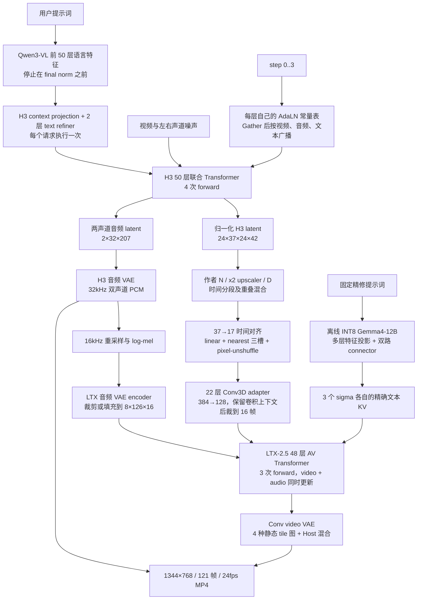

# 当前 Dense 发布方案

Sol-H3 当前构建仅导出组件，不再附带完整 H3/LTX 去噪采样；下游导图使用固定种子、
有界且尺寸正确的 latent 示例。GPTQ/AutoRound 真实量化校准不变，完整音视频生成
由发布后的独立验收负责。Native H3/LoRA 构建流程未改；已在运行的全量导出仍使用
其启动时加载的源码，不能将后续编排优化追溯为该大包的构建方式。

2026-10-23 首轮 Conv3d 完整包位于
`/data01/datasets/Sol-H3-assets/releases/unified_w4_conv3d_20261023/bundle`。
五种模式均已通过隐藏源目录的公开推理、1344×768×121 视频解码及32kHz双声道
有限波形检查。每模式输出保存在同根 `validation/<mode>/medusa.mp4`。
该历史包 reference encoder 使用有损 zero padding。2026-10-24 源码恢复原生 reflect，
Conv3d 仍由 SDK 拆为 Slice/Conv2d/Add；新产物需独立验收，不能沿用旧包结论。

默认构建配置已改为 schema 5 五模式统一包，prompt 上限 1024，Qwen KV 容量由官方
processor 预算推算并向上对齐 256。首尾帧四模式共用 base H3 分支，Ref2VA 使用独立的
transformer_ref 与 LoRA；两分支各自拥有 text refiner、DiT 和时间常量表。Qwen 视觉、
前 50 层语言图、音频、桥接和 LTX 组件共用，运行时每个请求重置 KV 并按阶段释放 session。
2026-10-22 的完整统一包已构建并搬迁到
`/data01/datasets/Sol-H3-assets/releases/unified_w4_20261022/bundle`，共 15 个图。
SDK VP 逐次 FP16 舍入修复后，隐藏源目录的公开 API 已重新完成五种模式音视频生成。
同一 runtime 的 T2VA→Ref2VA→T2VA 已完成，前后 T2VA 编码前 RGB 与 PCM 均逐位相同，
也与独立公开 API 的 T2VA 相同；证据为发布目录 `runtime_switch_vp_fp16/raw_equality.json`。
这个结论针对 2026-10-22 包的固定输入与 seed，不代表后续模型图转换均无量化误差。
早期有损视频摘要比较曾失败；中间张量重放逐位一致，同一原始 RGB 跨进程编码可产生
不同的解码后摘要。旧基线未保存全部原始 RGB，不能将全部历史差异归因为编码。
消费前端编译执行未验证。独立 wheel 安装与核心模块导入已通过；
独立环境的 T2VA、I2VA、L2VA 已完成，后续扩展验证按用户要求停止，
不将部分模式结果表述为独立安装后的五模式验收全部完成。

当前统一参考 VAE 默认分为普通首/尾图 `1×384×672`、Ref 图片 `1×768×768`、
Ref 视频 `17×768×768` 三档。普通图为
`h3_reference_encode_base_t1_h384_w672`，Ref 图为
`h3_reference_encode_ref_t1_h768_w768` / `h3_reference_encode_ref_t17`；
组件目录将 `h3_reference_encode` 替换为 `vae_encode_h3_reference`。
普通 I2VA/L2VA/FL2VA 图仅有 `pixels` 输入，使用原生逐帧 GroupNorm，禁用 Host 空间
切片；不做 mask、面积补偿或补到768方形。尺寸跟随 YAML `draft_size`。
Ref 图片/视频各自保留一个最大空间画布、有效域 mask 及 GN→RMSNorm 表达；
不会为每种边界 tile 单独导图。三个图都保留原生空间反射边界和因果时间边界。

`reference_vae_layout="split_v1"` 明确标识新参考编码布局；`reference_vae_base`
记录普通图名和精确 shape，`reference_vae_tiles` / `reference_vae_masks` 只记录 Ref 图
路由和 mask 策略。实际请求模式决定普通/Ref 分支，避免同尺寸时角色混用。
构建阶段显式按 H3 分支选择，运行阶段使用模式视图；统一包仍为 schema 5。
旧单画布、缺失布局标识或旧无 mask 参考包明确报错，须重新导出。
单模式构建也生成上述新布局，只包含所需角色，不输出旧参考图格式。
当前完整包为 `Sol-H3-assets/releases/unified_w4_rms1024_reflectpad_20261024/relocated/bundle`，
共19张图。Qwen ViT 由单图改为1024、1280、65536 patch 三档；容量按原生 processor
推算并向上对齐256，运行时对每个视频时间组或图片选择最小可容纳档。
三档均使用非因果 FlashAttention，保留有效长度与三路 DeepStack 输出。
参考 VAE 普通图采用显式 `Pad(reflect) → Conv2d`；Ref 档用 Gather 对有效区域反射，
不能换成对整个补齐画布的固定 Pad。全图审计见发布目录 `audit_bundle.json`，
三档真实输入对照见 `visual_gears_numeric/receipt.json`。
组件通过统一 `export_meta_info.json` 平铺登记，运行布局作为包内 JSON 资源发布。

以下为2026-10-23历史17图包的记录，根目录为
`Sol-H3-assets/releases/unified_w4_split_reference_20261023/bundle`，不代表当前 reflect 包的数值结果。
普通图全权重导出为34个 Conv2d、25个 GroupNorm、零 Gather，输入仅 `pixels`。
两个实际首/尾图样本中，plain wrapper 对原生 FP32 zero encoder 后验逐 bit 一致；
HMONNX 相对原生 moments 的相对 L2 为1.006–1.012%，后验 mean 为2.820–2.974%。
相对旧 masked HMONNX，moments 差异为0.665–0.699%，不能声称两种量化图逐 bit 相同。
证据为该根目录 `base_export.json`、`base_accuracy.json`；此比较不包含恢复 reflect 的差异。
I2VA/L2VA/FL2VA 三个普通模式已完成完整权重神经生成和媒体验收；T2VA/Ref2VA
沿用未变图的两档验收。普通三次运行的公共 API 后置校验因运行期间补全导出索引而持有
旧 manifest，原失败记录保留，不能写成三次 API 全流程通过。冻结后66个清单文件的
全量 size/SHA、公共包校验及模式 metadata 已重新独立通过。
范围和证据见 `five_mode_acceptance.json`、`completed_generation_recovery.json`、
`final_manifest_validation.json`。

此前两档中间验证包位于
`/data01/datasets/Sol-H3-assets/releases/unified_w4_t1_t17_20261023/bundle`，共16张图。
本轮新导出 T1，原样复用 T17 及其余14张图。两编码图均为9输入、零 Gather；
T1/T17 分别含94/902个 Conv2d，222份卷积参数 payload 逐字节一致。
在有效域 `1×384×672`、`1×768×768`、`17×384×672` 上，旧单图与新路由的
后验逐 bit 相同；22帧视频两次 T17 分片及裁剪后的后验也逐 bit 相同。
证据为同根 `encoder_graph_audit.json`、`reference_split_complete.json`。
这仅验证两档中间方案；最终三档还需验证普通图的原生空间画布。
前述 reflect→zero 的有损差异仍然存在。

同一 GPU、相同图片有效域的 HMONNX `session.run` 对照，预热后3次中位数从
23.745秒降至1.643秒（14.45倍），峰值 allocated 显存从10.678 GiB降至1.982 GiB。
不含图加载、输入准备和其他生成模块，不代表整段视频或芯片实测加速比。
原始样本、预热和显存口径见 `reference_split_accuracy.json`。

mask 层级为时间/空间压缩率
`(1,1)、(1,2)、(2,4)、(4,8)、(4,16)`，GroupNorm 排除空间补齐区域。当前参考图
恢复原生 reflect 空间边界，因果卷积仍屏蔽时间尾部。LTX decoder 将原四种 tile 合为一个 16×14×24 latent 图，
每层卷积前应用有效空间 mask，保留原生 PixelNorm、时间边界和 Host 混合。
对应原生数值、实际导出和模式切换回归分别见 `test_sol_h3_reference_vae.py`、
`test_sol_h3_vae_graph.py` 和 `test_unified_model_sol_h3.py`。

单通道卷积的 SDK VP 执行与消费前端解析须同时验证。当前单通道 VP 导出保留第 4 输入的
FP16 原权重，而 `qweight/scale` 使用原 depthwise 路径的标量占位。若消费前端仍对该节点
执行 TE 的 mantissa 布局校验，会拒绝该图；GPU simulator 通过不能证明此导入契约通过。
已报告的 H3 音频 decoder `node_conv2d_2` 是 `Cin=Cout=groups=1`、kernel `[12,1]`，
其 VP 原权重形状为 `[1,1,12,1]`，与 TE 期待的 `[12,64,1]` mantissa 不同。
前端解析问题尚未闭环，新统一包不能据此宣称可编译部署。
已核对 hmcc `2152a00fa`：前端仅识别 `groups=Cin=Cout>1 && dilation=1`，
内部 depthwise 算子也要求通道相等。按当前分工，SDK 先支持，编译器需求另行提交；
本次不修改 hmcc。需求及真实节点复现位于发布目录 `frontend_repro/COMPILER_REQUEST.md`。
SDK VP 的逐次 FP16 舍入修复已通过 44 项导出/数值回归，另有 4 项 SDK 原有后端回归通过。
此前五模式媒体属于旧数值实现，不能复用旧输出作为新数值路径的验收证据。
修复后的五模式完整结果见 `validation_vp_fp16/`，独立无上下文 ASR 均识别出目标句子
的同音表达。抽帧中的角色与场景保持稳定；L2VA、FL2VA、Ref2VA 未明确呈现要求的结尾微笑，
不把媒体格式和 ASR 通过等同于动作、表情或唇音同步全部符合提示词。

发布 recipe 仅 `sol-h3`，两阶段均 Dense。Qwen 前 50 层合为一图，残差与 embedding /16，
普通宽累加 RMSNorm 使用 epsilon/16²；H3 context projection 吸收输入尺度，Host 无额外缩放。
H3 主干默认 /1024＋普通宽累加 RMS（epsilon=2^-24），稳定 RMS 可由 YAML 选择；Attention V/512、FFN 保护维持不变。
LTX 固定档位 RoPE 作为 8 路共享输入，随包保存一次；H3 cos/sin 也保留输入。
完整图审计发现，将 LTX RoPE 折成常量会在各层 Q/K 旋转中重复展开：768×1344 档位的
768 个旋转常量合计 35.62 GiB，而 W8 权重及量化参数约 15.88 GiB、固定文本 K/V 约
3.38 GiB。不能将这种重复存储导致的加载 OOM 解释为 LTX 模型本身需要 44 GiB 以上。
共享输入与常量图的小模型三步逐位一致性由 `test_sol_h3_ltx_graph.py` 验证。完整权重
共享输入图已在 32 GiB 进程上限下完成三步执行：initializer 合计 20,713,716,970 bytes
（19.29 GiB），共享 RoPE 约 0.37 GiB，PyTorch 峰值 allocated 为 22,595,210,240 bytes
（21.04 GiB），reserved 为 23,664,263,168 bytes。输入为固定 seed 的模拟桥接 latent，
输出全部有限，证据为 `full_modes_fp16_20261021/shared_rope_ltx_result.json`。
另以相同输入对完整 48 层新旧图作三步对照，六组音视频输出全部逐位一致，最大误差和
相对 L2 误差均为 0，证据为 `full_modes_fp16_20261021/shared_rope_full_equivalence.json`。
这项固定输入组件验证不代替五模式真实媒体生成。
生成文件统一 `.onnx`，运行采用 HMONNX 自定义算子。构建与调用见
[示例](../../../examples_merak/aigc/sol_h3/README.md)。

2026-10-21 五模式接入：T2VA/I2VA/L2VA/FL2VA/Ref2VA 各有默认 profile workflow。
Qwen 使用带 KV cache 的 chunk prefill，默认 256；YAML 中 prompt token 上限、Qwen 媒体像素预算、
参考数量/时长和 VAE 图像短边共同推算静态容量。算法与原生 processor 对照测试位于
`test_sol_h3_capacity.py`，参数与具体调用见上述示例 README。

2026-10-22 量产配置：五个公开 profile 默认使用 AutoRound W4/group64 的 Qwen3-VL
语言权重，前 50 层部署为 W4A8 SSFP；视觉和其余学习组件维持 W8A8 SEFP。
公开 build 可复用完整 GPTQ/AutoRound checkpoint，通过清单定位 Qwen 源配置后继续执行
中央身份、行为、层完整性和载荷校验。显式 `quant_method=None` 才走浮点权重的对照路径。
W4 workflow 缺少量化 checkpoint 时拒绝导出；发布校验同时核对特征图实际登记的精度。
单通道 Conv 由 SDK 原生 VP 分派，ModelZoo 不再展开输入通道。

完整五模式已使用当前代码重新导出并通过搬迁后的公开接口生成验证：发布根目录为
`/data01/datasets/Sol-H3-assets/releases/w4a8_five_modes_20261022`，完整包在
`bundles/{t2va,i2va,l2va,fl2va,ref2va}`，图数分别为 13/15/15/15/65。
复用的是完整 AutoRound W4 checkpoint，所有组件图均重新导出。
每包实际图中 350 个 Qwen 语言 Linear 为 W4A8，条件模式的 117 个视觉 Linear 为 W8A8。
T2VA 音频解码图中的 127 个 VP 卷积均保持原始单输入通道结构，未做 ModelZoo 通道扩展。

五次推理均在原始权重、量化 checkpoint、作者源码、构建输入和旧实验目录不可见的
mount namespace 内执行；先验证隐藏目录为空，再调用公开 inference。宿主机共享源权重保留。
各模式生成 1344×768、121 帧、24 fps 视频和 32 kHz 双声道音轨，均完成 4+3 次更新，
解码数据有限且非静音；Ref2VA 同时接收图像、视频和音频参考。输入和审计记录见
`validation/<mode>/acceptance.json`、`inputs.json`，媒体为同目录 `medusa.mp4`。
五模式独立 ASR 均识别到指定语句的同音句，原始“后魔”/“厚膜”文本保存在 `transcripts.json`；
抽帧检查覆盖 0/30/60/90/120 帧，未做完整运动、口型及主观音质基准。
源码快照、CI 和清理结果以发布目录的 `code_provenance.json`、`ci_results.json`、
`cleanup_receipt.json` 为准；本轮仍未执行真机性能和干净环境安装验证，OCR 未安装。

条件模式复用原生 H3 presentation、M-RoPE 和参考排列，Qwen 的三路 DeepStack 保留；
参考图/视频另经 H3 VAE，参考音频经 H3 audio VAE（posterior.mode）。参考 latent 前缀参与
每步 DiT attention，四步更新只作用于生成后缀，不使用有损 reference-token caching。
Ref2VA 使用 transformer_ref 和其 LoRA，融合复用已有 MiniMax PEFT loader。
条件 DiT 的十输入 ABI 携带有效行角色及压紧/还原索引，避免 padding 空洞进入 attention。
图像 VAE 使用原生空间 tile 和时间尾块规则；音频图以逐层有效长度 mask 保持短输入边界，
不能仅补长波形而不屏蔽卷积偏置产生的尾部激活。

2026-10-20 发布整理：已迁移到当前 per-model unified CI；首轮影响范围回归 842 项通过，
含原生小模型完整构建、搬迁、移除源文件后 4+3 步音视频推理。最终 Sol-H3 复验 63 项通过，
另 1 项因夹具资源格式不真实而失败；修正夹具后 19 项产物契约回归全部通过。三轮共 844 个
唯一测试的最新结果均通过，完整小模型链路在最终版本也通过。旧 /256、外置 LTX RoPE 的
13 图 Dense 包通过新加载器契约审计。发布证据目录：
`/data01/datasets/Sol-H3-assets/releases/w4a8_five_modes_20261022/previous_receipts/dense_release_20261020`。
本轮未重新导出完整大权重，也未验证真机性能和干净环境安装；OCR 未安装，采用人工源码与契约审查。

下文保留早期 /256、W8 及诊断实验的数值记录；这些数字不代表当前 W4 包的精度验证。
旧模型和生成媒体已清理，文中相对证据文件名按发布目录 `previous_receipts/<实验名>/` 查阅；
仅小型回执和脚本归档，历史视频、trace、大型 latent 与组件权重不再保留。
实际留存文件以 `previous_receipts_index.json` 为准；下文“保留”等描述属于当时的实验记录。
最新五模式产物、视频及验收以本页顶部的 2026-10-22 发布目录为准。

# Sol-H3 的静态 FP16 / SEFP8 接入记录

记录时间：2026-10-15。实现与验证对象是独立 `sol-h3` recipe，T2VA、4 步 H3、3 步 LTX-2.5、
XH2a 图表达、A100 80GB 上的 HMONNX GPU simulator。稀疏和真机结论分别列出，不能由 simulator 类推。

## 完整推理结构



H3 的 124 像素帧对应 37 latent 帧。视频 patch 是 `(1,2,2)`，所以视频 token 数是
`37×12×21=9324`，每个输入 token 为 `24×1×2×2=96` 维。
音频以 40Hz 表示，`round(124/24×40)=207` 是每个声道的时间位置；左右声道合并为 414 个 32 维 token。
默认 T2VA 主图容量是 `9472+512+1024=11008`，分别为向上对齐后的音视频与文本槽位。
实际有效长度由 int32 输入控制，pack 将各槽位中的有效行压紧，padding 只占 attention 尾部。
序列使用视频、音频、文本三段连续排列；位置编码与模态标签随 token 一起重排。

H3 输出 latent 直接进入上采样和 adapter，这条流程不需要先解码 H3 视频再重编码。
adapter 先处理 17 个 LTX 时间位置，随后裁剪到 16 个；LTX 的时间压缩是 8 倍，`(16-1)×8+1=121`。
最终音轨使用 H3 的原始 PCM；LTX 音频 latent 在精修过程中参与联合更新，最终没有再经过 vocoder 输出。

## VAE 档位合并与时间窗口简化

合并前五个独立包的 Ref2VA reference encoder 有 50 个图：17 个单帧空间档位、
33 个 17 帧空间档位；LTX video decoder 有 4 个图，latent 形状分别为
`16×14×24`、`16×14×20`、`16×12×24`、`16×12×20`。它们沿用原生 tile
边界、归一化和拼接，不是 50/4 套独立训练权重。

原生 H3 encoder 的两个 Pad 分别是空间 reflect 和时间左侧补零。对称 reflect
不能等价换成 Conv2d 的 zero padding；下采样的右侧/下侧 reflect 同理。
当前 SDK 的 Conv2d pads 是对称空间参数，ONNX 前端遇到非对称 padding
会拆出 Pad。不能因为 ONNX Conv 能描述非对称 pads，就认定部署 Conv2d
可直接吸收它。

固定单帧图可以只保留因果卷积的最后一个时间权重切片，因为其余时间切片
始终乘零。普通图复用既有 MiniMax wrapper 的 `set_static_shape` 单帧特化，
保留最后一个时间权重切片为 Conv2d；没有新增时间窗口打包或 Gather 路径。
Ref masked 图保留 Conv3d 交给 SDK，图片固定 T=1，视频固定 T=17。
视频历史帧一般非零，必须保留全部时间核。

Conv3d 的部署转换交给 SDK 前端：按输出时间位置和时间核位置 Slice，
各时间核分别执行 Conv2d，再 Add 求和，最后沿时间维 Concat。
不同输出时间位置复用相同的时间核，bias 仅加一次。ModelZoo 仅冻结归一化
所需的静态形状，不再用时间 Gather 将通道扩展为 `Cin * Kt`。
LTX 保留原生首尾帧复制的时间 padding，再由同一 SDK 转换卷积。
当前统一参考编码图保持原生空间 reflect padding。普通图使用固定尺寸的原生
边界表达；Ref 图根据每个尺度的实际有效高宽生成反射 Gather 索引，不能反射最大画布。
metadata 的 `spatial_padding_mode="reflect"` 与图输入同步发布。此前为了去除空间
Gather 改成 zero 属于有损变更，已观察到条件视频细白框，因此不再作为默认导出。
这些空间边界 Gather 不承担 Conv3d 时间窗口打包；Slice/Conv2d/Add 拆分保持不变。
LTX decoder 原本使用空间零填充，继续保持其原生边界及时间首尾帧复制语义。
旧的时间窗口打包和 Gather 消除实验不再代表当前导出图。
分支 Conv2d 和 Add 会改变量化舍入边界，不能沿用旧图逐位一致的结论。

时间核拆分改变量化分组的输入宽度，浮点等价不意味着 W8 结果逐位相同，
仍须用原生浮点输出验证重新量化后的误差。

SDK 仿真层的 unfold 临时空间独立受控：按 batch 和输出空间切块，每块保留
完整通道和卷积 halo，只补当前块需要的零边界，不改变 SEFP 通道分组或累加顺序。
2026-10-23 的 FP16 `[17,384,770,770]` 到 `[17,128,768,768]` 卷积实测中，
未分块 unfold 的理论大小为 64.55 GiB；分块后单次 unfold 最大 126.6 MiB，
整次卷积峰值 allocated 为 10.04 GiB（含输入、输出），首、中、尾抽查窗口与
未分块 SEFP 逐位相同。这是 GPU 仿真显存测量，不是芯片性能结论。
实现为 SDK [47105](http://gerrit.houmo.ai/c/houmoquantization/xhquanttool/+/47105)，
测量记录为 `Sol-H3-assets/releases/unified_w4_conv3d_20261023/sdk_memory_large.json`。

### 当前17图的 Conv3d 路径审计

对 `unified_w4_split_reference_20261023/bundle` 全部27,825个 Conv2d 调用逐项检查
输入通道、逻辑权重、前后节点及实际时间求和树，未发现滑动时间窗口折为 `Cin×Kt`
的一次卷积。这里不是根据 ONNX 中没有 Conv3d 或仅出现 Add 作出的判断。

| 模块 | 导出 Conv2d 调用数 | 实际路径 |
|---|---:|---|
| 普通图片 encoder | 34 | 33个既有 T=1 空间特化，保留最后时间核；1个 Kt=1 projection 由 SDK 转换 |
| Ref 图片 / 视频 encoder | 94 / 902 | 原始34个 Conv3d 均交 SDK，Kt=3 按时间核 Slice→Conv2d→Add |
| H3 upscaler T20 / T42 | 4,440 / 9,324 | 原始74个 Conv3d 各自拆核，含 Kt=3 和 depthwise Kt=5 |
| H3-to-LTX adapter | 2,329 | 原始91个 Conv3d 拆核；stem 每个 tap 的 Cin 仍为384，未扩成1,152 |
| LTX video decoder | 10,386 | 原始42个 Conv3d 拆核；输入 Slice 后每帧求和再按时间 Concat |
| H3 reference audio / audio decoder | 38 / 256 | 原生 Conv1d 转2D；decoder 的转置卷积为 ConvTranspose1d |
| LTX audio encoder | 22 | 原生二维频谱卷积 |
| Qwen3-VL visual patch projection | 0 | 不重叠2×16×16 RGB patch 的 Conv3d 权重展平为1536→1152 Linear |

SDK 时间拆解的实际链是 Slice(axis=2)→Squeeze→Conv2d→Unsqueeze→Add→Concat。
Kt=1没有多个 tap，不要求 Add；输出时间长度1不要求 Concat。普通图片 encoder 的
单帧特化和 Qwen patch projection 是明确的模型表达例外，未采用滑窗时间打包。
LTX 上采样是 Conv3d 后的 DepthToSpace；本包未调用 ConvTranspose3d 的 SDK 路径。

Adapter 入口仍有3个 Gather：原生37→17潜帧对齐、三个 nearest slots 将24通道变96，
再经2×2空间 pixel-unshuffle 变384。这是训练时的输入语义，其后的 stem 仍逐 tap
进行 Cin=384 的卷积，不能当作 Conv3d 打包回退删掉。LTX DepthExpansion 的通道展开
同样是原生上采样语义。完整逐节点证据及 Netron 例子见该发布实验目录（`bundle` 同级）的
`conv_topology_audit.md` / `conv_topology_audit.json` / `conv_topology_all_nodes.json`。

SDK 使用合一变更 [47132 PS2](http://gerrit.houmo.ai/c/houmoquantization/xhquanttool/+/47132/2)
（`79278357`），包含此前普通 Conv3d 拆解和受限 unfold 内存修复；相关生产实现与
已生成本包的 SDK 一致，冻结包没有再次改写或重复生成。结构回归使用小 tensor 的
原生 Ref encoder、UpscalerSegment、AdapterGraph 和 CausalPadConv，逐源卷积核对
Cin/Cout/groups/空间 kernel/stride/dilation/权重切片及真实求和拓扑；同时覆盖 Kt=1、
单输出时间帧、groups、stride 和 dilation。它验证结构与浮点结果，不替代芯片性能测试。

2026-10-23 首轮 Conv3d 完整权重重导出覆盖 reference encoder、两个 H3 upscaler 档位、
H3-to-LTX adapter 和 LTX decoder 共五张图，其余十张图沿用已验收包；没有
声称重新量化 Qwen。ONNX checker、external-data 边界及卷积系数 shape 均通过。
reference encoder 为 902 个 Conv2d、零 Gather、9 个输入；LTX decoder 为
10386 个 Conv2d、零 Gather，126 份时间核系数在各输出时间位置共享。
H3-to-LTX adapter 另有 3 个时间对齐 Gather，它们不是 VAE 的卷积窗口打包。

同输入完整权重数值检查记录于
`Sol-H3-assets/releases/unified_w4_conv3d_20261023/`：

| 检查 | 结果及口径 | 记录 |
| --- | --- | --- |
| 单图 / 17帧参考 encoder | 新 W8 相对 native **zero** 的 posterior mean 相对 L2 为 2.55% / 3.04%，输出有限 | `zero_reference_accuracy.json` |
| reflect 改为 zero | native posterior mean 相对原生 reflect 偏离 26.65% / 29.40%；裁去 latent 外两圈仍为 10.85% / 14.84% | `reference_padding_effect.json` |
| LTX decoder 四档 | 新 W8 相对 native FP32 的相对 L2 为 1.51%～1.84%；新旧量化图之间为 0.87%～0.93%，不逐位一致 | `component_accuracy.json` |
| encoder / decoder GPU 峰值 | 本次独立数值检查 allocated 分别为 10.68 / 15.90 GiB | `component_accuracy.json` |

padding 改动的 26%～29% 是 latent 语义偏离，不是量化误差，也不是画质下降
百分比。该变更不等同于现有 MiniMax-H3 适配：许晨的 encoder wrapper 沿用
checkpoint 的 `spatial_padding_mode="reflect"`。只有比较最终同条件视频才能
评估成片变化，不能用卷积图可执行或数值有限替代质量结论。

同条件最终视频 A/B 仅替换 reference encoder，其他14张图及 encoder 的222份
卷积系数 payload 均一致：I2VA / Ref2VA 的解码后 RGB PSNR 分别为 18.29 / 27.52 dB，
解码后 PCM SNR 为 -3.58 / 16.36 dB。以上含 H264/AAC 编码差异，不能当作原始
张量指标。I2VA 抽样可见睁闭眼、嘴型时序和姿态变化；Ref2VA 整体动作接近，
局部嘴部与眉眼仍有差异。两种 padding 及五模式的独立 ASR 均识别为
“后魔智能，我的最爱。”，不能由文字相同推断声音或口型无损。对照记录与图位于
`padding_media_comparison/`、`visual_review.json`；这是运行与变化核验，不是无损质量验收。

2026-10-22 完整 encoder 权重、512×512 人物图的局部对照保存于
`work_dirs/sol_h3_vae_compaction_20261022/full_encoder_result.json`：
FP32（禁用 TF32）相对 L2 为 `7.82e-7`，旧/新 W8 图相对原生 FP32
误差分别为 `1.0356% / 1.0252%`；Gather 从 34 减为 0，Pad 从 60 减为
30，保留的均为空间 reflect。这是单张输入的 encoder 检查，不代表视频
生成质量或芯片时延验收，也未替换此前发布的五模式包。

当前统一 reference encoder 使用固定最大画布，只有输出 mask 不足以
保持所选 padding 策略的边界语义。空间压缩因子 `[2,2,2,2,1,1]` 对应
`1、1/2、1/4、1/8、1/16` 五个尺度的有效区域；这些 mask 可以由输入
有效高宽自动推导，不要求调用者手写五份。每个尺度需要同时处理：

- GroupNorm 按有效空间元素求均值和方差，保留每帧独立统计。
- 当前 reflect 策略按真实 tile 边界取值，不能按最大画布边界反射；
  时间无效区仍在卷积前清零。
- 各次卷积、残差与带 bias 的运算之后，避免无效区域进入下一次空间计算。

因此四次下采样各乘一次 mask 并不充分。当前时间下采样因子为
`[1,2,2,1,1,1]`，时间压缩 4 倍，不是 16 倍。旧图像请求使用17帧图的第一个
输出，`1×512×512` 首层输入扩到 `17×768×768`，体素数增至39.2倍；
两档中间方案只扩空间到 `1×768×768`，体素数为2.25倍。最终图片图按实际空间档位
导出，不引入这次空间扩大。它们是输入规模比，不是实测时延比。
Ref 两档保留 masked 去均值、面积补偿与 RMSNorm；普通图只使用原生 GroupNorm，
不额外做去均值或面积补偿。

T=17 来自 H3 VAE 的 `clip_length`，是视频图固定时间尺寸。Host 按17帧切片；
短视频或末片不足17帧时复制最后一帧补齐，拼接各片后沿用原生 `token_drop`。
因此图内没有“17帧以内动态少算”，也不把仅剩一帧的尾片切换到图片图。视频的
补帧和后验裁剪语义由 `MiniMaxH3VAEEncoderWrapper.forward` 统一承担。

LTX decoder 的空间 padding 是零、PixelNorm 只沿通道归一化，4 个档位
已合为一个最大 `16×14×24` 图。需要在每次空间卷积之前清除无效
区域，并在上采样时传播有效边界；输入反归一化的 mean、卷积 bias 等
都会把补零区域变成非零，故不能仅在最终图像乘一次 mask。原有 overlap
混合 mask 继续用于 tile 拼接，它与有效区域 mask 承担不同作用。
小原生 LTX decoder 的 eager 验证（含非零 latent mean）表明，只补齐输入
并裁输出的相对 L2 偏差为 44.6%～64.5%；逐卷积输入 mask 后，各边界
尺寸的偏差低于 `8e-7`，见
`work_dirs/sol_h3_vae_compaction_20261022/prove_decoder_masks.json`。
该早期实验使用运行时 hook 验证数学边界；后续正式实现与导出没有依赖这些 hook。

2026-10-22 的 mask 合图验收曾测得 LTX decoder 四档 W8 逐位一致、参考 encoder
FP32 相对误差 `3.17e-7` / `4.54e-7`，记录在旧统一包的 `component_checks/`。
这些记录对应保留 reflect 和时间窗口打包的旧图；2026-10-23 的 Slice/Conv2d/Add 与 zero
边界图有独立完整权重记录；2026-10-24 恢复反射的三档图需重新验证，不沿用旧结论。
五模式已共用一个交付包和 Qwen/VAE/LTX 等公共组件，但
`transformer + dense LoRA` 与 Ref2VA 的 `transformer_ref + ref2va LoRA`
是两条权重来源，不能靠 mask 把它们替换成一份 DiT 权重。
前四模式使用同一 conditioned DiT 容量，Ref2VA 保留其权重分支；
运行时按请求选择，并沿用原生 row roles、pack/unpack、RoPE 和有效长度。
共享容量必须逐字段取上界。默认 prompt 1024、Qwen 沿用 checkpoint processor、
Ref2VA 图片 VAE 短边 2048 时，Ref2VA 文本原生上界为 18822，向上对齐后
text capacity / 公共 Qwen KV 为 18944。FL2VA 对齐后的 text capacity 为 1792。
video/audio/text 槽位容量分别向上对齐到 256；T2VA 复用已有 packed 图与槽位布局，
有效行先压紧再执行 attention，输出裁回原生长度。实际 latent 几何、RoPE 和 scheduler 不变。
这些是新导出的配置与图契约；已发布的 prompt 512 / 低参考预算包需重新导出，不能只改 metadata。

## Qwen 文本编码器单图布局

默认 workflow 的 `text_layers_per_graph` 为 50，当前统一包的前 50 层位于
`text_encode_h3_c256_s18944/h3_feature_00_50.onnx`。Embedding 和 RoPE 输入仍由 Host 准备，
不包含 Qwen 的最后 14 层、final norm、LM head 或视觉塔；H3 自己的 context projection
和两层 text refiner 合在独立图内，统一包按 base/ref 权重分支各提供一张。
runtime 继续按包内 `feature_graphs` 执行，因此原 10 段图包也可读取。

以下为历史 W8 单模式合图验证：当时从 10 段特征图合成一图，完整包由 22 图减少为
13 图，每个视频由 27 次图调用减少为 18 次；路径为 `text_encode_h3_s512/h3_feature_00_50.onnx`。
这些图数、调用数和权重大小不代表当前 15 图的 W4 五模式统一包。

2026-10-15 使用原始权重重新导出并执行单图。鹰提示词的有效文本特征与原 10 段 SEFP8
串联输出逐元素一致：相对 L2 和最大绝对差均为 0；对原生 BF16 的相对 L2 仍为
0.011439687173181709、余弦为 0.9999353234916457。证据位于
`/data01/datasets/Sol-H3-assets/releases/w4a8_five_modes_20261022/previous_receipts/qwen_merged_20261015/export_receipt.json`。
合图保持全部 350 个 Linear、50 个 FlashAttention 及数值补偿，不代表计算量或权重减少。
单图外部权重约 23.4GiB；这次首次 simulator 解析约 349 秒，一次调用栈采样落在
GraphSurgeon lazy constant 转 NumPy、Linear 权重解析；这不能将全部解析时间归因于该行，
也不能声称合图后加载更快。

合图包 `/data01/datasets/sol_h3_merak_w8_qwen50` 通过全部 13 张图审计，
2916 个 SEFP8 Linear/Conv 与 390 个 FlashAttention 的配置保持不变。
完整公开接口生成了 `eagle_w8a8_qwen50.mp4`（历史媒体，已清理），
1344×768、121 帧、24fps、32kHz 双声道；解码音频样本有限。
与旧包同提示词、seed=42 成片的全部 121 帧相比，RGB 平均绝对差为 0.473672/255，
最大单通道差为 37/255，不是逐像素一致。抽检 0/30/60/90/120 帧的主体、构图和运动阶段一致，
当前未进一步归因像素差异，不能将文本特征一致直接等同于成片 bitwise 一致。
证据为同目录 `demo_receipt.json`、`schema3-graph-audit-report.json`、`split_vs_merged.jpg`。
独立进程 Qwen 解析约 440 秒，完整 runtime（含各图加载）约 968.7 秒；不是芯片性能。
本次 137 项轻量检查与 1 项完整小模型构建/搬迁/推理测试通过；未重跑其他模型的完整 CI。
首次小模型测试的源码根路径错误已修正并重跑，原失败日志保留。

[飞书流程文档与六张画板](https://houmo.feishu.cn/docx/BRQsd42KoohFkdxykfSc4NwdnLf)
说明各模型张量交互、AdaLN、缩放补偿、固定提示 KV 和解码融合。

## LTX-2.5 的文本和 latent 表示

当前 release 的文本编码器是 Gemma4-12B：48 层、hidden 3840，局部 attention 与周期性全局 attention 混合。
文本侧取 embedding 与 48 层输出，共 49 份 hidden state。V2 feature extractor 对每个 token、每层的
3840 维特征做 RMS 归一化，再拼成 `49×3840=188160` 维，经过独立投影得到视频 4096 维、音频 2048 维特征。
随后两个 8 层 connector 分别处理视频和音频，带 gated attention 和可学习 register。

作者 Sol-H3 精修阶段使用固定质量提示词
`4K, refined, high quality, cinematic detail, clean textures, natural motion.`。
本接入保持这个流程：用户内容提示词进入 H3，LTX 从 H3 latent 获得画面内容，固定提示词负责精修风格。
离线缓存采用作者的 INT8 Gemma + INT8 connector 配方，边界在两个 connector 之后，得到
`[1,1024,4096]` 和 `[1,1024,2048]` 的 BF16 context；导出时转成 FP16 的逐 sigma KV 常量。
Gemma/connector 的 padding mask 已在特征处理中消耗，不能再按原始 18 个有效文本 token 把 context 清零。
运行时无需加载 Gemma 和 connector；改变精修提示词需要重建 cache、KV 和导出包。

视频 latent 经 H3→LTX adapter 进入 128-channel、时间压缩 8 倍、空间压缩 32 倍的表示。
LTX video patchifier 的 patch size 为 1，每个 latent 网格位置直接成为一个 128 维 token。
音频先变成 16kHz log-mel，由 audio VAE 编码成 8-channel、16 个频率位置的 latent；
每个时间位置将 channel 与频率打平为 128 维 token，与视频在模型内部交互。

## LTX 首尾图条件的 wrap16 原型

首尾身份约束必须贯穿 LTX 精修。只在 H3 使用参考图、再让 LTX 对整段 latent 加噪，
不能保证精修后的女孩仍保持参考五官和首尾表情。浮点验证复用相同 H3 bridge/audio 输入，
单独比较工程 FP16 LTX；不以替换最终 RGB 首末帧代替条件采样。

`ltx_keyframes.py` 复用原生 LTX 条件对象与采样状态：首图冻结目标首 latent；
末图以 pixel frame 120 的独立时间位置追加 guide，不覆盖目标最后一个 latent，
后者承载约 8 帧内容。768×1344 档每帧 1008 tokens，双图条件为 16128 个目标 tokens
加 1008 个末图 guide。每步恢复冻结条件，结束后去掉 guide，仅解码目标视频。

工程 DiT 为视频折叠当前 sigma 和零时刻两类 AdaLN 常量，按连续 token 区间应用，
避免复制每个 token 的调制表。音频、prompt K/V 和跨模态 gate 仍使用全局 sigma；
self/AV RoPE 都包含真实 guide 时间位置。checkpoint 的 keyframe 位置 embedding
独立于 denoise mask：无给定图片时目标首帧也有 marker，不能把 marker 当作冻结 mask。

新增 `VideoEncodeGraph` 输出归一化图像 latent。完整权重的下采样卷积可能输出超过
FP16 上限；编码器将残差流保持为原值的 1/32，同时补偿残差分支、卷积 bias 和
归一化 epsilon，最终归一化 latent 仍在原量纲。该调整由真实 native 小模型、卷积
溢出回归及完整权重参考图编码对照验证，不以截断或更换 BF16 编码器规避。

这是工程 FP16 验证接口；当前已发布的 HMONNX 包没有新增图像编码器及 guide 输入档位。
后续部署接入还需要同步图容量、metadata、加载和量化校验，不能直接向旧 LTX 图追加 tokens。

## LTX-2.5 的一层

视频每帧有 `24×42=1008` 个位置，16 帧合计 16128 个 128 维输入 token。
音频是 126 个 token，每个由 8 个 latent channel ×16 个频率位置组成，也是 128 维。
视频投影到 4096 维、音频投影到 2048 维，经过 48 层后分别投影回 128 维速度场。

| 分支 | Q/K/V 与头配置 | 调制和交互 |
| --- | --- | --- |
| 视频 self-attention | 32 头 ×128 | 视频 RMSNorm、时间 shift/scale、attention、gate residual |
| 视频到文本 | 32 头 ×128，文本 context 4096 | 文本侧也有时间 AdaLN，因此 KV 按三个 sigma 分别折叠 |
| 音频 self-attention | 32 头 ×64 | 音频 RMSNorm、时间 shift/scale、attention、gate residual |
| 音频到文本 | 32 头 ×64，文本 context 2048 | 独立的音频文本 KV |
| 音频到视频 | 视频 Q、音频 K/V，32 头 ×64 | 使用音视频时间 RoPE 与交叉调制 |
| 视频到音频 | 音频 Q、视频 K/V，32 头 ×64 | 与上一方向使用同一份更新前状态 |
| 两个 FFN | 视频 4096→16384→4096；音频 2048→8192→2048 | GELU approximate=tanh，独立调制和 residual gate |

每层六个 attention 都带模型原有的每头 `2×sigmoid(gate_logits)`。视频和音频交叉方向先各自读取快照，
再写回 residual；先更新视频再让音频读取新视频会改变模型。
Q/K RMSNorm 在拆分 heads 前对完整投影宽度执行，不能改成逐头归一化。

精修 sigma 为 `[0.909375,0.725,0.421875,0]`。LTX 的 velocity 是 noise-ward，Euler 更新
`x_next=x+(sigma_next-sigma)×velocity`；H3 使用自己的 data-ward scheduler，两个阶段不能共用更新符号。

## LTX 的 AdaLN 与 Gather：先认清取的是什么

LTX 的 Gather 主要在选时间表、固定文本 KV 和参数行，不是在为每个视频 token 生成一套参数。
记视频隐藏宽度为 $D_v=4096$，音频为 $D_a=2048$；$j$ 是去噪步，$l$ 是 block 编号。
block 主残差流使用 **RMSNorm**；最终输出头使用 **LayerNorm**，后者会减均值，不能统称为 RMSNorm。

### 时间先生成 e，再投影成 a

每个模态有自己的时间网络，同一模态的网络在48个 block 间共享。
原生 `AdaLayerNormSingle` 先执行正弦时间编码及 MLP，再执行额外的 SiLU 和 Linear：

$$
e_m(t)=\operatorname{TimeEmbed}_m(c\,t),\qquad
a_m(t)=\operatorname{reshape}_{9,D_m}\!\left(W_m\operatorname{SiLU}(e_m(t))+b_m\right).
$$

这里常规时间倍率 $c=1000$；视频 token 的 $t$ 为当前噪声 sigma 或条件零时刻，音频使用全局 sigma。
原生 `TransformerArgs.timesteps` 保存的已是投影后的 $a$；`embedded_timestep` 才是 $e$，变量名不能当成原始标量时间。
第 $l$ 层再加自己的 learned table $S_m^{(l)}\in\mathbb R^{9\times D_m}$：

$$
P_m^{(l)}(t)=a_m(t)+S_m^{(l)}.
$$

因此共享的是时间网络，各层最终调制参数仍不同。`get_ada_values` 完成上述相加和选行：

| 9行表的行号 | 参数 | 用在何处 |
| --- | --- | --- |
| 0 | shift $\beta_{sa}$ | self-attention 输入 |
| 1 | scale $\gamma_{sa}$ | self-attention 输入 |
| 2 | gate $g_{sa}$ | self-attention 残差 |
| 3 | shift $\beta_{ff}$ | FFN 输入 |
| 4 | scale $\gamma_{ff}$ | FFN 输入 |
| 5 | gate $g_{ff}$ | FFN 残差 |
| 6 | shift $\beta_{text}$ | 文本 cross-attention 的 query 输入 |
| 7 | scale $\gamma_{text}$ | 文本 cross-attention 的 query 输入 |
| 8 | gate $g_{text}$ | 文本 cross-attention 残差 |

每一行都是 $D_m$ 维向量；同一时间角色内沿 token 轴广播。以一个子层 $F$ 为例：

$$
u=\operatorname{RMSNorm}(x)\odot(1+\gamma)+\beta,\qquad
x^+=x+g\odot F(u).
$$

这个 $g$ 是 AdaLN 残差门控；attention 内另有每头的 `2×sigmoid(gate_logits)`，两者是不同操作。

### 音视频交叉分支的5行表

每层还各有一张视频、音频 `[5,D]` learned table。前四行与本模态的 scale/shift 时间网络相加，
最后一行与独立 gate 时间网络相加，作用如下：

| 行号 | 视频侧 `[5,4096]` | 音频侧 `[5,2048]` |
| --- | --- | --- |
| 0 | A→V 的视频 query scale | A→V 的音频 KV scale |
| 1 | A→V 的视频 query shift | A→V 的音频 KV shift |
| 2 | V→A 的视频 KV scale | V→A 的音频 query scale |
| 3 | V→A 的视频 KV shift | V→A 的音频 query shift |
| 4 | A→V 写回视频的 gate | V→A 写回音频的 gate |

scale/shift 读取**本模态逐 token 的噪声时间**；写回视频的 gate 读取**音频全局 sigma**，
写回音频的 gate 读取**视频全局 sigma**。两者各按 checkpoint 配置的倍率缩放；
实际 LTX-2.5 checkpoint 的 `timestep_scale_multiplier` 与 `av_ca_timestep_scale_multiplier` 均为1000，
不能用源码构造函数中交叉 gate 倍率的默认值1代替实际配置。
所以首图或末图的时间为0，不等于其跨模态 gate 也该取0；工程折叠保留了这个区别。

### 输出头的2行表读取 e，不读取9行 a

输出头另有 `[2,D]` learned table，顺序为 shift、scale；没有 residual gate。
它把**原始时间 embedding $e$** 同时加到两行，随后执行无自身 affine 的 LayerNorm 和输出投影：

$$
[\beta_{out},\gamma_{out}]=S_{out}+e(t)[None,:],\qquad
v=W_{out}\!\left(\operatorname{LayerNorm}(x)\odot(1+\gamma_{out})+\beta_{out}\right)+b_{out}.
$$

文本 context 也有独立的 `[2,D]` prompt shift/scale 表，它与输出头不是同一张表。
该表叠加全局 sigma 的 prompt 时间投影后调制 context，再生成本层 $K=\operatorname{RMSNorm}_K(W_K C')$、$V=W_V C'$。
当前 LTX 使用固定 Gemma/connector context，因此这两行及 KV 能在导出时折叠。
缓存的1024是 **LTX固定context长度**，与用户 `prompt.max_tokens=1024` 是两个预算；用户 Qwen hidden 不直接送入 LTX。
更换 LTX prompt、相关权重或时间表，必须重新生成 context、逐步 KV 和导出图，不能只改 metadata。

### 三步整数查表与旧包1734个 Gather

工程预先计算 $\sigma=[0.909375,0.725,0.421875]$ 对应的调制参数与文本 KV。
运行时输入 `step=0/1/2`，`StepTable` 按第一维查表；不对浮点 sigma 做搜索，也不再运行时间 MLP。
**仅2026-10-24旧11输入、无guide的 ONNX**审计得到以下1734个 Gather：

| 数量 | 实际读取内容 | 计数来源 |
| --- | --- | --- |
| 194 | 当步的调制参数表 | 每层视频/音频9行表、视频/音频5行表：`48×4`；两个输出头再加2 |
| 192 | 当步固定文本 K/V 缓存 | 每层视频K/V、音频K/V：`48×4` |
| 1348 | 已取出参数中的固定行 | 每层 `9+9+5+5=28` 行：`48×28`；两个输出头再取4行 |

即 `1734=194+192+1348`。选参数行不等于按视频 token 查表；读取文本 KV 也不等于读取视频 latent。
这只是旧包的序列化图计数，不能套用到新增 guide、`first_role` 后的新图；优化器版本也会影响节点数量。

### 新 first_role：三段位置，只有两类噪声时间

新图视频容量固定17136，调制参数仍只保存 `noisy=σ`、`clean=0` 两类小表：

| token 区间 | 物理含义 | 选择的噪声时间 |
| --- | --- | --- |
| `[0,1008)` | 首目标 latent 帧 | `first_role=0` 用sigma；有首图时 `first_role=1` 用0 |
| `[1008,16128)` | 其余15帧目标 latent | sigma，包含仍需更新的目标末latent |
| `[16128,17136)` | 独立末图guide | 0；无末图时另由有效长度屏蔽 |

`FirstFrameTimeTable` 只Gather首段的小向量，随后逐段广播；不会造一张 `17136×D` 的调制参数表。
末图的**噪声时间0**表示干净条件；它的**帧RoPE位置120**表示在视频中的位置，两者互不替代。
音频及prompt仍读全局sigma；交叉gate仍读另一模态全局sigma。本段也不能套用H3的 `1-sigma` 时间约定。

核对入口：工程 [折叠与运行图](../../../xhmodel_merak/xh_other_model/models/sol_h3/ltx_graph.py)、
[原生时间准备适配](../../../xhmodel_merak/xh_other_model/models/sol_h3/ltx_prepare.py)、
[三步及条件角色对照](../../../benchmark_test/ci_test_transformer5.16.0/test_sol_h3_ltx_graph.py)。
原生对应文件位于构建输入 `ltx_source/packages/ltx-core/src/ltx_core/model/transformer/` 下的
`adaln.py`、`transformer_args.py`、`transformer.py` 和 `model.py`。

## AdaLN 为什么可以离线折叠

H3 时间特征 `e(t)` 为 2688 维。原生第 l 层的独立投影输出三种模态 ×六个 5376 维向量：
attention 的 shift/scale/gate 和 FFN 的 shift/scale/gate。50 层的投影权重彼此独立，只有时间特征共享。

折叠顺序是先合并全部 Dense hybrid LoRA，再用原来的时间 embedding、SiLU 和投影精度计算每个固定时间点。
视频 sigma 为 `[1,0.972972989,0.923076928,0.8,0]`，音频为 `[1,0.9,0.75,0.5,0]`；
时间输入是 FP32 的 `1-sigma`。文本在主图中使用视频时间。不能先把 `e(t)` 提前转 FP16 再计算原生 SiLU。

当前 Sol-H3 导出统一保存五角色，每层是 `[4,6,5,5376]` 的 FP16 表，
50 层主表约61.5 MiB，另外存输出 head 的 shift/scale。base 分支即使没有参考音频槽位，也不退回三角色表。
这删除了 13,039,369,728 个时间投影参数；时间 MLP 也不进入运行图。常量不随视频 token 数复制。
换 LoRA、时间表或步数必须重新折叠和导出。

五角色分别为R0视频时间的视觉token、R1视频时间的文本token、R2音频时间的音频token、
R3参考VAE视频token、R4参考音频token。R0既包含目标视频，也包含Qwen视觉context；
角色表示AdaLN调制语义，不能拿 `role==0` 判断稀疏attention的目标视频来源。
导出时选择每步、每角色的 AdaLN 常量，查询值与时间表必须使用相同的 FP32 `1-sigma` 运算。
Python 先做减法再转 FP32，
可能使查询值略大于已有时间行，导致 `searchsorted` 选中下一行。例如第 4 步视频时间
应为 `0.199999988`，不能因查询值舍入到 `0.2` 而选到音频时间 `0.5`。
回归对照使用原生 scheduler 和 `build_row_timesteps`，不复用被测角色索引生成预期结果。
当前运行图只在入口将投影后的feature重排到固定角色slot，出口恢复视频/音频输出位置。
每层按整数 `step` Gather 当步的小表，随后用固定slot的 Slice 和广播应用六组向量；
不再用长度为N的role索引Gather出 `N×D` 调制参数。运行时没有浮点时间搜索；
上述舍入错误发生在导出时选表行，整数查表不能修复已经折错的常量。

2026-10-26 全大权重ref档H3 DiT的实际ONNX header审计为：53个Gather，
其中入口1个（索引长度55040）、step查表51个（每个索引长度1，50层加输出头）、
出口1个（索引长度35840）。50个FlashAttention的slot11均读取 `[1,1,1,55040]` 广播key mask；
201个RMSNorm均为 `force_fp32=0 / sum_dtype=float16 / keep_fp32_variance=0`。
这是该档位的导出图证据，不代表整包已完成或已经通过芯片编译。

H3 的 prompt-only refiner 可以精确执行一次；主 Transformer 中的文本特征参与双向联合 attention，
不能像具有因果前缀的 Qwen-Image-2.1 那样直接把每层文本 KV 固定下来。
LTX 的精修提示词固定，但 prompt AdaLN 随 sigma 变化，因此保留三套不同 KV，而非跨时间共享一套。

## FP16 溢出与补偿

真实 Dense LoRA 权重的原始 FP16 测试在 `context_embedder` 首次出现 Inf。
同一 FP16 输入和权重用 FP32 重算的最大值为 72136.234375，超过 FP16 的 65504。
BF16 的完整四步中 residual 最大约 14,221,312；直接转 FP16 或在 65504 截断会改变结果。

图采用二的幂表示缩放。当前文本特征保存为原值/16；text refiner residual 使用 /4；主 residual 默认使用 /1024。
主干普通 RMSNorm 使用 epsilon=2^-24，等效原始尺度 epsilon=0.0625，属于有损方案。
可配置 stable 模式，按 `epsilon/scale²` 保持源模型归一化语义。
plain/stable决定epsilon和图表达，归约精度由独立的 `export.norm_fp16` 控制：默认true，
仅H3/LTX两类DiT的RMSNorm使用SDK按最大值缩放后执行FP16归约的路径；关闭则使用宽归约。
VAE、Qwen和文本refiner继续宽归约，LayerNorm不受这个开关影响。
SwiGLU 仅缩小线性半支，保持 SiLU 参数不变，在线性输出权重和 residual gate 中补偿比例。
权重变换发生在 FP32、FP16 narrowing 和 SEFP PTQ 之前，没有模型 residual 的 65504 截断。

另一个溢出发生在 SDK FlashAttention 的未归一化 `P×V` 累加中。126 个音频 Q 对 16128 个视频 K/V 时，
中间 numerator 可以超过 FP16，最终 Linear 可能将 Inf 变成 65504 的有限饱和值。因此只检查最终 isfinite 不足以验收。
独立复现：近似均匀 attention、V 均值 20，未归一化 numerator 约 322560；原路径输出 Inf。
V 缩小 64 或 512 倍并补偿后，输出恢复约 20，相对误差约 0.000681。

当前图统一把 V projection 的权重和 bias 缩小 512 倍，将 output projection 权重放大 512 倍；
缓存 V 同样先缩小。Q/K、softmax 分布、gate 和 output bias 保持原语义。
`Attention(Q,K,V/512)×512` 与原 attention 代数等价，降低累加峰值；量化和 FP16 舍入误差仍通过逐步对照测量。
schema-3 记录这个补偿，拒绝加载此前没有补偿的诊断图。

还发现了缩放后 RMSNorm 的倒数平方根溢出。SDK 的 `force_fp32` 只保证平方和使用宽累加，
倒数平方根仍窄化为 FP16。文本 residual `/256` 后，第一层 epsilon 为 `1e-6/256²`，
很小的有效输入以及零 padding 会产生 Inf/NaN，后续 Linear 可以将其饱和成有限值。
真实前五层的 SDK 特征峰值约 20176，而原生补偿后的 FP16 约 0.81；最终视频丢失了鹰的条件，生成厨房人物。
这些 schema-2 视频和产物已归档为诊断证据。

H3 text refiner 的 `/4` 使用普通宽累加 RMSNorm：epsilon 为 `1e-5/16`，
倒数平方根上限约 1265，无需最大值重标定或追加坐标；两档各简化 5 处。
当前 Qwen `/16` 同样使用普通宽累加 RMSNorm。H3 DiT 默认 `/1024` 使用普通 RMSNorm，
epsilon=2^-24、倒平方根上限4096；其归约采用上述 `norm_fp16` 默认FP16路径。
可在 `export.h3_precision` 中用 `rms_norm_mode: stable` 和 `rms_norm_eps: null` 选择以下有界 RMS 表达，
`residual_scale` 独立选择1024或4096等二的幂。plain模式的 `rms_norm_eps` 支持FP32值，
但FP32舍入后必须满足 `eps>=1/65504²`；FP32 epsilon不能消除倒平方根窄化到FP16的限制。
设保存的向量为 `y=x/s`，宽度为 n，
`epsilon_s=epsilon/s²`。在图内计算：

```text
d = sqrt(n * epsilon_s)
m = max(max(abs(y)), d)
z = concat(y/m, d/m, zeros)
p = z 的宽度，向 64 对齐
output = RMSNorm(z, epsilon=0)[前 n 维] * sqrt(n/p) * gamma
```

代入公式可得 `output=y/sqrt(mean(y²)+epsilon_s)*gamma`。
每行 z 至少有一个坐标的绝对值为 1，因此 reciprocal RMS 不超过 `sqrt(p)`，零 padding 也有定义。
最大值、除法和追加坐标都在静态图内；没有重建可能超范围的原始大 residual，也没有截断模型激活。
FP16 常量 d 和 gamma 的舍入误差通过实际 SDK 回归测量。
零、极小、大输入的两种真实宽度回归已通过，全部中间值有限；真实前五层特征与 BF16 相对误差约 3.54%，
完整 50 层已通过逐段中间值检查：最终 SEFP8 特征与原生 BF16 的相对 L2 为 1.144%，
余弦相似度为 0.999935（CPU FP64 统计，`text-rms3-final-precision.json`）。
上述历史稳定 RMS 方案曾完成两个提示词和 seed 的完整视频验证。当前包记录 `h3_precision`，
`scaled_rms_policy` 必须与其一致：plain 为 `plain_wide_reduction`，stable 为 `max_rebased_augmented`。
新默认的完整产物需重新导出验证，不能将历史稳定 RMS 的精度数字视为新默认的验证结果。

## 与旧适配的差异

| 位置 | 旧 MiniMax-H3 路径的现状 | 新 Sol-H3 路径 |
| --- | --- | --- |
| 功能档位 | 352×608 FL2VA、Turbo 8 步 | 独立 T2VA 4+3 步与新的 recipe/runtime |
| AdaLN | Host 只算时间特征，13B 投影仍在图内 | 完整 LoRA 合并后折叠，每层 step Gather |
| LoRA | 六类投影的普通 PEFT 路径不足以覆盖 hybrid | 校验并合并低秩对、完整 weight/bias diff；拒绝 VSA replacement |
| 溢出 | context 输入 /2、部分归一化/FFN 缩放和 clip | 明确的比例补偿、epsilon 配套、长序列 V 缩放与数值对照 |
| Attention | 分开的 QK/softmax/PV | SDK FlashAttention，明确 SEFP 位宽 |
| 静态卷积 | 原生 forward/动态辅助对象可能无法追踪 | 固定 shape、Conv3D 时间窗口吸收为 Conv2D、显式 depth-to-space |
| API | 公开 MiniMax unified inference 返回 unsupported | Sol-H3 自己的 build、产物搬迁和完整视频 inference |

上述差异不修改旧 MiniMax-H3 文件。旧路径的缩放/clip 是否影响已有任务，需要单独重跑其对应输入和 golden，
不能由 Sol-H3 的验证替代。

## 64 与 512 稀疏块的边界

作者 Stage 2 保留第 0 层 dense，在第 1–47 层的视频 self-attention 使用 Sol-Attn，
三步 tau 为 `[1,1.25,1.5]`；其余五种 attention 仍为 dense。
Sol-Attn 的 64-token block 使用 K 均值、V 的和、Q block centroid、K 均值/方差估计阈值，
显著块读取原始 K/V，其他块仍通过摘要近似贡献 numerator 和 denominator；不是直接丢弃低分 KV 的 top-k。

512 个 token 包含八个 64-token 小块。直接在 512 上重新取均值会消去小块差异，阈值、精确计算比例和摘要误差都会改变。
当前 SDK `SparseAttentionSelectKV` 是 CSA 的 candidate top-k，pool_size 仅 1/4，语义不对应上述精确/摘要混合。
当前静态 dense 图不声称已实现 512-block Sol-Attn。后续需要保留 64 粒度统计，定义 512 的调度/融合规则，
验证 mask、末块、摘要补偿、精度和实际访存收益，再发布单独稀疏档位。

## 验证状态与证据

证据目录 `/data01/datasets/Sol-H3-assets/releases/w4a8_five_modes_20261022/previous_receipts/night_20261015`：原始 FP16/BF16 范围探测、
补偿后的原生 FP16 四步、逐步 LTX 原生对照、各阶段真实 HMONNX 导出/执行、公开 build 和搬迁推理。
源码/权重版本入口见 [示例 README](../../../examples_merak/aigc/sol_h3/README.md)。

修复 PV 累加前的完整 W8A8 图仅通过有限值检查，逐步数值对照发现了明显偏差，已归档为诊断产物。
PV 补偿的 CPU 原生等价回归、独立 SDK 溢出复现、真实权重重新导出和逐步数值对照已通过。
逐步对照为各 step 提供同一份输入，比较输出 velocity，使用 `||W8-FP16||₂/||FP16||₂`：

| 模型 | 视频相对 L2 | 音频相对 L2 | 参考与证据 |
| --- | --- | --- | --- |
| H3 四步 | 7.63%–13.55% | 5.35%–9.58% | 补偿后的原生 FP16；`h3-w8-rms3-precision.json` |
| LTX 三步 | 5.79%–7.29% | 2.03%–5.24% | 原生 FP16 dense；`ltx-w8-pv-precision.json` |

所有逐步输出均为有限值。上述误差包含 SEFP8 与 simulator 的运算误差，不能用作最终视频质量评分。
原始 BF16 与补偿后的 FP16 自由迭代轨迹还存在舍入差异，必须与这项同输入比较区分。
表中 H3 数值使用正确的原生文本特征，仅证明 DiT 的同输入误差；不覆盖文本编码器。
文本编码器的独立对照为 SEFP8 与原生 BF16 的相对 L2 1.144%、余弦 0.999935；
bridge 在同一份 W8 H3 latent 输入下，与原生 FP16 的相对 L2 为 8.58%、余弦 0.99635
（`bridge-w8-precision.json`）。这些阶段误差不能简单相加成最终图像误差。

最终公开产物位于 `/data01/datasets/sol_h3_merak_w8_public`，schema-3、约 66.6GiB。
`schema3-graph-audit-report.json` 审计了全部 22 张图和 9 份运行资源：所有图接口为固定正整数 shape，
浮点接口/常量为 FP16，索引接口为 int32；2916 个 Linear/Conv 算子实际使用 SEFP8 权重与激活、
FP24 累加，390 个 FlashAttention 的 Q/K/V/P 均为 8 位，RMSNorm/LayerNorm 使用 FP32 reduction。
报告同时检查了缩放 RMS 的 epsilon、V 补偿标记和所有发布资源路径。

完整视频均通过公开 `inference_model` 运行，环境只包含本仓库和 Merak 依赖，不加入作者源码路径。
第二个案例使用搬迁后的独立产物目录；两者均未加载原始 checkpoint。

| 案例 | 提示词与 seed | 实际输出 | 证据 |
| --- | --- | --- | --- |
| 鹰 | `A majestic eagle flies above a tranquil mountain lake, with snow-covered peaks in the background. Cinematic lighting, detailed feathers, natural movement, and gentle ambient sounds.`，42 | 山湖上飞行的鹰 | `schema3-demo-receipt.json`；`eagle_w8a8.mp4`（历史媒体，已清理） |
| 机器人 | 花园里挥手的橙色小机器人，123 | 与提示词相符的机器人 | `schema3-relocated-demo-receipt.json`；`robot_w8a8_relocated.mp4`（历史媒体，已清理） |

两份视频完整解码均为 1344×768、121 帧、24fps（视频时长 5.042 秒）；音频为 32kHz 双声道，
解码样本全部有限。音轨 stream 时长 5.175 秒，沿用 H3 原始 PCM，略长于 LTX 的 121 帧视频；
同提示词原生 BF16 demo 也采用该长度关系。AAC 解码含尾部 padding，不将其当成模型额外生成的音频。
音频验证覆盖解码、声道、采样率和数值范围，没有主观听音质量评分。

已抽检第 0/30/60/90/120 帧；鹰案例还与同提示词、同 seed 的 Sol-H3 级联 BF16 dense 参考视频并排比较。
这个浮点参考仍采用 H3 672×384 四步加 LTX 1344×768 三步，仅用于检查本次静态图和量化适配；
它不是 H3 独立以 1344×768 运行原始约 49 步的质量基线。本机尚未完成这项原始高分辨率 H3 对照。
整体主体、场景和运动阶段相近，局部羽毛细节、背景纹理和姿态仍有差异。
这两个案例证明条件链路和完整生成流程可用，不能代表广泛提示词质量或无损量化。
抽帧见 `eagle_native_vs_w8a8_frames.jpg`（历史媒体，已清理） 和
`robot_w8a8_frames.jpg`（历史媒体，已清理），解码统计见 `schema3-media-inspection.json`。

本次大权重公开打包复用了已经实际导出、执行过的图：重新导出的 12 张 schema-3 H3/文本图，
以及无需更改的 10 张 bridge/LTX/codec 图。打包调用公开 build 的 manifest/index/环境记录流程，
没有重新编译未变的图（`schema3-publication-receipt.json`）。正常示例 build 会从本地输入重新导出全部组件；
统一小模型已验证这条完整构建路径、搬迁、删除源权重后的推理和 mux。

鹰案例的 simulator runtime 为 576 秒，搬迁后的机器人为 1205 秒；均包含各阶段图加载，
并发实验的 CPU/磁盘负载也影响结果，不宜据此比较模型吞吐。
不存在 XH2a 真机速度验证记录。原生 BF16、原生 FP16、GPU HMONNX 与最终视频质量是四个独立验证项。
产物搬迁验证使用当前已安装的 Merak 环境；`environment.json` 是直接依赖声明，状态为
`blocked_distribution`，还没有完成发布 wheel/传递依赖锁定后的干净环境安装验证。

当前 CI：`test_sol_h3_static_graph.py`、`test_sol_h3_feature_and_hybrid.py`、`test_sol_h3_ltx_graph.py`、
`test_sol_h3_bridge_graph.py`、`test_sol_h3_vae_graph.py`、`test_sol_h3_long_attention.py`、
`test_sol_h3_unified_api.py`、`test_sol_h3_scaled_rms.py`，以及 unified small-model matrix 的 `sol-h3/full`。
最后一轮 schema-3 静态图/文本/LoRA/LTX/API 契约 27 项通过，实际 SDK 的缩放 RMS 回归 2 项通过，
统一小模型完整构建与搬迁推理 1 项通过；注册/依赖契约重跑 121 项通过。
此前 bridge、codec、长序列 attention 和 recipe 覆盖也已通过，具体范围保留在各 `ci_*.log` 中。
没有重跑 unified matrix 的其他 47 个案例，不能把本次结果称为完整 CI 全通过。
本机没有可用的 `ocr` 命令；本次逐文件核对了职责边界、静态图、数值补偿和产物契约，未执行 `ocr` 审查。
SDK 前端或 attention 累加方式升级后，要用长序列带非零 V 均值的回归和真实权重逐步对照，才能删掉对应改写。

### 2026-10-21：RMS 累加精度与单通道卷积

实验目录：`/data01/datasets/Sol-H3-assets/releases/w4a8_five_modes_20261022/previous_receipts/full_modes_fp16_20261021`。
RMSNorm 的生产默认仍为 FP32 累加。当前 SDK 的 `force_fp32=False` 不只是缩窄求和：
它先除行最大值，在归一化后的平方和上加入 epsilon，再计算倒数及权重补偿。
普通 RMS 的非零 epsilon 不能直接沿用原值；极小输入还可能使中间倒数溢出。
有界输入的平方和不溢出，并不足以证明整个 SDK FP16 路径安全。

现有 max-rebased augmented 表达已把 epsilon 放入额外坐标，RMS primitive 的 epsilon 为零，
且至少一个输入坐标为 1，因而避开上述问题。真实 HMONNX 测试覆盖 128/5120/5376 宽度及
零值、极小值和大值，FP16 累加输出有限，相对 L2 误差低于 0.2%。这不是整模型精度结论：
完整权重文本 refiner 的 5 个有界 RMS 切换后，单层 RMS 误差约 0.04%～0.07%，
refiner 输出相对 FP32 累加基线的 L2 差异为 1.389%。原始数据在 `text_refiner_rms.json`。
完整 DiT 使用相同 seed、固定文本特征和完整序列，四步分别运行 FP32 基线与仅 102 个有界 RMS
启用 FP16 的分支；最终视频 latent 相对 L2 差异为 40.588%，音频为 19.042%，两者均有限。
原始结果在 `dit_rms.json` 及对应两份 latent 文件中。这是 latent 差异，不是视频感知质量分数；
它已不足以支持精度等价。因此保持所有生产 RMS 的 FP32 累加，也未改变 LayerNorm。

I2VA、L2VA、FL2VA、Ref2VA 的完整构建还采样了实际执行中的 RMS 输入：每个节点首次
执行时抽取至多 16 行，逐节点比较 FP16 与 FP32 路径，不将实验输出反馈给后续节点。
四种模式各记录 1291 个节点，采样中直接 FP16 路径均为有限值；Qwen 特征节点的最大
相对 L2 误差为 0.47831%，LTX 节点为 0.08066%。这仅说明这些采样输入下的局部误差，
不能推导全输入无溢出或多步生成精度合格。汇总为 `rms_completed_modes_summary.json`，
逐节点记录在各模式的 `*_build_result.json` 中。

随后完成的 T2VA 构建采样了 1292 个节点，其中 Qwen 的 100 个宽度 5120、
epsilon=`1e-6/256` 的残差 RMS，在直接设置 `force_fp32=False` 的旁路比较中出现
非有限值；同输入的 augmented 比较均有限，最大相对 L2 为 0.32324%。这里记录的
非有限值来自实验旁路，未送入生产构建的后续计算。其余四模式未触发并不能推导安全，
也不能只凭“归一化后的平方和不溢出”开启普通 RMS 的 FP16 路径。五模式结果均汇入
`rms_completed_modes_summary.json`。

每组单输入通道卷积由 XH2a SDK 的量化图和运行时直接选择 VP：`Cin=groups>0`，
`Cout` 是 `groups` 的正整数倍。输出通道 `oc` 读取输入 `oc // (Cout/groups)`，
覆盖单输入多输出、普通 depthwise 和 multiplier 大于 1 的情况。
ModelZoo 不再广播输入或改写 groups。Conv1d 复用 SDK 既有的 Conv2d `[K,1]` 表达，
保留原始通道数、卷积核、偏置、stride、padding、dilation。
SDK 为单通道 VP 分别计算输入与输出通道地址，不物化输出通道数倍的输入副本。
VP 分支使用原始 FP16 系数；不能把节点携带的 TE SEFP8 属性解释为 VP 实际执行精度。
`audit_graph` 校验其原始权重并在 `vp_fp16_convolutions` 中列出节点。
该行为需要配套 SDK 并重新导出相关组件；已有广播加 depthwise 的模型包仍沿用原执行路径。

以下两段为逐次 FP16 舍入修复前的历史结果，不能作为当前数值精度或性能结论。
真实参考音频 encoder 首层为 `[64,1,7]`。使用该层完整权重、4 秒真实音轨补齐至 5 秒，
对照原始浮点卷积，TE SEFP8 的相对 L2 误差为 0.24698%，VP FP16 为 0.02690%。
旧版广播加 depthwise 的 GPU simulator 预热后 5 次执行中位耗时分别为 7.532 ms 和 0.542 ms；
这是旧实现的单层测量，不能作为直接单通道 VP、整模型或 XH2a 真机的加速比。
详见 `mono_benchmark.json`。当前 CI 覆盖 Conv1d/2d 导出、非默认 stride/dilation/padding、
原始系数审计、ALIGNED/FAST 切换、CUDA/fallback 与独立逐次舍入参考一致性，以及参考音频 encoder
变长输入和删除测试源权重后的执行。

2026-10-22 使用同一首层已导出的 FP16 权重和 `[2,1,160000]` 真实音频输入复测：
直接单通道 VP 与旧广播加 depthwise VP 的输出逐位相同，相对 PyTorch FP16 卷积的 L2
误差均为 0.02303%。A100 GPU simulator 预热 3 次、执行 10 次的中位耗时为
TE 8.910 ms、旧 VP 0.499 ms、直接 VP 0.377 ms；该结果只适用于此层和模拟环境。
记录位于 `Sol-H3-assets/experiments/sdk_mono_vp_20261022/real_layer.json`。

LTX 的固定条件预计算默认在 CPU 执行：时间条件、RoPE、提示词 context 以及逐层文本 K/V
折叠不随导出验证设备搬运整个 Transformer。此前 `prepare_conditioning(..., device=cuda)`
会把完整源模型放到 GPU，真实 FL2VA 在约 40 GiB 的进程显存上限下于 K/V 预计算失败；
这不是 CPU 图导出或逐层权重量化的显存需求。权重量化和导出后的 HMONNX 校验仍使用 GPU。
CPU/CUDA 的 FP16 固定条件数值应按容差比较，不能宣称位级相等；当前 CI 检查源权重和
折叠表留在 CPU，并与 GPU 条件表、RoPE 对照。
源模型加载也使用原生 `FuseRule` 接口，将每个 LoRA 合并结果立即返回 CPU，避免原生
加载器在最终 `.to(cpu)` 前积累全部 CUDA 合并权重；BF16 合并运算和舍入保持不变。
该路径仍可逐权重使用 GPU 加速 LoRA 合并，不能表述为加载过程完全不使用 GPU。
完整 18,987,859,200 参数 LTX 加载、768×1344 条件准备和 48 层折叠已在 4 GiB
进程显存上限下通过；PyTorch 峰值 allocated 为 626,417,664 bytes，峰值 reserved 为
1,105,199,104 bytes，全部折叠表与 RoPE 均位于 CPU 且有限。证据为
`full_modes_fp16_20261021/ltx_cpu_loading.json`；该测量不包含后续 HMONNX 去噪推理，
也不等同于 nvidia-smi 的总进程显存。

2026-10-21 完整 W8 T2VA 已通过公开 build/inference：`full_modes_fp16_20261021/t2va_baseline`
发布包约 109.3 GB，生成 `t2va_baseline.mp4`（1344×768、121 帧、24 fps），含 32 kHz
双声道音频，解码 PCM 有限且 RMS=0.01785。`t2va_baseline_source_access.json` 的 strace
检查未发现源权重访问。抽查第 0/30/60/90/120 帧可见正常鹰与山湖场景；这不是完整感知质量
基准。该项证明完整 W8 单模式链路可执行，五模式搬迁并删除隔离源权重后的验收仍单独记录，
不能把本次成功当作五模式或完整 W4 已通过。

2026-10-21 完整 Qwen3-VL-32B 的 AutoRound W4 生产与重载已完成，证据目录为
`/data01/datasets/Sol-H3-assets/releases/w4a8_five_modes_20261022/previous_receipts/qwen32b_autoround_20261021`。40 条原生 H3
presentation 覆盖五模式，使用 8 个提示词及固定参考媒体，每层 200 次迭代；这只是功能校准，
不代表广泛场景质量基准。H3 使用的前 50 层共 350 个 Linear 实际打包为 W4/group64，
视觉与未使用的后 14 层保留浮点；完整 checkpoint 约 31.12 GB。`checkpoint_audit.json`
检查全部 qzeros 解包均为 GPTQ v2 零点 8，producer 已通过真实 loader 和特征前向。
完整 W4A8 图导出与生成独立验收，不以 checkpoint 生产成功代替。

2026-10-22 完整五模式公开构建均已完成，证据为
`full_modes_fp16_20261021/{t2va,i2va,l2va,fl2va,ref2va}_build_result.json`。
这些已启动构建最初导出常量 RoPE 图；发布后复用同一份已验证的完整共享 RoPE LTX 图，
核对固定提示词、尺寸、LoRA 强度和精度配置，并更新运行元数据及 Manifest 文件摘要。
替换记录为 `shared_rope_installation.json`，原图和清单保留在 `constant_rope_archive/`。
五个包均已搬迁至 `relocated/<mode>`，本实验的 `private_sources/` 和 `source_inventory/`
已删除，原始共享数据的 18 个清单路径仍存在。删除记录为 `source_deletion.json`。
公开 inference 的五模式生成及 strace 源路径检查全部通过：每个模式生成 1344×768、
121 帧、24 fps 视频与 32 kHz 双声道音频，解码音频均有限且非静音。各模式媒体为
`<mode>.mp4`，自动验收为 `acceptance_current.json`，最终汇总为 `acceptance_final.json`。
首轮脚本把自身验证目录删除的两次 `stat(...)=ENOENT` 误报为源路径访问；修正分类仅允许
对两个已删除目录根路径的这两次失败检查，其他匹配源路径的操作仍全部报错。原始 trace
及 `*_source_access.unfiltered.json` 保留，后续模式把删除检查移至 strace 外的控制器执行。
不会将失败的源权重文件打开请求泛化为可忽略项。抽帧检查记录在 `visual_inspections.json`。
五模式均抽查第 0/30/60/90/120 帧，主体与场景可辨；未做音频听审或广泛感知质量评测。
T2VA 与早先完整 W8 基线在相同提示词和 seed 下，解码音频逐样本相同，视频并非逐像素
一致：RGB 平均绝对误差为 2.16139/255、相对 L2 为 3.49198%。这项重新导出流水线的
媒体对比不能归因为单一 RoPE 变化，也不能用组件同输入位级等价替代；记录为
`t2va_baseline_comparison.json`。相关回归与 CI 影响选择日志归档至 `validation_logs/`，
其中历史失败标注后续通过的复验；不把重复运行的用例数相加当作唯一测试覆盖数。

完整 AutoRound W4 workflow 导出也已完成（`qwen32b_autoround_20261021/export_status.json`），
复用已完成的组件图并执行各阶段推理；LTX 使用上述共享 RoPE 图。重新生成的八个 RoPE
资源与验证组件逐元素一致，记录为 `shared_rope_resource_equivalence.json`。
产物搬迁至 `relocated_bundle/` 后，Ref2VA 生成和实际序列化精度审计已通过：50 层特征图的
350 个 Linear 使用 W4A8，视觉图的 117 个 Linear 使用 W8A8；生成 1344×768、121 帧、
24 fps 视频及 32 kHz 双声道音频，解码音频有限、RMS 为 0.00478754。
`source_access.json` 返回码为 0，未发现源权重或作者源码访问。此项保留 AutoRound
checkpoint，通过 strace 验证生成不读取它，不宣称删除了该 checkpoint。
抽查第 0/30/60/90/120 帧，鹰与山湖场景连续可辨；未进行音频听审或广泛感知质量评测。
媒体为 `ref2va_w4.mp4`，汇总为 `acceptance.json`，完整记录为 `generation_status.json`。

### 2026-10-24 参考 VAE 白边修复

普通首尾图和 Ref 图片、视频三档恢复 checkpoint 的空间 reflect padding。
此前 zero 边界的有损选择在工程 FP16 和量化 FL2VA 成片上出现细白框，
原图及已有反射边界对照未见同样白框。上述 zero 图数字为历史记录，不代表修复后产物。
普通图仍只有 pixels 输入；Ref 图每个尺度使用 mask 及高宽反射索引。
空间边界 Gather 与 Conv3d 时间窗口打包不同，SDK 的 Slice/Conv2d/Add 拆分保持不变。
已有产物必须重导出参考编码器并更新 metadata、公开索引和 Manifest，源码修改不会改变旧图。

## 原生 H3 与可切换 LoRA

`minimax-h3` recipe 复用 `sol_h3/` 的条件编码与 H3 图，输出由原生 H3 视频、音频
VAE 解码，不包含 H3→LTX 或 LTX 去噪。新增流程位于 `sol_h3/`；音频解码复用已有
wrapper，不修改旧 `minimax-h3-fl2va` 模型接入。
构建和推理命令见 [原生 H3 示例](../../../examples_merak/aigc/h3/README.md)。

统一 API 使用普通 `ModelRecipe`，只公开 `all-native-768p-5s` 默认五模式包及 `full`、
`lora` 两个变体。两者复用 `h3_native_768p_w4.yaml`；LoRA 路径通过既有
`export.model.lora.path` 规划覆盖，不再按 profile 组合选择额外 workflow。
默认输出 768×1344、124 帧、24 FPS；Ref2VA 预算为参考图短边 768、视频/音频各 2 秒。
模式、输出画布、参考预算属于包的构建契约，加载端按 metadata 拒绝超档请求。

其余静态档位继续保留为 workflow YAML：前四种模式分别提供 384×672、768×1344 输出；
Ref2VA 各自提供 `image384`、`image768`、`video2s` 档。单模式容量仅按该模式和媒体预算
推导，可通过既有 `AutoWorkflow.from_config`、`quant/export` 导出，再用 `NativeH3Runtime`
加载工作流图包。它们不再是统一 API 的可选 profile；具体 YAML 和调用示例见原生 H3 示例。
LoRA 仍按包内适配器名称切换，标准图和适配器图共享相同的静态档位。

按本机官方 H3 tokenizer/processor、默认 1024 prompt token 实际推导的 DiT 容量如下
（2026-10-24，CPU 几何规划，不代表 GPU 完整推理验证）：

| 单模式/参考档位 | 384×672 输出 | 768×1344 输出 |
|---|---:|---:|
| t2va | 11008 | 38912 |
| i2va / l2va | 11776 | 40960 |
| fl2va | 12288 | 43008 |
| ref2va image384 | 12288 | 40192 |
| ref2va image768 | 15872 | 43776 |
| ref2va video2s | 15360 | 54016 |

保留的 all 768p 档 base/ref 分别为 43008/58624；最大 FFN 输出
`58624 × 28672 = 1680867328` 元素，低于此前触发的 INT32 边界。
这些数字随 processor 配置变化，应由构建规划重算，不能当作图中硬编码容量。
这只消除了该已知大预算触发条件，不替代 SDK 其他索引或内存路径的验证。

`native_sampling.steps` 是实际 DiT 调用数；原生 scheduler 接收 `steps+1` 个 sigma 点，
最后的零不是一次 DiT 调用。标准配置为 50 次、视频/音频 shift=12/3；8 步适配器为
8 次、shift=6/3。FP32 时间表、条件角色索引及 scheduler.step 沿用原生语义。
不能把 Sol-H3 的四步常量表用于原生 50 步或 8 步图。

LoRA 按 Qwen3.5 的静态适配器视图组织：共享 Qwen、参考编码和 VAE，每个适配器拥有
文本 refiner、DiT 及采样表；切换时清理 session/KV，再选择相应图。A/B 独立保留，
不合并进基权重。FL2V 与 Ref2VA 必须分别绑定对应权重，不能将一种训练分支复用于另一种。
折叠缩放后的 Linear 需同步变换 LoRA B，否则浮点原层的增量不能直接加到缩放后的图。
`native_lora.py` 记录原始 rank、alpha、SHA256 及实际绑定目标；未知目标明确拒绝。

原生视频 decoder 是 ViT，Host 保留原生时间窗口与空间分块拼接，图内预计算固定档位
RoPE。它不同于 LTX decoder，不能复用后者的 latent 布局或反归一化参数。

当前 CI 保留 `test_h3_native_schedule.py` 的原生调度对照、`test_sol_h3_native_lora.py`
的独立 B×A 补偿及错误权重拒绝、`test_sol_h3_native_video.py` 的原生 RoPE/分块对照和一张真实解码图。
默认包规划、三种代表性 workflow 预算和加载拒绝合并在 `test_h3_native_api.py`；
`test_unified_model_h3.py` 仅构建 full/LoRA 两个公开小包，承担五模式、
公开构建、产物搬迁、删除源权重和适配器切换。小模型数值及 HMONNX 验证不等同于
完整权重质量或真机验证，完整权重结果须另附配置与证据。

## LTX 统一最大 guide 档位

首尾一致性由 `export.ltx_reference_conditioning.enabled` 控制，默认开启。
共享 T1 图像 encoder 使用原始请求图片，按 LTX checkpoint 的 CRF、resize/center crop 和归一化预处理，
输出 normalized latent；不复用已降为 H3 草稿尺寸的图。其 W16A16 图残差流缩放32，
`encoder_norm_eps` 默认用 `2^-24` 对缩放后的 epsilon 取下限，完整 encoder 的37处均为普通宽累加 RMSNorm；
原本更大的 epsilon 不会被降低。这是有损的 epsilon 调整，并非尺度等价变换。
显式 `null` 仍可用于保留补偿语义的有界 RMS 诊断；切换需要实际重导该组件。

统一 LTX 图有16帧目标 latent 和1帧 guide，空间 token 数为 `F=(H/32)(W/32)`。
首目标帧通过 `first_role:int32[1]` 在 noisy/clean 两类小调制表之间选择，逐区间广播；
其余目标固定 noisy，guide 固定 clean，不按 token 展开调制表。
`video_valid_length:int32[1]` 为 `16F` 或 `17F`；有效 KV 使用广播 key mask，
不生成 `N×N` mask。视频 self-attention 和以视频为 KV 的 A/V attention 都屏蔽无效guide；
以视频为 query 的分支在带bias输出投影后归零无效query。

首图固定目标首 latent 帧；末图追加在 pixel frame120的独立guide，不覆盖目标最后latent，
后者仍覆盖113–120帧并参与去噪。每步按原生FP32 X0/条件恢复/Euler运算，
视频与音频噪声按固定CUDA BF16顺序生成，guide不消耗随机数。解码前始终去掉guide。
原生首target位置marker在无首图时也保留，末图guide不标为生成keyframe。

角色布局、有效长度及首尾状态均由包内Host和metadata维护，推理不导入作者LTX源码。
当前芯片静态FlashAttention仍有小KV长度限制；LTX的音频KV126分支不能由大视频KV的
mask入口验证类推。CUDA simulator、hmcc前端接入和整模型芯片编译须分别提供证据。
