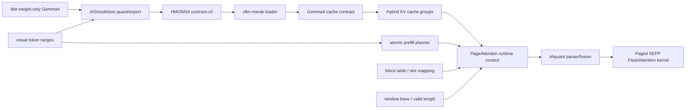

# Gemma4 Merak 端到端设计与开发指南

本文面向维护 `xh2modelzoo`、`xhquanttool` 和 `vllm-merak` 的开发人员，说明 Gemma4 26B-A4B、31B 从量化模型导出到 Merak PageAttention 推理的完整设计。

本文重点不是“复制一条命令启动服务”，而是回答以下问题：

- Gemma4 相对 Qwen3.5 为什么需要新的 Attention/KV Cache 契约；
- Sliding Window 的绝对坐标、物理 cache 和可见性如何计算；
- 280 个视觉 token 为什么不能跨 prefill chunk；
- 三个仓库分别负责什么，数据如何在三仓之间传递；
- 如何保证新增能力不改变 Qwen3.5 的既有行为；
- 出现越界、乱码或 cache 复用问题时应从哪里定位。

## 1. 目标与非目标

### 1.1 目标

当前实现支持：

- 从 Gemma4 4bit weight-only 权重导出 HMONNX；
- HMONNXInferenceV2 和共享 initializer/weight；
- Full Attention 与 Sliding Attention 混合层；
- Sliding KV Cache 的移动窗口和 compact metadata；
- SEFP FlashAttention 与 Paged SEFP FlashAttention；
- Gemma4 26B-A4B、31B 的视觉 token 双向可见；
- vLLM V1 Hybrid KV Cache、PageAttention、chunked prefill、回收和清零；
- Gemma4 contract-v2 MTP 的 target KV 只读 PageAttention 与逻辑长度回退；
- Qwen3.5 旧 ABI、full-attention 快速路径和调度策略兼容。

### 1.2 非目标

以下能力没有因为本次实现自动获得生产级保证：

- 256K 上下文硬件稳定性；
- `max_num_seqs > 1` 的性能和正确性；
- prefix cache 与 Sliding Cache 组合；
- HMONNX CUDA Graph replay 的完整验收；
- E2B/E4B 的完整端到端硬件验收。

## 2. 当前集成基线

三仓必须使用相互匹配的提交，不能只升级其中一个仓库。

| 仓库 | 集成分支 | Gemma4 提交 | 职责 |
| --- | --- | --- | --- |
| `xhquanttool` | `develop` | `acd4296d` / Gerrit `41223` | FlashAttention、Paged SEFP FlashAttention、parser/fusion、compact visibility 和 HMONNX V2 auto-offload。 |
| `xh2modelzoo` | `develop` | `14d5088f` / Gerrit `41365` | Gemma4 导出配置、contract-v2 metadata、输入处理、CUDA Graph 和 Qwen 共享 ABI 兼容。 |
| `vllm-merak` | `main` | `ef81d6aa` | loader、Hybrid KV Cache、PageAttention context、原子分块、最终容量规划和硬件验证。 |

相关回归结果：

| 仓库 | 结果 |
| --- | ---: |
| `xhquanttool` HMONNX V2 CUDA Graph 定向测试 | 35 passed |
| `xhquanttool` pre-push smoke | 36 passed |
| `xh2modelzoo` Gemma4、统一 Merak、Qwen shared-runtime | 96 passed |
| `vllm-merak` 全量测试 | 381 passed |

这些提交当前是开发集成基线。部署环境应记录实际使用的三仓 commit SHA，不要只记录分支名。

## 3. Gemma4 与 Qwen3.5 的关键差异

| 项目 | Qwen3.5 | Gemma4 26B-A4B/31B |
| --- | --- | --- |
| Linear Attention | 有 | 无 |
| Attention 结构 | Full/Linear 等既有路径 | 每 5 层 Sliding 后接 1 层 Full |
| Sliding Window | 不使用本次 compact sliding 契约 | 默认窗口 `W=1024` |
| Sliding KV 输入 | 既有 full/legacy 语义 | `slice_window`，cache 左端会移动 |
| 视觉 token | 使用既有 Qwen planner | 280 token，段内双向可见且不可跨 chunk |
| Compact metadata | 不需要 | `kv_window_start_abs`、`kv_valid_length`、`mm_prefix_ranges` |
| PageAttention | 保持旧 ABI | contract-v2 group context |

最大的设计差异是：Gemma4 Sliding Cache 的物理下标 `0` 不再恒等于绝对 token `0`。窗口移动后，kernel 必须知道物理 cache 最左端对应的绝对位置。

## 4. 端到端架构



运行时有两类坐标：

1. **绝对 token 坐标**：用于 causal/sliding/视觉可见性判断；
2. **物理 cache 坐标**：用于读取 HMONNX KV tensor 或 paged KV block。

`kv_window_start_abs` 是两类坐标之间的桥梁。

## 5. Sliding Window 数学契约

### 5.1 记号

| 符号 | 含义 |
| --- | --- |
| `W` | Sliding Window 大小，当前为 1024。 |
| `Q` | 导出的固定 prefill chunk capacity，当前为 320。 |
| `C` | 当前 chunk 的真实 query token 数，`0 <= C <= Q`。 |
| `P` | 当前 chunk 之前已经处理的 token 数，即 query 的绝对起点。 |
| `A` | Sliding KV Cache 的物理输入容量。 |
| `B` | 物理 cache 左端对应的绝对 token 位置。 |
| `L` | 当前物理 cache 中有效的 KV 数量。 |

### 5.2 物理容量

Gemma4 的 Sliding KV Cache 不能只分配 `W`，因为一次 prefill 会同时保留历史窗口并追加当前 chunk。

导出和运行时约定：

```text
A = align16(W + Q)
```

当前配置：

```text
W = 1024
Q = 320
A = align16(1024 + 320) = 1344
```

数学上最多需要保存 `W - 1` 个历史 token 和 `Q` 个当前 token，即 1343；16 对齐后仍为 1344。metadata 使用 `W + Q` 表达物理输入 contract，避免不同组件分别推导出不同长度。

### 5.3 窗口移动

当前 query 起点为 `P` 时，只保留最多 `W - 1` 个历史 token：

```text
R = min(P, W - 1)
B = P - R
  = max(0, P - W + 1)
L = min(A, R + C)
```

缓存移动后，物理下标 `0` 必须对应绝对位置 `B`。这就是“保证最左边是 start”的具体含义。

例子（`W=1024`、`Q=320`）：

| `P` | `B` | 保留历史 `R` | 满 chunk 后有效长度 `L` |
| ---: | ---: | ---: | ---: |
| 0 | 0 | 0 | 320 |
| 1023 | 0 | 1023 | 1343 |
| 1024 | 1 | 1023 | 1343 |
| 1344 | 321 | 1023 | 1343 |
| 4096 | 3073 | 1023 | 1343 |

物理容量是 1344，不代表每次都有 1344 个有效 KV；kernel 必须同时使用 `kv_valid_length=L` 屏蔽未写入区域。

### 5.4 绝对位置映射

对当前 chunk 内的 query 下标 `i` 和 cache 内的 key 下标 `j`：

```text
q_abs = P + i
k_abs = B + j
```

不得直接用局部下标 `i/j` 判断 causal 或 sliding，否则窗口第一次移动后就会错位。

### 5.5 可见性公式

设 `real_query(i)` 表示 `i < C`，`valid_key(j)` 表示 `j < L`。

基础 causal sliding 可见性为：

```text
causal_sliding(q, k) = (k_abs <= q_abs) and (q_abs - k_abs < W)
```

视觉段使用闭区间 `[s_r, e_r]`。query 和 key 位于同一视觉段时允许双向可见：

```text
same_visual(q, k) = exists r:
    s_r <= q_abs <= e_r and s_r <= k_abs <= e_r
```

Sliding Attention 最终公式：

```text
visible(i, j) =
    real_query(i)
    and valid_key(j)
    and (causal_sliding(q, k) or same_visual(q, k))
```

Full Attention 不使用 sliding 距离限制：

```text
visible_full(i, j) =
    real_query(i)
    and valid_key(j)
    and ((k_abs <= q_abs) or same_visual(q, k))
```

`mm_prefix_ranges` 的 `(0, 0)` 是空 range sentinel，不代表真实视觉 token。

## 6. 视觉 token 原子分块

Gemma4 26B-A4B、31B 单个视觉段最多包含 280 个 token，同一段内需要双向可见。如果在视觉段内部切分：

- 前半段执行时看不到后半段；
- 后续 PageAttention 无法重新计算已经完成的前半段 query；
- 仅靠 `mm_prefix_ranges` 不能修复跨 forward 的双向依赖。

因此 vLLM prefill planner 必须把整个视觉段放进同一个 forward。当前使用 `Q=320`，可以容纳 280 个视觉 token，并为相邻文本保留少量空间。

原子分块规则：

1. 普通文本可按 chunk 边界拆分；
2. chunk 边界命中视觉段内部时，移动边界而不是切开视觉段；
3. 单个视觉段长度超过 chunk capacity 时 fail closed；
4. 每个 chunk 的 range 数不能超过 `max_mm_ranges_per_chunk`；
5. range 坐标始终使用绝对 token 坐标和闭区间。

不能通过把前半段 range 留到下一 chunk、复制视觉 token 或扩大 mask 来规避原子性要求。

### 6.1 VIT 固定输入与 LLM 实际长度

这里必须区分 **VIT patch 数**、**VIT 固定输出容量** 和 **实际送入 LLM 的视觉 token 数**：

```text
actual_patches <= 280 * 9 = 2520
VIT input       = [1, 2520, 768]       # 尾部 padding
position ids    = [1, 2520, 2]
pooling matrix  = [1, 280, 2520]       # 每 3*3 patches 聚合 1 token
VIT output      = [1, 280, hidden]     # 固定最大容量
actual_tokens   = actual_patches / 9   # processor 给出的真实长度
LLM visual      = VIT output[:actual_tokens]
```

xh2modelzoo 的 processor 负责把真实 patch 补齐到 2520，同时生成
`pooling_matrix`、`visual_attention_mask` 和 `image_soft_token_count`。VIT 可以固定输出
280 个槽位，但 vllm-merak 在做 multimodal embedding replacement 前必须按
`image_soft_token_count` 裁掉 padding 输出。LLM 中的视觉占位符长度和双向可见 range
均使用这个实际长度，不能固定写成 280。

因此 vLLM 的静态 encoder token budget 是 **280 个 VIT 输出 token**，不是 2520 个
patch，也不能沿用 HF `default_output_length=2496`。2520 只属于 HMONNX VIT 输入
shape；把它当成 LLM token budget 会错误阻止 `max_num_batched_tokens=320` 的服务启动。

## 7. Contract-v2 数据模型

### 7.1 Artifact metadata

Gemma4 HMONNX artifact 至少需要以下字段：

| 字段 | 要求 |
| --- | --- |
| `attention_contract_version` | 必须精确等于 `2`。 |
| `uses_sliding_flash_attention_v2` | 存在 Sliding 层时为 `true`。 |
| `layer_types` | 每个 Transformer 层的 `sliding_attention/full_attention`。 |
| `layer_cache_types` | 每个物理 cache 的类型。 |
| `layer_cache_indices` | layer 到 cache index 的绑定。 |
| `layer_cache_owner_indices` | 共享 cache 的唯一 owner layer。 |
| `layer_kv_shapes` | 每个 cache 的物理 tensor shape。 |
| `sliding_window` | 当前为 1024。 |
| `prefill_chunk_length` | 当前为 320，且不得小于 280。 |
| `sliding_cache_storage_length` | 当前为 1344。 |
| `sliding_kv_cache_input_mode` | 必须为 `slice_window`。 |
| `bidirectional_vision_attention` | 26B-A4B/31B visual variant 必须为 `true`。 |
| `max_mm_ranges_per_chunk` | 正整数，当前验证基线为 1。 |

vllm-merak 会 fail closed：字段缺失、层数不一致、cache shape 不符合 `align16(W+Q)`、owner 绑定错误或 contract 版本不匹配时直接拒绝加载。

### 7.2 Raw HMONNX 外部输入

contract-v2 的文本输入前缀为：

```text
inputs_embeds
past_seq_length
current_input_length
[mm_prefix_ranges]        # visual variant
kv_window_start_abs
kv_valid_length
[per_layer_inputs]        # 部分 variant
```

随后才是 KV Cache 输入。`mm_prefix_ranges` 形状为 `[batch, max_ranges, 2]`、dtype 为 `int32`；绝对窗口起点和有效长度使用逐 batch 整数 tensor。

PageAttention fusion 后，KV tensor 和 compact metadata 不再作为普通 HMONNX 外部输入；vllm-merak 通过 `PageAttentionContext` 在运行时注入：

```text
paged_kv_cache
block_ids
slot_mapping
block_size
seq_lens
kv_window_start_abs
mm_prefix_ranges
```

`kv_window_start_abs` 只允许出现在 Sliding PageAttention。Full Attention group 必须保持 `None`；`mm_prefix_ranges` 可以独立存在。

## 8. xh2modelzoo 实现

xh2modelzoo 是 artifact contract 的生产者，不能把 contract 修复留给运行时猜测。

### 8.1 配置

26B-A4B、31B、E2B、E4B 的 Merak YAML 显式配置：

```yaml
attention_contract_version: 2
sliding_kv_cache_input_mode: slice_window
prefill_chunk_length: 320
```

visual variant 同时启用双向视觉 attention 和 range 数上限。MTP 必须使用独立的
`*_full_mtp_page_attention.yaml`，并固定导出
`gemma4_mtp_readonly_page_attention_v2`；不再暴露
`readonly_attention_lowering` 配置开关。旧非 PageAttention 配置保持原有
mask/softmax 导出，不由运行时猜测或改写语义。

readonly v2 将 target 已提交 KV 长度记为 `N`。每次 proposal 都使用
`past_seq_length=N-1`、`current_input_length=1`；attention 的 causal mask
位置为 `N-1`，assistant RoPE 位置仍为 `N`。Full 层读取 `[0,N)`，Sliding 层
读取 `[max(0,N-W),N)`。Sliding PageAttention 图额外接收：

```text
kv_window_start_abs = max(0, N - W)
kv_valid_length     = N - kv_window_start_abs
```

这两个标量在同一轮的所有 proposal 中复用；图内不生成 exact-range，也不需要
`Clip`。accept/reject 只更新逻辑 `N`，拒绝尾部留在物理 page 中但不会再次可见。

### 8.2 导出

主要实现位置：

- `examples_merak/llm/gemma4_series/gemma4_series_quant_export.py`
- `xhmodel_merak/xh_llm/models/gemma4_series/gemma4_series_llm_model.py`
- `xhmodel_merak/xh_llm/models/gemma4_series/_llm_model_impl.py`
- `xhmodel_merak/xh_llm/models/gemma4_series/data_preprocess.py`
- `xhmodel_merak/xh_llm/models/gemma4_series/llm_text.py`

导出流程负责：

1. 从 4bit weight-only 模型加载权重；
2. 生成 prefill/decode/visual HMONNX；
3. 使用 HMONNX V2 共享 initializer/weight；
4. 为 Sliding FlashAttention 追加 compact inputs；
5. 写入 layer/cache ownership 和 shape metadata；
6. 导出完成后重新读取 ONNX 图并验证输入顺序、节点属性和 metadata 一致性。

导出目录名称中出现 `w8a8` 不足以判断源权重精度；权重来源、quant adapter 和 initializer dtype 才是判断 4bit weight-only 的依据。

### 8.3 Raw HMONNX 输入处理

`Gemma4DataPreprocess._build_compact_attention_metadata` 计算：

```text
B = max(0, P - W + 1)
L = min(align16(W + Q - 1), min(P, W - 1) + C)
```

这里 `align16(W+Q-1)` 与物理 artifact contract 的 `align16(W+Q)` 在当前 `W=1024/Q=320` 下都等于 1344。运行时仍以 artifact 声明的物理 shape 为准。

## 9. xhquanttool 实现

xhquanttool 是可见性和 kernel 行为的最终执行者。

### 9.1 Continuous FlashAttention

主要修改：

- `flash_attention/sliding_contract.py`：CPU dense oracle 和 metadata 校验；
- FP Torch/Triton：绝对 query/key 坐标和视觉 overlay；
- XH2 Torch/Triton：SEFP compact coordinates；
- head size 512 支持；
- bounded V-tile packing，替代 dense `torch.where` 临时张量。

`query_start_abs` 和 `kv_window_start_abs` 必须成对出现。未传时保持旧逻辑：

```text
query_start_abs = seq_len - query_len
kv_window_start_abs = 0
```

因此 Qwen3.5 full-attention 路径不需要构造 Gemma4 metadata。

### 9.2 PageAttention fusion

FlashAttention 可选输入按以下顺序追加，不插入或重排旧输入：

```text
... existing inputs
mm_prefix_range
kv_window_start_abs
kv_valid_length
```

fusion 要求：

- `kv_window_start_abs` 与 `kv_valid_length` 同时存在或同时缺失；
- Sliding + multimodal range 必须有绝对窗口起点；
- Full Attention 不得携带 sliding window 起点；
- legacy 6-input 和带 sinks 的 7-input 节点继续可解析。

### 9.3 Paged SEFP FlashAttention

Paged kernel 通过 `block_ids` 找到物理 page，通过 `kv_window_start_abs` 恢复绝对 key 坐标。kernel 只遍历 causal/sliding/visual range 可能命中的 tile，而不是为整个 1344 cache 构造 dense mask。

必须区分：

- `seq_lens`：请求的绝对序列长度；
- `query_lengths`：本次 forward 的真实 query 长度；
- `block_ids`：物理 page 映射；
- `kv_window_start_abs`：Sliding cache 的绝对左边界。

### 9.4 函数签名中的 `*`

FP Torch 和 XH2 Triton helper 新增的裸 `*` 不是一个 tensor 输入。它只表示后续参数必须按关键字传递：

```python
def fn(old_a, old_b, *, kv_window_start_abs=None): ...
```

这样新增可选参数不会改变旧位置参数 ABI，也能避免调用者把绝对坐标误传到其他 slot。它不进入 ONNX graph，也不增加 kernel 实参。

## 10. vllm-merak 实现

### 10.1 Loader 和 cache contract

主要文件：

- `vllm_merak/model_executor/model_loader/gemma4.py`
- `vllm_merak/model_executor/model_loader/gemma4_cache_contract.py`
- `vllm_merak/model_executor/model_loader/merak_for_causal_lm.py`
- `vllm_merak/kv_capacity.py`
- `vllm_merak/hmfp_kv_cache.py`

loader 根据精确 architecture 和 `attention_contract_version=2` 激活 Gemma4 路径，解析每层 attention kind、cache index、owner 和 shape。Qwen3.5 不满足此门控，不会进入 Gemma4 contract parser。

### 10.2 Hybrid KV Cache group

Sliding 和 Full layer 使用不同 cache spec/group。每个 binding 同时记录：

- scheduler block size；
- HMONNX physical block size，当前为 64 token；
- 一个 scheduler block 对应的 physical page 数；
- cache owner layer；
- layer 到 cache index 的绑定。

vLLM 的 `MultiGroupBlockTable` 已把 scheduler block 投影为 physical 64-token page。runner 不得再次展开，否则 block id 会被放大两次并越界。

这里还必须区分“virtual allocator 打包”和“模型物理 cache ownership”：

- `KVCacheTensor.shared_by` 只表示 vLLM 为了统一 page size，把哪些 layer 放进同一个 virtual slot；
- 它不能推导 HMONNX 是否共用一份物理 KV。Qwen3.5 会把一个 FullAttention layer 和三个 Mamba layer 打进同一个 virtual tensor，但物理上仍是一个 HMFP cache 加三份独立 Linear state；
- 未提供物理 owner contract 时，Merak 按解析后的模型 layer spec 一层一份投影；
- Gemma4 只有在 `attention_contract_version=2` 明确提供 `cache_owner_layer_idx` 时，才按 owner 去重物理 backing。

因此 capacity projection 可以用 virtual tensors 校验 layer 覆盖和重复打包，但禁止把 `shared_by` 当成物理 alias。这个边界同时保护 Gemma4 的显式共享和 Qwen3.5 的混合 Full/Mamba 拓扑。

物理容量还必须按 attention kind 区分：

```text
Full layer physical pages    = scheduler_blocks * pages_per_scheduler_block
Sliding layer physical pages = (sliding_window + prefill_chunk_size) / 64
                             = 1344 / 64
                             = 21
```

Gemma4 每 6 层只有 1 层 Full Attention。256K 时只有这些 Full 层随全局 block pool
扩展，其余 5/6 Sliding 层始终使用导出的 21 个移动窗口物理页。禁止把所有层都按
256K 的 `num_blocks` 分配；那会把 31B 的 KV backing 错误放大到数倍并造成 OOM。

global block 规划必须基于 vLLM 完成 `unify_kv_cache_spec_page_size()` 和 cache
grouping 后的最终 geometry，再转换成传给 vLLM 的 virtual byte budget。禁止先按原始
64-token specs 计算 block 数、转成 bytes，再让最终 geometry 反算 block 数；Full
Attention page 对齐可能改变 scheduler block size，使目标 block 数在 bytes 交接时丢失。
256K、`max_num_seqs=1` 的当前最终结果为 `required=2293`、5% headroom 后
`recommended=2408`，而不是近似双并发的 4559。

HMONNXInferenceV2 的 prefill/decode initializer 共享与上述 KV backing 独立。单卡能
容纳模型时应使用 `--use-v2 --cuda-graph`，不额外启用 `--auto-offload`。Gemma4 在
text、visual prefill 和 decode 全程使用 CUDA Graph，不能按 range 或序列长度回退
eager。`mm_prefix_ranges` 始终以固定 `[batch,max_ranges,2]` 形状绑定；没有视觉段时
填 `(0,0)` sentinel。这样 graph 的 `USE_MM_PREFIX` 结构保持不变，视觉双向可见性
只更新稳定地址中的 range 值。固定 2520-token 输入的 VIT/Video-VIT 同样继承
`--cuda-graph`。多阶段 auto-offload interpreter 不能用来掩盖错误的 KV 容量或
graph 生命周期规划。

启动命令仍带 `--enforce-eager`，它关闭的是 vLLM 的 Torch/Inductor graph capture，
不是 HMONNX V2 的 graph。Merak 的模型算子由 `--cuda-graph` 控制，启动日志必须对
prefill、decode、visual 和 video_visual 分别出现
`using CudaGraphGraphModuleInterpreter in HMONNXInferenceV2`。不能用 vLLM 的
`Enforce eager set` 警告推断 HMONNX 已回退，也不能仅凭请求成功推断 HMONNX 在 replay；
两层执行机制必须分别验收。

### 10.3 PageAttention context

每个 cache group 单独构造 context：

```text
seq_lens = past_lens + query_lengths
B = max(0, past_lens - W + 1)    # 仅 Sliding group
```

Full group 的 `kv_window_start_abs` 必须为 `None`。视觉 range 先按当前 query 区间过滤，再传入命中的 group context。

短 final chunk 可以为 HMONNX 固定 shape 补不可达 metadata，并把 padded slot 设为 `-1`；真实 token 所需的 block table 不足时必须报错，禁止复制最后一个 block id 伪造容量。

PageAttention metadata buffer 是 prefill/decode 两个 HMONNX interpreter 的共享外部
输入。block-table power-of-two bucket 扩容时，必须同时失效全部 prefill graph 和
decode graph。只清当前 phase 会让先前短请求捕获的 decode graph 在后续长请求中
replay 已释放的旧 buffer 地址，典型表现是长请求第 2 个 decode token 报
`cudaErrorIllegalAddress`。扩容后允许重新 capture，但不允许切 eager。

### 10.4 Cache 生命周期

PageAttention 正确性不仅取决于 kernel，还取决于 page 生命周期：

1. scheduler 分配 virtual block；
2. Merak 投影到 physical HMFP page；
3. slot mapping 写入新 KV；
4. request 完成后释放 ownership；
5. page 复用前清零；
6. 同一个共享 owner 只清零一次；
7. 不同 group 中数值相同的 block id 不能视为同一 page。

`vllm_merak/gemma4_trace.py` 和 `tools/gemma4_merak_hardware_validation.py` 用于记录 ownership、release、zero-complete 和 recycled-page proof。

## 11. 端到端数据流

### 11.1 Prefill

1. processor 生成文本 token、视觉 embedding 和视觉绝对范围；
2. atomic planner 生成不切分视觉段的 chunk；
3. scheduler 为 Sliding/Full group 分别提供 block table；
4. runner 计算 `past_lens/query_lengths/seq_lens`；
5. Sliding group 计算 `B=max(0,P-W+1)`；
6. runner 注入 group-specific `PageAttentionContext`；
7. xhquant parser 将 context 传给 paged SEFP kernel；
8. kernel 用绝对坐标计算可见性并写回 KV page。

### 11.2 Decode

Decode 的 `C=1`，窗口起点仍按同一公式移动。物理 backing 保留导出的 1344 capacity，但有效读取范围由 `seq_lens`、窗口起点和 block table 决定。

不要为 decode 另写一套“近似”等价的窗口公式；prefill/decode 必须共享同一绝对坐标定义。

### 11.3 Raw HMONNX 与 PageAttention 对照

Raw HMONNX 使用连续 Sliding cache 和 `kv_valid_length`；PageAttention 使用 paged cache、`block_ids` 和 `seq_lens`。两条路径的物理存储不同，但必须满足第 5.5 节相同的可见性公式。

## 12. 已解决的主要问题

| 问题 | 根因 | 解决方式 |
| --- | --- | --- |
| Sliding cache 在 1024 后错位 | 把物理下标当作绝对位置 | 传入 `kv_window_start_abs`，统一 `k_abs=B+j`。 |
| cache 只分配 1024 无法完成 prefill | 忽略当前 320-token chunk | 物理容量改为 `align16(W+Q)=1344`。 |
| visual token 结果不正确 | 280-token 双向段被跨 forward 切分 | 使用 320 chunk 和 atomic visual planner。 |
| 4096 附近非法访问 | virtual scheduler block 与 64-token physical page 混用或重复投影 | binding 显式保存两套几何，禁止 alias padding。 |
| Qwen3.5 EngineCore 初始化失败 | 把 heterogeneous `KVCacheTensor.shared_by` 误当成物理 cache 共享并要求 spec 相同 | virtual tensor 只校验 scheduler 覆盖；物理 ownership 只来自模型 layer spec 或显式 Gemma4 contract。 |
| PageAttention fusion 丢失窗口坐标 | 旧 context 没有 compact metadata | 扩展 parser/context，并要求 base/valid 成对。 |
| Qwen3.5 回归风险 | 修改共享 FlashAttention/PageAttention 实现 | 新参数尾部追加、默认 `None`、按 contract/architecture 门控。 |
| 边界 prompt 输出“額” | 重复 token 合成输入本身退化 | 用 raw HMONNX 和 PageAttention A/B 区分模型行为与 cache 错误。 |
| kernel 临时显存过大 | dense V-tile mask/packing | 改为 bounded chunk packing，并与旧 dense reference 对比。 |

## 13. Qwen3.5 兼容性边界

Qwen3.5 会经过部分共享代码，但不会启用 Gemma4 语义：

- 不解析 Gemma4 cache contract；
- 不传 `kv_window_start_abs/kv_valid_length`；
- `sliding_window is None`，继续使用 full-visible/3D 快速路径；
- legacy positional input prefix 不变；
- 旧 6-input、7-input-with-sinks PageAttention node 保持兼容；
- Qwen 图片 planner 不使用 Gemma4 atomic chunk planner；
- scheduler/platform policy 不因 Gemma4 architecture 改变。
- heterogeneous `KVCacheTensor.shared_by` 只参与 virtual scheduler 校验，不改变 Full/Mamba 的原生物理 cache ownership。

共享的 bounded V-tile packing 会影响 Qwen3.5 的实现路径和临时内存，但已与旧 dense reference 做数值回归；这是性能/内存实现变化，不是 attention 语义变化。

## 14. 开发验证

以下命令假设三个正式 checkout 位于同一个工作目录：

```bash
export VLLM_ROOT=<workspace>/xh2modelzoo/vllm_merak
export XH2_ROOT=<workspace>/xh2modelzoo
export XHQ_ROOT=<workspace>/xhquanttool
```

### 14.1 xhquanttool

```bash
cd "$XHQ_ROOT"
CUDA_VISIBLE_DEVICES=0 conda run -n xhquant_55 \
  python -m pytest -q \
  tests/testing/xh2a/ops/test_flash_attention_qmodel.py \
  tests/testing/xh2a/ops/test_flash_attention_sliding_contract.py \
  tests/testing/xh2a/ops/test_paged_kv_cache_write.py \
  tests/testing/xh2a/ops/test_paged_sefp_flash_attention_sliding.py \
  tests/testing/xhonnxruntime/test_flash_page_attention_v2_contract.py
```

### 14.2 xh2modelzoo

```bash
cd "$XH2_ROOT"
CUDA_VISIBLE_DEVICES=0 conda run -n xhquant_55 \
  env PYTHONPATH="$XH2_ROOT:$XHQ_ROOT" \
  python -m pytest -q \
  tests/gemma4/test_flash_attention_export_contract.py \
  tests/gemma4_merak_unified_public_test.py \
  tests/gemma4/test_compressed_tensors_import_compat.py \
  tests/gemma4/test_runtime_page_attention_integration.py
```

### 14.3 vllm-merak

```bash
cd "$VLLM_ROOT"
CUDA_VISIBLE_DEVICES=0 conda run -n vllm \
  env VLLM_PLUGINS=merak \
  PYTHONPATH="$VLLM_ROOT:$XH2_ROOT:$XHQ_ROOT" \
  python -m pytest -q
```

### 14.4 硬件边界

至少覆盖：

```text
P = 0
P = W - 1
P = W
P = W + 1
P = W + Q
P = 4096
```

并检查：

- raw HMONNX 与 PageAttention 的 token A/B；
- `B=max(0,P-W+1)`；
- Sliding/Full group 的 block table 不串用；
- visual range 未被切分；
- release/reallocate 后 page 已清零；
- manifest 中图指纹与实际 HMONNX 一致。

硬件工具：

```bash
CUDA_VISIBLE_DEVICES=0 python tools/gemma4_merak_hardware_validation.py \
  --model-dir <MODEL_DIR> \
  --mode hmonnx-cuda-graph \
  --boundaries \
  --window 1024 \
  --three-requests \
  --max-tokens 8 \
  --max-model-len 8192 \
  --trace-dir <RUN_DIR>/traces \
  --output <RUN_DIR>/manifest.jsonl
```

不能只看“请求返回了 token”。验收 manifest 还需要包含 ownership、release、zero-complete 和 recycled-block 证据。

### 14.5 当前单卡硬件证据（2026-07-16）

下列结果用于证明当前实现链路，不等价于完整 256K token 压测：

| 模型 | 服务配置 | 请求顺序 | 结果 |
| --- | --- | --- | --- |
| Gemma4 26B | `max_model_len=262144`, V2, HMONNX CUDA Graph | 21-token text → 283-token image → 9621-token text → short replay | 全部 HTTP 200；图像语义正确；扩容后 decode 正常；short replay 0.72s |
| Gemma4 31B | `max_model_len=262144`, V2, HMONNX CUDA Graph | 21-token text → 283-token image → 9621-token text → short replay | 全部 HTTP 200；图像语义正确；扩容后 decode 正常；short replay 2.98s |

两种模型的 prefill、decode、visual、video_visual 均加载
`CudaGraphGraphModuleInterpreter`。26B 的 V2 initializer 统计为
`unique=26,827,651,388 bytes`、`shared_saved=26,827,651,204 bytes`；31B 为
`unique=32,463,200,036 bytes`、`shared_saved=32,463,199,852 bytes`。修正容量交接后，
两个模型均使用 `global_blocks=2408 (required=2293, recommended=2408)`；26B 的物理
HMFP cache 为 `3.115559 GiB`，31B 为 `12.462234 GiB`。这说明 256K 配置只让 1/6
Full Attention 层随全局容量增长，5/6 Sliding 层仍固定为 21 pages。

长请求会让 PageAttention metadata bucket 扩容并重新 capture；这属于稳定地址变化
后的必要生命周期动作，不是 eager fallback。验收要求每次 capture 后出现 replay，且
请求结束后再发短请求不重复缩容或触发非法地址。

### 14.6 服务启动、Thinking 与原生工具调用

Gemma4 的 Thinking 和原生 Function Calling 共用官方 tool chat template，并分别由
vLLM 的 Gemma4 reasoning parser 和 tool parser 解析。部署前先确认当前 vLLM 构建已注册
这些参数：

```bash
python -c 'import vllm; print(vllm.__version__)'

vllm serve --help=all 2>&1 | \
  grep -E 'gemma4|enable-auto-tool-choice|tool-call-parser|reasoning-parser'
```

当前验收环境使用 vLLM `0.24.0`，`gemma4` 已出现在 `--tool-call-parser` 合法值中。
如果 `gemma4` 不是合法 parser，不能通过删除 parser 参数绕过，应升级到包含 Gemma4
支持的 vLLM 构建。

下载 vLLM 官方模板：

```bash
curl -fL \
  https://raw.githubusercontent.com/vllm-project/vllm/main/examples/tool_chat_template_gemma4.jinja \
  -o /data01/home/yujy/work/gemma4-e2e-validation-20260715/tool_chat_template_gemma4.jinja
```

2026-07-16 验收版本的 SHA256 为：

```text
afdbb2abe3667ccde95cc2f86919f05370339399bab5f750950a4390523b8927
```

生产部署应保留经过验收的模板副本或校验 hash，避免直接使用随 upstream `main` 变化的
未固定内容。

四个原生能力参数必须成组配置：

```bash
--enable-auto-tool-choice \
--tool-call-parser gemma4 \
--reasoning-parser gemma4 \
--chat-template /data01/home/yujy/work/gemma4-e2e-validation-20260715/tool_chat_template_gemma4.jinja
```

其中：

- `--enable-auto-tool-choice` 允许模型根据请求自动决定是否调用工具；
- `--tool-call-parser gemma4` 把 Gemma4 tool channel 转换为 OpenAI
  `message.tool_calls`；
- `--reasoning-parser gemma4` 把 Gemma4 thought channel 转换为
  `message.reasoning`；
- `--chat-template` 必须指向绝对路径，保证 API server 和子进程读取同一个模板。

Thinking 的具体行为如下：

- `enable_thinking=true` 让模板在首个 system turn 注入 `<|think|>`，并让生成从
  `thought` channel 开始；
- `--reasoning-parser gemma4` 负责把 `<|channel>thought ... <channel|>` 从普通回答中
  分离到 OpenAI 响应的 `message.reasoning`；
- 只传 `enable_thinking=true` 而未启动 parser 时，模型虽然会思考，但思考文本会进入
  `message.content`，且 `message.reasoning` 为 `null`，这不属于正确部署。

推荐服务端默认关闭 Thinking，由请求显式开启。这样普通请求不额外消耗 reasoning
token，同时同一个服务支持 think/non-think A/B：

```bash
# 26B: GPU 5, port 18526
CUDA_VISIBLE_DEVICES=5 VLLM_PLUGINS=merak \
python examples/vllm_chat_server.py \
  --model /data01/home/yujy/work/gemma4-e2e-validation-20260715/models/26b_fresh \
  --host 0.0.0.0 --port 18526 \
  --served-model-name gemma4_26b_a4b_w8a8 \
  --trust-remote-code --config-format merak_llm --load-format merak_llm \
  --enforce-eager --max-model-len 262144 --max-num-seqs 1 \
  --use-v2 --cuda-graph --generation-config vllm \
  --enable-auto-tool-choice \
  --tool-call-parser gemma4 \
  --reasoning-parser gemma4 \
  --chat-template /data01/home/yujy/work/gemma4-e2e-validation-20260715/tool_chat_template_gemma4.jinja \
  --default-chat-template-kwargs '{"enable_thinking": false}'

# 31B: GPU 1, port 18531
CUDA_VISIBLE_DEVICES=1 VLLM_PLUGINS=merak \
python examples/vllm_chat_server.py \
  --model /data01/home/yujy/work/gemma4-e2e-validation-20260715/models/31b_fresh \
  --host 0.0.0.0 --port 18531 \
  --served-model-name gemma4_31b_w8a8 \
  --trust-remote-code --config-format merak_llm --load-format merak_llm \
  --enforce-eager --max-model-len 262144 --max-num-seqs 1 \
  --use-v2 --cuda-graph --generation-config vllm \
  --enable-auto-tool-choice \
  --tool-call-parser gemma4 \
  --reasoning-parser gemma4 \
  --chat-template /data01/home/yujy/work/gemma4-e2e-validation-20260715/tool_chat_template_gemma4.jinja \
  --default-chat-template-kwargs '{"enable_thinking": false}'
```

请求级开启可以直接使用 vLLM/OpenAI 兼容参数 `reasoning_effort`。Gemma4 当前只区分
开/关：`low|medium|high` 都开启 Thinking，`none` 关闭 Thinking：

```json
{
  "model": "gemma4_31b_w8a8",
  "messages": [{"role": "user", "content": "计算 17*23，并说明过程"}],
  "reasoning_effort": "high",
  "max_tokens": 512
}
```

也可以直接传 chat template 参数；这种写法优先级高于 `reasoning_effort`：

```json
{
  "model": "gemma4_31b_w8a8",
  "messages": [{"role": "user", "content": "计算 17*23，并说明过程"}],
  "chat_template_kwargs": {"enable_thinking": true},
  "max_tokens": 512
}
```

支持 `reasoning_effort` 的 OpenAI Python client 可以直接传递：

```python
response = client.chat.completions.create(
    model="gemma4_31b_w8a8",
    messages=[{"role": "user", "content": "计算 17*23，并说明过程"}],
    reasoning_effort="high",
    max_tokens=512,
)
```

如果客户端版本还没有 `reasoning_effort` 字段，可以继续通过
`extra_body={"chat_template_kwargs": {"enable_thinking": True}}` 传入。Thinking 消耗
输出 token，硬件验收不得只给几十个 `max_tokens`，否则可能只看到 reasoning 而没有
最终 content。

原生 Function Calling 验收请求：

```bash
export no_proxy=10.30.0.23
export NO_PROXY=10.30.0.23

curl --noproxy '*' http://10.30.0.23:18526/v1/chat/completions \
  -H 'Content-Type: application/json' \
  -d '{
    "model": "gemma4_26b_a4b_w8a8",
    "messages": [
      {"role": "user", "content": "What is the weather in Hangzhou? Use the tool."}
    ],
    "tools": [{
      "type": "function",
      "function": {
        "name": "get_weather",
        "description": "Get current weather",
        "parameters": {
          "type": "object",
          "properties": {"city": {"type": "string"}},
          "required": ["city"]
        }
      }
    }],
    "temperature": 0
  }'
```

31B 使用相同请求，只需把端口改为 `18531`，模型名改为
`gemma4_31b_w8a8`。正确响应必须满足：

```text
HTTP 200
choices[0].message.tool_calls[0].function.name == "get_weather"
choices[0].message.tool_calls[0].function.arguments 包含 "city": "Hangzhou"
choices[0].finish_reason == "tool_calls"
```

如果请求返回 HTTP 400，优先检查启动日志的 `non-default args` 是否同时包含
`enable_auto_tool_choice=True`、`tool_call_parser='gemma4'` 和绝对 chat template 路径，
不要先修改模型、KV Cache 或 PageAttention。

2026-07-16 实机验证中，26B/31B 均返回 HTTP 200 和正确的 `get_weather` tool call；
两个服务各观察到 2 次 HMONNX CUDA Graph capture 和 2 次 replay，工具调用配置未让
推理回退到 raw/eager HMONNX。

EvalScope BFCL-v4 必须按原生 Function Calling 口径配置：

```json
{
  "is_fc_model": true
}
```

验收条件：

```text
think 请求:     message.reasoning 非空，message.content 为最终答案
non-think 请求: message.reasoning 为空，message.content 不包含 "thought" channel
tool 请求:      message.tool_calls 非空，finish_reason 为 "tool_calls"
```

## 15. Code Review Checklist

### 15.1 xh2modelzoo

- [ ] 4bit weight-only 来源明确，未被目录名误导；
- [ ] contract-v2 input 顺序与 ONNX graph 一致；
- [ ] Sliding layer 的 cache shape 为 1344；
- [ ] Full layer 未收到 Sliding compact coordinates；
- [ ] 26B/31B visual variant 导出双向 range；
- [ ] 导出后 graph validator 实际执行。

### 15.2 xhquanttool

- [ ] `query_start_abs/kv_window_start_abs` 成对；
- [ ] `kv_window_start_abs/kv_valid_length` 成对；
- [ ] 可见性使用绝对位置而不是局部位置；
- [ ] valid-key mask 在 visual overlay 后仍生效；
- [ ] Full Attention 不误用 Sliding base；
- [ ] legacy positional ABI 和 Qwen 快速路径测试通过。

### 15.3 vllm-merak

- [ ] contract parser 对错误 metadata fail closed；
- [ ] scheduler/physical page 几何只投影一次；
- [ ] group context 与 cache index 一一对应；
- [ ] 真实 block table 不足时不做 alias padding；
- [ ] visual segment 不跨 chunk；
- [ ] prefill/decode/visual/video_visual 全部使用 HMONNX CUDA Graph；
- [ ] shared metadata 扩容同时失效所有 prefill/decode graph；
- [ ] page release、ownership 和 zeroing 有 trace 证据；
- [ ] Qwen3.5 isolation tests 通过。

## 16. 调试顺序

遇到问题时按以下层次定位，避免直接修改 kernel 掩盖上游 contract 错误：

1. **Artifact**：检查三仓 SHA、metadata、HMONNX input names 和图指纹；
2. **Planner**：检查 chunk 边界、视觉绝对 range、`P/C`；
3. **Cache contract**：检查 layer kind、cache index、owner、shape；
4. **Page table**：检查 group-specific block ids、slot mapping 和 page ratio；
5. **Compact metadata**：检查 `B/L/seq_lens`；
6. **Kernel**：对照 CPU dense oracle 检查可见性；
7. **Lifecycle**：检查 release、清零和复用；
8. **模型质量**：最后再判断 tokenizer、chat template 或权重质量。

常见断言：

```text
0 <= C <= Q
0 <= B <= P
0 <= L <= A
B = max(0, P - W + 1)
q_abs = P + i
k_abs = B + j
```

任何组件如果无法给出这些值，就不应继续进入 kernel。

## 17. 后续工作

按优先级建议继续：

1. 在正式三仓 CI 中固化当前测试矩阵；
2. 增加真实 Qwen3.5 HMONNX 硬件 A/B 门禁；
3. 完成 `max_num_seqs > 1` 的多请求并发测试；
4. 验证 prefix cache 与 page lifecycle；
5. 分阶段完成 16K、32K、64K 和完整 256K token 的持续压测；
6. 将跨 phase graph 失效和 text/visual 固定 ABI 纳入真机 CI；
7. 为 E2B/E4B 补齐与 26B/31B 同等级硬件证据；
8. 为各尺寸 Gemma4 MTP 补齐真机 acceptance、拒绝回退、视觉和长上下文性能门禁。

在这些工作完成前，不应把“导出配置支持 256K”描述为“256K 服务已完成生产验证”。
