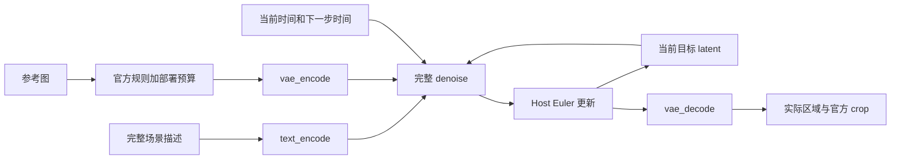

# 模型与图表达

FLUX 3 Klein 的图像 transformer 由三种 mode 的各五层独立分支和二十八层联合分支组成。
文本取 Qwen3-VL `hidden_states[4,8,12,16,20,24,28,32]`，沿特征轴拼接。
图像 VAE 的 32 通道、8× 下采样 mean 经 2×2 patchify 后成为 128 通道、16× 空间 token。

## 文本图

输入为 embeddings、位置、每 query 可见的 KV 范围、query/key mask 和有效长度。
真实 token 作为有效 key；官方补齐到 80 倍数的位置仍作为有效 query，并保留其 hidden state。
只有物理容量额外增加的尾部才全程清零。选择非 causal FlashAttention 加显式连续可见范围，
同时表达真实 token 的因果关系和 padding query 对有效前缀的可见性。
八层中的最大索引为 32，后续未使用的 decoder 层和最终 norm 不进入图。

## DiT 图

Host 准备 target/reference/text 三段固定容量输入。原始顺序为目标、所有参考图、文本。
各分支先独立前向，之后根据 Host 提供的固定长度 permutation Gather 为连续有效前缀，
无效尾部通过长度排除。参考图在同一 image_cond mode 中相互可见；参考编号由第四个坐标轴区分。
四轴 RoPE 的 image H/W 坐标乘 0.5；相邻对旋转显式转换为 SDK 半通道布局。

默认最多八张参考图，每张预处理面积上限 1024²。单参考容量保持 4352，总参考容量为
8704，目标容量 4352、文本容量 1280，联合物理长度 14336。两张各 1 MP 保持原有输入；
更多参考若总量超限，Host 先保留小图预算，再把剩余预算均分给大图，按原宽高比缩小并
中心裁剪到 16 网格，从原图只缩放一次。输入总量已满足预算时不额外缩小。各参考执行同一
VAE encoder，按附件顺序拼接 latent，参考编号轴为 -1、-2、…；原生单图反射填充规则不变。
增加参考总容量只改变 DiT 的物理形状，文本图和两张 VAE 图可直接复用。

当前目标时间进入 time MLP，条件时间为零；下一步时间进入 ref_time MLP，并加到每个 mode。
早期条件分支因此也随步变化。联合层为双向 attention，条件受当前目标影响，不冻结条件 KV。
图只输出目标预测。时间 MLP、shift/scale/gate、LayerNorm、Q/K RMSNorm 和学习投影均在图内。
Host 管理包内 token embedding 查表、随机数、FP32 latent、采样时间表和输出裁剪；
Transformer/VAE 的线性、卷积、归一化和注意力前向均由部署图执行。

原生 BF16 文本投影出现超过 115000 的值，后续 residual 达到数百万，直接导出 FP16 会饱和。
部署统一储存 `x' = x / 1024`，输入投影及每层 residual 输出投影的权重、偏置除以 1024，
LayerNorm 的 epsilon 同时除以 `1024**2`。于是 `LN(x/s, eps/s²) = LN(x, eps)`，联合层共享同一表示，
最终归一化后恢复原始预测尺度。该变换保留模型数学，不裁剪原生大值，也不在 Host 补算学习层。

## VAE 图

边界为四维 NCHW，latent 画布通道 128。Host 提供 1/2/4/8/16 尺度矩形 mask、
画布与有效区域的面积比、attention Gather/restore 索引和有效长度。
GroupNorm 每组的均值、方差仅统计有效通道/空间区域，避免补零改变统计分母。
残差、卷积、上下采样在相应尺度应用 mask；stride-2 下采样保留右/下零填充。
attention 在 8× 下采样空间收集有效位置，单头完整通道做 FlashAttention，再恢复二维位置。
512 维单头的 Q/K/V 补零到 768 维，使用 SDK 已有的 bounded-memory 大 head 路径；scale
仍为 `512**-0.5`，输出裁回 512 维，从而保持完整点积与单头概率，避免 GPU 共享内存超限。
图内完成 BN 运行统计的正/逆变换以及 patchify/unpatchify。官方参考图 reflect padding 是有效内容。

## 验证层次

CPU 小真实模型对齐原生文本、完整 DiT 和 VAE；SDK 测试导出并执行 HMONNX，检查空参考分支、
多参考顺序、非方形尺寸、脏 padding、包搬移与删源后的运行、重复请求及三档精度。
完整权重对照单独记录各组件和每步误差。发布配置、metadata 和真实图输入 shape 交叉核验，
公共 Manifest 校验文件及 ONNX external data；不能通过修改 metadata 切换精度或容量。
# 可选官方扩写器

`sources.prompt_upsampler` 将原始官方 Qwen3.5-9B 扩写器交给现有 `Qwen35Workflow`
导出；`sources.upsampler_bundle` 复用独立组件；两者互斥。`sources.image_bundle`
复用精度、文本和 VAE 档位一致的核心包，只复制运行依赖闭包，不复制旧 Golden 或缓存。
仅参考总容量变化时，使用复用图生成连通校准输入并从原始 checkpoint 重新导出 DiT；
同时校验复用包的源配置与 checkpoint 一致。其他不兼容的容量或精度变化明确拒绝。
省略两个扩写器来源时保持四图。来源绑定、指纹、原子发布和最终 Manifest 继续由统一
构建事务维护。组件清单由 `upsampler_component.json` 描述，根清单登记全部语言、视觉及核心图。
默认三个视觉档位 256/512/1024，因此扩写组件为五图，组合共九图。

扩写器按实际运行阶段平铺。Prefill `[1,P,4096]`，Decode `[1,1,4096]`，
Visual `[1,4*M,1536]` patches，M 是单张图片选择的合并视觉 token 档位。
P 和上下文 C 从实际 Qwen3.5 导出 metadata 读取，默认分别为 256 和 8192。
语言图各有 16 个 `[1,4,C,256]` 全注意力 K/V cache 端口；24 层线性注意力使用卷积和递归状态，
Prefill 为 `GDRChunkScan`，Decode 为 `GDRRecurrentScan`。沿用家族原有状态生产、
回填和每请求重置机制。导出与加载核对真实端口、算子数量、W8A16H1 SEFP 和 group 64。

推理显式传 `prompt_upsampling=True` 才加载额外模型。扩写器使用自己的 processor、
系统提示词和逐 token 生成；输出 caption 经 FLUX 自己的 processor 重新分词，继续
执行既有八层特征文本图。新的 processor 附加字段 `mm_token_type_ids` 在边界去除，
因为现有部署 wrapper 从 token ID 和 image grid 推导 M-RoPE，不消费这一分类辅助字段。
视觉图片使用官方 EXIF/白色透明背景/RGB/32 对齐/LANCZOS/JPEG-q92 路径；一张面积上限
1024²、两张各 724²、三至十张各 512²。每图选择最小可容纳档位并逐张编码，按附件顺序
合并到语言序列。FLUX VAE 仍从原始参考图独立准备输入。支持文生图和多图编辑，没有 bbox 接口。

三个长度预算分别是导出上下文 C、组件生成上限（默认 3584）、FLUX 部署容量（默认 1280）。
模板、文字和全部视觉 token 共占输入 L；本次生成预算为 min(组件生成上限, C-L)。
没有剩余空间直接拒绝。caption 经 FLUX 模板和 80 补齐后再检查下游容量。
超出容量、空输出、未正常结束的生成均明确报错，不静默截短
到部署容量。输出统计记录最终 caption、两阶段 token 数和扩写耗时。

普通推理只使用 HMONNX V2。V2 的 Golden 开关在构造 interpreter 时固定，所以显式
Golden 使用同一个 HMONNX 文件及实际显式状态输入建立单次 V2 诊断会话，记录各图首个
连接调用后恢复常规 V2；不会对所有生成 token 保存逐层中间值。未命中的视觉档位用显式
单图校准视图补齐，合成与真实来源分别覆盖每张图。每种图片来源均检查全部图
Golden 存在；同一核心图可复用此前按相同图文件生成的 Golden。
