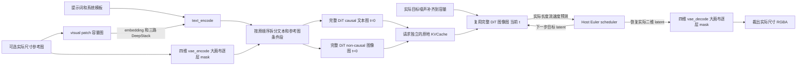

# Qwen-Image-2.1 / Turbo

统一模型 ID 分别为 `qwen-image-2.1` 和 `qwen-image-2.1-turbo`。
Turbo 复用本目录的六图结构、容量与 cache ABI，从 Turbo checkpoint 独立导出全部学习组件；
不复用普通版已量化权重。三档配置为 `qwen_image21_turbo_1mp_w16.yaml`、
`qwen_image21_turbo_1mp_w8a16.yaml`、`qwen_image21_turbo_1mp_w8.yaml`。
构建、加载及使用方法见[统一示例](../../../../examples_merak/aigc/qwen_image21/README.md)。

Turbo 默认采样读取 checkpoint 的 `model_index.json.sample_sigmas`，共 8 步；
scheduler 使用 `use_dynamic_shifting=false`、`shift_terminal=null`、`shift=1`。
显式 `sigmas` 优先于 checkpoint 序列；仅指定 `steps` 不会重采样 Turbo 的固定序列。
sigma 须严格递减，取值在 `(0,1]`，不包含终点零（由 scheduler 添加）。
普通版没有固定序列，仍按 `steps` 生成线性 sigma 并应用原 scheduler 的动态 shift。
部署包收录 pipeline 与 scheduler JSON，加载不依赖原始模型目录；公开推理的
`stats["steps"]` 返回实际执行步数。具体验证范围见[Turbo 接入记录](../../../../docs/modeling/structures/qwen-image21-turbo.md)。

默认 1MP 包含六张固定 shape 学习组件图：text_encode、visual、vae_encode、vae_decode、
denoise_text、denoise_image。batch 为 1；实际输入输出尺寸可在容量内变化，无需新增图。
上游三个学习网络 Qwen3-VL、DiT 和 VAE 分别拆成视觉/文本、causal 文本条件/non-causal 图像、encoder/decoder。
公开接口提供文生图和单参考图指令编辑，输出 RGBA。



文生图仅使用文字条件。编辑时参考图同时提供视觉语义和 VAE 空间 latent；
文本层使用 Qwen3-VL 最终 RMSNorm **之前**的序列特征与三路 DeepStack，
DiT 条件前缀用参考 latent 替换视觉占位区域。目标从随机噪声开始迭代生成。
条件使用 t=0，目标使用 scheduler 当前时间；图的 noise 输出实际是 flow velocity。
VAE encoder 取 posterior mean，归一化使用随包 HF mean/std。

构建时使用 Transformers 原生 Qwen3-VL 类在 CPU 加载权重，再交给本模型的
`PackedVision` 和 `CapacityTextFeatures` 改写为固定容量图。文本 RoPE 按原生
`rope_parameters` 初始化，随后构建本模型的位置表；其他 family 注册的旧版
默认 RoPE 初始化函数不会参与这条加载路径。特征回归覆盖补丁存在与不存在时的
权重重载，并将容量图输出与官方最终 RMSNorm 前的特征比较。

## 默认容量与实际尺寸

Workflow 的 export 配置统一提供尺寸和容量：

```yaml
output_size: [1024, 1024]     # 默认实际输出，也是构建校准示例
reference_size: [1024, 1024]  # 构建校准示例
canvas_size: [1536, 1536]     # VAE 各层实际计算的固定大画布
target_capacity: 4352
reference_capacity: 4352
visual_patch_capacity: 4352
prompt_budget: 512
max_references: 1
max_position: 32768
```

输入输出高、宽均须为正的 32 倍数。VAE 压缩为 16，视觉 patch16 再做 2×2 merge，
共同要求整条链按 32 对齐。实际目标和参考 latent token 数为 H×W/256；
视觉 patch 数同样为 H×W/256，merge 后语言层视觉 token 数为 H×W/1024。
宽高分别受 canvas_size 限制，面积受对应 token 容量限制。
例如 1024×1024、1024×1088、768×1376、1376×768、672×1536 可复用默认同一个包。

实际参考图按比例拟合到容量范围并对齐 32，同一张处理后的参考图进入视觉和 VAE。
视觉分支将 alpha 合成白底，VAE 保留 RGBA。公开推理用 height/width 指定实际输出。
视觉学习位置嵌入和二维 RoPE 使用实际 patch grid；DiT RoPE 使用实际 latent grid，
再补齐到容量。采样器按实际目标 token 数计算时间调度，DiT 输出先裁回实际长度。

文本图容量按 tokenizer 实测系统模板、prompt_budget、最多参考图的视觉 token 容量推导；
DiT 前缀按文本预算和参考 latent 容量推导，不能手填 feature_capacity/prefix_capacity。
当前真实 tokenizer 推导出 VLM 文本容量 1664、DiT 文本段容量 576、条件前缀最大容量 4928。超长提示报错，不截断。
配置、各组件 metadata、包内资源和加载端交叉校验；容量内改变尺寸不增加图。
增大容量或画布需要重新构建，入口见[统一及配置构建示例](../../../../examples_merak/aigc/qwen_image21/README.md)。

## Cache ABI

完整包 metadata schema=3，DiT schema=4，graphs 只有 text/image，
cache_policy 为 inplace_replace_target。每层 K/V 形状为
[1, heads, cache_tokens, head_dim]，cache_tokens 等于最大条件长度加最大目标长度；
端口按 layer0 K/V、layer1 K/V 排列。K 在 Q/K norm 和 RoPE 后写入。
两图都使用 LLMCacheV2，图输出分别只有 hidden 和 noise，不输出普通 cache tensor。

实际 token 在 cache 中紧凑排列为 [条件 P][目标 N][无效尾部]。
条件按原始文本/图像排列分段计算，各段一次跑完整 DiT 层栈，t 固定为 0。
官方编辑模板通常是前置文本、参考图、后置提示词，不能先合并所有文本。
文本段用 causal FlashAttention，图像段用 non-causal FlashAttention。
每次 KVCache 调用的 past_seq_length 是当前段起点，current_input_length 是实际段长度；
图像 attention 的 kv_valid_length 为两者之和。不需要 query_kv_range_abs 或图像块范围参数。
RoPE 仍按完整原序列和实际宽高生成，再按段切片；缓存偏移不替代位置坐标。

条件初始化完成后，每个去噪步仅运行目标图像段：past_seq_length=P、
current_input_length=N，始终原地覆盖 [P,P+N)，不累加历史目标。
参考图只计算条件 KV，不参与采样。无效 Q/K/V 行在 attention 量化前清零。
SegmentDenoiseRequest 独立分配 CacheTensor；不同请求和正负 CFG 分支不共享状态。
加载端启用 SDK 原地更新，避免物化或复制整份 cache 输出。
SDK MultiHMONNXLoader 仅复用两张图相同的静态 initializer。
默认 32 层、32 heads、head_dim=128、cache_tokens=9280 的 FP16 请求 cache 约 4.53 GiB。
旧逐层和 extract/cached 图表达保留作历史数值对照，公开完整包要求新容量契约。

真实单图编辑样本（参考图 1024²、输出高768/宽1376、提示 Make the teapot blue.）记录如下。
文本容量 576、图像容量 4352 是补齐后的图输入形状；下表长度均为实际 token 数。

| 调用 | 图 | 时间 | past | current | KV 总有效长度 |
|---|---|---|---:|---:|---:|
| 文本前段 | text，causal | 0 | 0 | 8 | 8 |
| 参考图 | image，non-causal | 0 | 8 | 4096 | 4104 |
| 文本后段 | text，causal | 0 | 4104 | 12 | 4116 |
| 每步目标 | image，non-causal | 当前 t | 4116 | 4128 | 8244 |

目标每步覆盖 [4116,8244)，条件 [0,4116) 保持不变，剩余 1036 个 cache slot 不可见。
文本 attention 的 KV 长度由 past/current 确定，图像 attention 显式传 kv_valid_length=past+current。

## VAE 画布与算子

VAE 全程在固定画布计算，Host 提供 1/2/4/8/16 五个尺度的矩形有效区域 mask。
卷积输入和输出均乘 mask，下采样、上采样及残差 shortcut 使用对应尺度 mask。
VAE encoder 输入 [B,4,H,W]、输出 [B,64,H/16,W/16]，decoder 反向；
各层 mask 同为四维。卷积和残差 shortcut 去掉单帧时间轴，保持原始空间重排和归约。
原生通道 L2 Normalize、sqrt(C)、gamma、零 bias 使用现有 SDK RMSNorm，
分母为 sqrt(mean(x²)+1e-8)，权重直接使用 gamma；接受与原生 L2 分母截断的微小公式差异。
epsilon=1e-8 保证现有 FP16 倒数在全零 padding 处有限。SDK RMSNorm 接口、导出和加载无需扩展。
二维 padding 展平有行间空洞；图先 Gather 有效位置到连续前缀，按实际长度执行
FlashAttention，再恢复二维位置。Encoder/decoder 共用这套规则，最终裁出实际区域。

所有部署 attention 统一使用 SDK FlashAttention，不提供非 FlashAttention 分支。
视觉原生 head_dim=72 在 RoPE 后补零到物理 128 维，保持原始缩放并裁回 72。
真实 VAE attention 保持单头 D=768/1152，SDK 大头实现保留完整 QK 点积，不拆分 attention head。
完整 DiT 每图有 64 个 Q/K RMSNorm、64 个 Rope、32 个 FlashAttention；文本图另有文本投影 RMSNorm。
原相邻通道 RoPE 与 SDK 前后半通道布局在图中显式转换并恢复。

SDK 卷积运行时分段展开输出行，每段带完整输入邻域，再写回完整画布张量，
限制 SEFP unfold 临时内存。空间位置分段不改变通道共享指数和卷积归约顺序。
原始 SDK kernel、CPU 参考及未分段卷积实现均保留，具体依赖和验证见
[接入记录](../../../../docs/modeling/structures/qwen-image21.md)。

## 构建精度与 CPU 路径

从新鲜 FP32 checkpoint 构建 XH2a W16A16、W8A16 或 W8A8 SEFP。
源模型、校准前向、图 trace 和 HMONNX 导出都在 CPU；SDK 仅将正在做权重 PTQ 的模块临时放到 GPU。
export_cpu_graph 使用独立副本，开启 auto_release_unused_parameters，量化图恢复 CPU 后导出。
视觉、文本、VAE 和完整 DiT 使用相同流程；CPU FP32 attention 校准按 query 分块计算。

统一接口 deployment_precision={"image": "w8a16_sefp"} 或 {"image": "w8a8_sefp"} 选择精度。
W8A16 的 Linear/Conv 权重为 SEFP 8 bit、激活为 SEFP 16 bit；三档 cache tensor ABI 均为 FP16。
Workflow 使用 export.model.quant_scheme；旧 export.quant_type 仍兼容，同时提供时必须一致。
源 checkpoint 精度与部署精度独立，Manifest、有效 YAML 和 runtime metadata 交叉核对。
各精度必须分别导出，不能通过修改已有包 metadata 切换。
实际验证范围及图片见[接入记录](../../../../docs/modeling/structures/qwen-image21.md)。
