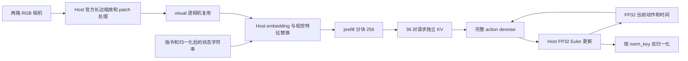

# Wall-OSS-0.5 模型、图和状态接口

Wall-OSS-0.5 在 Qwen2.5-VL 的视觉/语言主干上增加连续动作专家。
语言专家 hidden=2048、FFN=11008；动作专家 hidden=1024、FFN=2048，均经过 36 层。
两类专家的 Q 都进入 16×128 注意力空间，K/V 均为 2×128。路由由 token 类型决定，
可以在固定语义边界分别执行专家，不需要通用的动态 top-k MoE 路由算子。
原始 norm、fused QKV 和 fused gate/up 权重按 checkpoint 名称严格加载。

## 三图边界

| 图 | 主要输入 | 主要输出/状态 |
| --- | --- | --- |
| visual | `[1,1024,1176]` patches；patch/window 排序、逆排序、RoPE、mask、full/window 可见范围 | `[1,256,2048]` 视觉 embedding；按实际图裁出有效 token |
| prefill | `[1,256,2048]` 前缀 embedding；RoPE、past/current 长度、72 个 KV 端口 | `[1,256,2048]` hidden；36 层 K/V 原地写入 |
| denoise | `[1,32,26]` 当前动作与 DOF mask；`[1,1024]` 时间特征；动作 RoPE、长度和前缀 KV | `[1,32,26]` 速度；本步动作 K/V 覆盖同一区域 |

缓存物理 shape 为 `[1,2,2048,128]`，接口 dtype 为 FP16；缓存数量由真实层数决定。
模型代码从源配置读取维度，并校验双专家、注意力头和视觉结构的一致性。
公开真实 checkpoint 的默认参数为上表数值。

`prefill` 不需要词表 logits 或最终语言 norm；其 hidden 输出不参与动作采样，KV 在各层 attention 中产生。
`denoise` 包含完整 w1/w2/w3 学习投影、动作专家最终 norm 和 action_proj_back。
Host 只计算确定性正弦时间特征、位置、mask、embedding 查表、噪声、调度和输出归一化。
运行时没有原生 Transformer、视觉网络或学习投影回退。

## 首步拆分与缓存

官方首次联合计算前缀和带噪动作，得到首个速度，再将 KV 裁至前缀，后续步骤只计算动作后缀。
当前 checkpoint 的动作 attention 为 causal；前缀不可见动作，动作可见前缀及因果允许的当前动作。
因此可以先用语言专家产生各层前缀 K/V，再用同一张动作图执行所有采样步。
这一变换已经通过官方首次联合前向及完整缓存采样器的 FP32 数值对照。

逻辑布局为 `[有效前缀 P][当前动作 H=32][无效尾部]`。
每步固定 past=P、current=H，SDK KVCache 写入 `[P,P+H)`，不累积上一步动作。
长前缀按真实顺序分块写入；每个请求重新分配缓存，复用 session 不复用上一个请求状态。
加载器要求每张状态图有 72 个实际 cache producer，并显式启用原地更新。
运行时还检查最终前缀逐位不变。Host 不拼接或回拷整份 KV。

## 可变宽高视觉

每张输入先保持比例缩放长边至 448，再按官方 smart_resize 将宽高对齐至 28。
单帧 temporal patch=2 的原始 patch 值完整保留，patch projection 使用原 Conv3d 权重展开成 Linear；
不丢弃任一时间切片。一个 token 的输入维度为 3×2×14×14=1176。

32 层视觉网络采用窗口注意力；第 7/15/23/31 层使用整张图注意力。
Host 按实际 grid 生成 merge-major patch 顺序、窗口 permutation、范围和逆重排，padding 放在有效序列之后。
图内各层清零无效行，FlashAttention 的范围排除无效位置；merger 后恢复原图 token 顺序。
原 head_dim=80，经 RoPE 后补至物理 128 维，attention scale 保持 `80**-0.5`，输出裁回 80。
这保持单个原始 head 的完整点积，图像不因物理容量而变成方图。

## 状态、时间和精度

状态按 checkpoint 的具身 min/delta 统计归一化到 [-1,1]，512 档离散化后仅序列化有效状态维度。
动作输入将 26 维当前动作与 26 维 DOF mask 拼接，投影到 1024 维，再融合时间特征。
默认时间为 `linspace(0,1,11)*0.999`，支持 checkpoint 的 time_shift；当前 checkpoint 为速度预测。
Host 使用 FP32 持久动作，并以正向 Euler 更新至 t=0.999。
inactive DOF 使用官方归一化 padding 速度规则；最终按同一 norm_key 反归一化。

原生 checkpoint 主干以 BF16 保存，norm 和动作投影以 FP32 保存。
数值验证先执行官方 FP32，再执行目标 FP32，再比较各部署精度，明确分开结构改写和量化误差。
支持 W16A16/W8A16/W8A8 SEFP，group size=64；发布和加载审计真实 Linear/attention 精度。
FP32 下 Conv3d/Linear、fused/split MLP 及 SDPA 计算路径的舍入可能逐层累积，
因此对视觉组件同时记录最大误差、RMSE、cosine，再用完整动作轨迹确认影响。

## 发布与 Golden

`runtime_meta_info.json` 是图/状态/容量契约；`export_meta_info.json` 仅登记包内相对 path/type，
Manifest 覆盖实际图、外部权重和运行资源。tokenizer、embedding、源配置、normalizer 随包保留。
加载交叉检查 metadata、源结构、真实图 I/O、attention/cache 数量及 SEFP 位宽/group。
Golden 在独立诊断目录生成，不在发布包里增加未登记软链接；合成和真实输入都沿同一 HMONNX 数据流采集三图。
